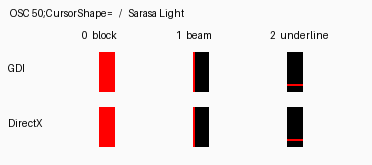

# Nemoterm 的现代终端协议范围

v0 面向使用 `TERM=xterm` / `xterm-256color` 的日常应用。`TERM` 告诉程序该查哪份终端能力描述；它不要求启动 Linux 上的 XTerm。Windows Terminal 和 Alacritty 是行为参照，两者支持的所有序列的并集不作为发布清单。

| v0 范围 | 如何判断 |
| --- | --- |
| 必须可用 | shell 的光标、擦写、滚动和颜色（含 256 色与真彩）；Vim、tmux 等全屏程序的备用屏切换与恢复、常用查询和按键；现代 TUI 的鼠标、焦点、括号粘贴和同步更新；窗口标题、OSC 8 超链接，以及项目明确要求的 Sixel 图片输出。中文宽字符显示和选中复制、应用接管鼠标时 Shift 强制选区、输入框就绪后粘贴附件分别按真实交互验收。 |
| 按具体功能注明支持 | 例如 OSC 52 文本剪贴板及其权限、shell 命令标记、扩展键盘编码、Kitty / iTerm2 图片。保留已经实现的功能；一个子命令可用，不代表整个协议族都可用。 |
| 不阻挡 v0 | VT52、Tektronix、打印机转发、ReGIS 与老 XTerm 的逐像素差异；特定前端的补全菜单、桌面通知、找不到命令时的建议，以及 Kitty 图像的动画、文件和共享内存传输。已观察到的差异仍保留原始记录。 |

如果一个范围外的序列确实导致上述应用丢字、卡住或无法恢复输入，就按受影响的实际操作处理。下面的表用于认识协议，不是新增功能待办。

## 这些序列是做什么的？

终端收到字节后，有的显示为文字，有的执行操作。下面的 `ESC` 是一个字节 `0x1B`；`CSI` 通常写作 `ESC [`，`OSC` 是 `ESC ]`，`DCS` 是 `ESC P`，`APC` 是 `ESC _`。记号里的分隔空格不是要输入的空格。字符串常用 `ST`（`ESC` 后接反斜线）结束；OSC 也常用 `BEL` 结束。例：`\x1b[31m错误\x1b[0m` 中，应用真正发出 ESC 字节时，终端用红色显示“错误”，然后恢复默认样式。

| 应用想做的事 | 代表序列或模式 | 用户能看到的效果 |
| --- | --- | --- |
| 控制一行文字 | `CR`、`LF`、`BS`、`HT`、`BEL` | 回到行首、换行、后退、制表、响铃。进度条可以回到行首重写一行。 |
| 移动光标、编辑屏幕 | `CSI 4;10H`、`CSI 2J`、`CSI K`；插删字格或行、设置滚动区；`ESC 7` / `ESC 8` | 定位到第 4 行第 10 列、清屏、清除行尾、保存或恢复光标。编辑器只需重写变动的位置。 |
| 控制样式和颜色 | `CSI … m`（SGR），如 `1`、`4`、`38;5;n`、`38;2;r;g;b`、`0`；`OSC 4/10/11/12` 与相应复位 | 粗体、下划线、256 色、真彩色；调整或查询调色板、默认前景、背景、光标色。 |
| 进入全屏、成帧更新 | `CSI ?1049h/l`、`?25h/l`、`?2026h/l` | Vim 或 agent 可以切换备用屏、显示或隐藏光标；同步更新让用户看到画完的一帧。这里 `h/l` 分别表示开启或关闭。 |
| 收按键、鼠标、焦点、粘贴 | 应用光标键/小键盘、`CSI u` 键盘协商；`?1000/1002/1003`、`?1006`、`?1004`、`?2004`；Windows 特有的 `?9001` | 应用能区分方向键和修饰键，收到点按、拖动、滚轮、焦点及带边界的粘贴。`1002` 等决定**何时**上报，`1006` 决定**如何编码坐标**。 |
| 查询终端 | `CSI 6n` → `CSI 行;列R`；DA、模式查询 `DECRQM`、光标样式及尺寸查询 | 程序既会往终端写，也会从输入流读回复。检查能力时，回复的字节和状态与画面同样重要。 |
| 设置标题、链接、目录和剪贴板 | `OSC 0/2` 标题、`OSC 8` 超链接、`OSC 7` 当前目录、`OSC 52` 文本剪贴板；`OSC 133` 命令边界、`OSC 9;4` 进度 | 可点击的链接可以有自己的显示文字；shell 能报告工作目录、命令开始/结束和进度。剪贴板读写各自受权限控制。 |
| 在字符网格里画图 | Sixel：`DCS … q 数据 ST`；另有 Kitty 图形 `APC G … ST`、iTerm2 图片 `OSC 1337` | **Sixel 是必需项**。其余图片协议按传输方式和子命令分别记录，支持显示 PNG 不等于也支持从文件、共享内存或动画帧读取。 |

Shift 拖选屏幕文字、Ctrl+Shift+C/V 和可配置右键是 **Nemoterm 自己的操作**。子程序开启鼠标上报后，普通拖动可以交给它，按住 Shift 则由终端选中屏幕上看得见的字。它不依赖子程序实现 `OSC 52`。同样，Sixel 是程序把图片**输出到窗口**，而从系统剪贴板给 Codex **输入一张附件**是另一个方向，两项分别验收。

## 判断一项是否属于目标

1. 先看应用所需的 xterm 行为，再对照 [Alacritty 支持表（固定版本）](https://github.com/alacritty/alacritty/blob/aa5d942f46c40184a3f214830ff5f7989f4733a1/extra/man/alacritty-escapes.7.scd)、[Windows Terminal 解析器（固定版本）](https://github.com/microsoft/terminal/blob/5f7dc283013152f89bfb76950515c33f45157ad7/src/terminal/parser/OutputStateMachineEngine.cpp)及其 [VT](https://learn.microsoft.com/en-us/windows/console/console-virtual-terminal-sequences) 和 [shell 集成说明](https://learn.microsoft.com/en-us/windows/terminal/tutorials/shell-integration)。按方向、参数、开关、可见效果及回复字节核对。上游写的是部分支持，就只引用它实际支持的部分。
2. **编号相同不代表语义相同。** 例如 Alacritty 的 `OSC 50` 支持 `CursorShape`；`7faa7fac` 的 [OSC 50 处理函数](../vendor/putty-0.85/terminal/nemo_font_ops.inc)实现的是字体查询和设置，没有该光标子命令。跨终端设置光标形状可用 `DECSCUSR`，例如 `CSI 2 SP q` 表示常亮方块（`SP` 是实际空格）。与这个已交付版本分开，开发版按 [Alacritty 使用的 vte 0.15.0 解析代码](https://github.com/alacritty/vte/blob/3b3da71c34cc1256c7e20981cf03f8eb95e08ffc/src/ansi.rs) 分派 `CursorShape=0/1/2`（方块、竖线、下划线），维持原有闪烁模式。候选 `9b82d1cf` 已通过[逐字节解析、取消及闪烁状态检查](https://github.com/xiongnemo/nemoterm/actions/runs/44837714426/artifacts/14679840880)。同一份 Windows EXE 使用 Sarasa Light，在 [GDI](https://github.com/xiongnemo/nemoterm/actions/runs/44837714426/artifacts/14679796635) 和 [DirectX](https://github.com/xiongnemo/nemoterm/actions/runs/44837714426/artifacts/14679647034) 各四种字体读写权限组合下，把闪烁方块改成竖线后，查询都读到闪烁竖线，字形像素与原字体一致。此项验证的是状态回复和字体保持。另一次[同一单文件的屏幕回放](https://github.com/xiongnemo/nemoterm/actions/runs/44838883485)从 GDI 窗口和 DirectX 子窗口分别取图。在 8×20 像素字格上，两者的方块为 8×20、竖线为 1×20、下划线为 8×1；六个结果均与各自的标准 `DECSCUSR` 对照逐像素相同。[12 张完整窗口原图、状态回复及制品身份](../research/osc50-cursor-9b82d1cf.zip)。
3. [XTerm 控制序列手册](https://invisible-island.net/xterm/ctlseqs/ctlseqs.html)还收录 VT52、Tektronix 绘图、打印机转发、ReGIS 等。仅因列在该手册，并不成为 v0 阻塞项。已实现的功能和重现过的差异保留在[详细支持表](PROTOCOLS.md)和[已知问题](KNOWN_ISSUES.md)里。Kitty、iTerm2、VS Code 的私有扩展也按子命令评估；不能因一条常用命令推及整个厂商命名空间。

## 两个参考终端实际列了哪些 OSC？

[Alacritty 固定版本的支持表](https://github.com/alacritty/alacritty/blob/aa5d942f46c40184a3f214830ff5f7989f4733a1/extra/man/alacritty-escapes.7.scd)把 `0`、`2`、`4`、`8`、`10`、`11`、`12`、`50`、`52`、`104`、`110`、`111`、`112` 列为已实现，明确拒绝 `1`（图标名称）。部分编号只实现特定参数，如 `50` 的光标形状。这是该手册的清单，不是其代码路径的全集：例如它依赖的 vte 解析器还识别 `OSC 22` 鼠标指针形状，这也不同于 `OSC 50` 的文字光标。

Windows Terminal 还有一批按子命令分派的 OSC。下面列出会影响现代应用的几个区别；上游的解析入口、具体操作和 Nemoterm 的当前实现要分开看。[微软固定版本的处理函数](https://github.com/microsoft/terminal/blob/5f7dc283013152f89bfb76950515c33f45157ad7/src/terminal/adapter/adaptDispatch.cpp) · [Nemoterm 的详细支持表](PROTOCOLS.md)。

| 控制串 | 参考实现的效果 | Nemoterm 的边界 |
| --- | --- | --- |
| `OSC 9;4`、`OSC 133;A/B/C/D`、`OSC 1337;SetMark` | 任务栏进度、提示符与命令边界、添加标记 | 有对应处理。`SetMark` 不代表要实现 iTerm2 的所有 `1337` 命令。 |
| `OSC 633;Completions;…` | 将 shell 给出的候选项交给 Windows Terminal 的补全界面 | 现有 `633` 命令标记和目录支持不包含补全菜单。 |
| `OSC 777;notify;标题;正文` | 上游启用桌面通知功能后才显示通知 | 当前 `777` 分支只识别内部文字排版提示，没有此通知子命令。 |
| `OSC 9001;CmdNotFound;命令名` | Windows Terminal 可向应用层请求查找缺失的命令 | 当前前端没有这个 OSC 操作。已有的 `CSI ?9001h` 是 Win32 键盘输入模式，不会搜索或安装软件。 |

这是一份范围说明，**不是逐项一致性认证**。`7faa7fac` 的[原始验收包](../research/trial-7faa7fac.zip)包括单文件身份、内存采样、实际客户端按键/选区、渲染画面和未通过的交互用例；[v0 验收结果](KNOWN_ISSUES.md#v0-的验收边界)给出统计和适用范围。
