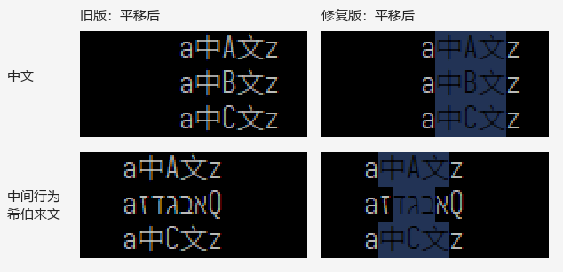

# 松手后，矩形选区跟随整块文字平移

[Windows x64 单文件试用版 `5ccb22b4`](https://github.com/xiongnemo/nemoterm/actions/runs/44801554063/artifacts/14660973842)：解压后运行 `nemoterm.exe`（4,943,360 字节），SHA-256 `78a2596c83c1b413330c4eada560dc396dd7fd4406e8425878e415b66e10b945`。ZIP 内的 JSON 是构建记录，运行时无需分发。REA 静态读取也确认它是 x64 原生 PE，没有 CLR 目录。

在应用已接管鼠标的终端中，用 Ctrl+Shift 拖出跨三行的矩形，再松手。以前，应用用 DECIC、DECDC、SL 或 SR 左右平移整块文字后，高亮会消失；默认右键还会把鼠标按下和松开送给应用。现在，如果每一行的完整字形都平移同样多的显示列，选框会跟着字走。若左右混排导致框内字形不再对应、选中的宽字被切开，或者只有部分行移动，则清除高亮，右键交还给应用。

| 每种渲染器独立测试 | 旧版 `ba16d56b` | 新版 `5ccb22b4` |
| --- | ---: | ---: |
| 默认右键 | 4/11 | 11/11 |
| Ctrl+Shift+C | 1/8 | 8/8 |
| 可选右键复制并粘贴 | 4/11 | 11/11 |

GDI 和 DirectX 各自得出了上表的结果。一项通过需同时满足高亮位置、剪贴板的实际更新与文字、子程序读到的输入字节。包括中文宽字、从右到左的希伯来文、文字被裁切及只有部分行移动的对照。实际字体均为 `SarasaTermSC Nerd Light`。复核两份 CI 制品中的 120 张编辑后原图，每行高亮的像素位置均与对应回执一致。

[旧版的远程作业](https://github.com/xiongnemo/nemoterm/actions/runs/44801169901/job/136513408577) · [新版的远程作业](https://github.com/xiongnemo/nemoterm/actions/runs/44801554063/job/136517689574) · [两份原始 Actions 制品、SHA-256 与逐格复核结果](column-pane-5ccb22b4.zip)。同一份新版 EXE 在 GDI 和 DirectX 也分别通过了移动两行后复制 `𠀀` 与组合重音、各 120 个 VT 与 Win32 单元格读回，以及只编辑选区旁一行的回归。严格 XTerm 单元格对照仍为 725/728；三处差异仍是行尾的 `V`，[原始原因](column-edge-integrity.md)不变。

**真实应用和内存。** [十个实际 Codex、Claude Code 和 OpenCode 窗口](https://github.com/xiongnemo/nemoterm/actions/runs/44803698710/artifacts/14662201685)的原始选区与输入框截图已独立复核；[18 个快捷键与两种右键策略的组合](https://github.com/xiongnemo/nemoterm/actions/runs/44803737361/artifacts/14662680783)都通过。以下为该 EXE 的终端前端私有工作集峰值（十进制 MB），不含 shell、agent 或控制台宿主。

| 工作负载 | GDI | DirectX |
| --- | ---: | ---: |
| Codex 编辑、复制与提交 | 11.81 | 17.47 |
| Claude Code 编辑、复制与提交 | 8.81 | 21.49 |
| OpenCode 编辑、复制与提交 | 11.91 | 18.22 |
| 同机 24 轮 Codex 对话 | 5.58 | 9.78 |
| 双标签 Unicode 与 Kitty 图形，两页均有进度条 | 19.00 | 29.98 |

真实应用窗口共有 1,034 次定时采样，另有 50 次操作节点采样。[24 轮对话的同机对照](https://github.com/xiongnemo/nemoterm/actions/runs/44801554063/artifacts/14661613713)中，原版 pterm 为 3,768,320 字节；本版 GDI 为 5,578,752，DirectX 为 9,781,248。双标签场景重新从原始采样取峰值：[GDI 19,001,344 字节](https://github.com/xiongnemo/nemoterm/actions/runs/44801554063/artifacts/14662475925)，[DirectX 29,982,720 字节](https://github.com/xiongnemo/nemoterm/actions/runs/44801554063/artifacts/14662107269)。DirectX 在这项负载只余 17,280 字节；不能用它代替六项满屏压力套件，也不能排除两次采样之间更高的峰值。

[此 EXE 的完整回归与独立实测](https://github.com/xiongnemo/nemoterm/actions/runs/44801554063)。上一版的[六种负载、交互和真实 agent 测量](acceptance-ba16d56b.md)只适用于上一版 EXE。

**标签、交互和拖放的收尾验收。** [本版四边标签的八张原始 Windows 截图](https://github.com/xiongnemo/nemoterm/actions/runs/44801554063/artifacts/14661178737)与[切换前后对照图](tab-faces-ba16d56b.png)的八块标签像素逐一相同。当前页向终端敞开，其他页保留边线；上下左右均确认了悬停预览随内容更新、切页后键盘到达对应终端、拖选复制得到 `Copy7`，以及五种中键操作（合计 20/20）。标签栏由 Win32 GDI 自绘，不需添加 DLL。

[严格交互](https://github.com/xiongnemo/nemoterm/actions/runs/44801554063/artifacts/14663046665) **80/81**，无跳过。Codex 刚显示输入提示时，物理 Ctrl+Shift+V 的首次提交只含文字。等编辑器重绘后，Ctrl+V 和 Ctrl+Shift+V 在物理按键及窗口消息下均提交了正确图片。八帧 Sixel 的像素通过复核；十个真实应用窗口在启动和提交后共 20 次采样均未发现已知 WebView 模块或进程。严格交互与 Sixel 图像通过的范围不同于完整协议、WSL 几何及 XTerm 对照。

六种独立 160×48 满屏负载各自的前端私有工作集峰值（字节）：

| 满屏负载 | [GDI](https://github.com/xiongnemo/nemoterm/actions/runs/44801554063/artifacts/14662776928) | [DirectX](https://github.com/xiongnemo/nemoterm/actions/runs/44801554063/artifacts/14663860109) |
| --- | ---: | ---: |
| 纯文本 | 15,908,864 | 25,755,648 |
| 内嵌图片 | 16,969,728 | 27,308,032 |
| 动画 | 16,982,016 | 27,242,496 |
| Kitty | 16,809,984 | 27,717,632 |
| 压缩 Kitty | 17,059,840 | 27,021,312 |
| Unicode 与 Kitty | 19,951,616 | 29,233,152 |

文件拖放的[原始严格运行](https://github.com/xiongnemo/nemoterm/actions/runs/44801554063/artifacts/14659993961)在 GDI 的第一次 PowerShell 命令未收到回显，尚未投递文件。保留原始失败。[同一 EXE 的独立回放](https://github.com/xiongnemo/nemoterm/actions/runs/44804889030/artifacts/14662447469)两种渲染器均通过，包括原冷启动路径。单独等提示符后，在 PowerShell 改设置前、改设置后、重新打开 cmd 三个阶段分别拖文件和文件夹，两种渲染器共 **12/12** 次实际读到预期文件内容或目录成员；WSL 资源管理器路径也通过。另一个[Unicode 对照](https://github.com/xiongnemo/nemoterm/actions/runs/44801554063/artifacts/14661787563)中，产品 GDI 和 DirectX 的粘贴字节均通过，外部非串行 WinPTY 的 Claude 用例未在超时前回显提交标记，仍保留失败。

[四份原始 Actions 制品和 SHA-256 清单](trial-5ccb22b4.zip)包含四边标签、严格交互复核及两次拖放运行。
