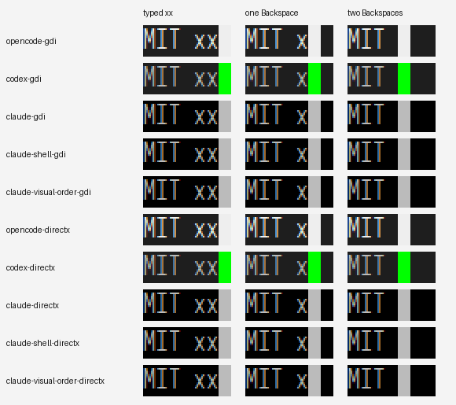

# Windows x64 试用版 706fe3ee：真实 agent 的复制、退格和粘贴

[下载 Windows x64 单文件](https://github.com/xiongnemo/nemoterm/actions/runs/44739336945/artifacts/14630900237)，解压后运行 `nemoterm.exe`（4,940,288 字节）。SHA-256：`4aab33c307d391387aeabc28760339f5e800752179d6312f725cb56ad9e05373`。

程序在运行时切换 Backspace 模式后，按键和能力查询使用当前状态。匹配 terminfo 数据来源的 [64 个 XTerm 实测场景](https://github.com/xiongnemo/nemoterm/actions/runs/44740494760/artifacts/14630318048)中，模式、能力值和按键均一致；[Windows 原生行编辑与 VT 两种读取 API 的来回切换](https://github.com/xiongnemo/nemoterm/actions/runs/44740887816/artifacts/14629998901)通过 6/6。Ubuntu 系统数据库有不同的 `kbs`，应答还有十六进制字符大小写差异，见[完整比较和原始失败](backspace-706fe3ee.md)。

在 160×48、SarasaTermSC Nerd Light 下，Codex、Claude Code 和 OpenCode 共 10 个真实窗口均通过：程序启用鼠标时仍能 Shift 拖选「中文」，还可以复制包含中文、组合字符和私用区字符的一整段回复。取消关闭后恢复输入，连续两次 Backspace 删掉多打的 `xx`，Ctrl+Shift+V 粘贴后，提供方收到的消息包含且仅包含一次这段选区。GDI 和 DirectX 各五个场景。[独立核对原始图片、字形、剪贴板和提交回执](https://github.com/xiongnemo/nemoterm/actions/runs/44742074375/artifacts/14631995636)。

[同步更新时的实际选区](https://github.com/xiongnemo/nemoterm/actions/runs/44739336945/artifacts/14630755560) GDI、DirectX 各 13/13。默认右键只复制、Ctrl+Shift+C 复制、可选右键复制并粘贴在 [GDI](https://github.com/xiongnemo/nemoterm/actions/runs/44739336945/artifacts/14630387848) 和 [DirectX](https://github.com/xiongnemo/nemoterm/actions/runs/44739336945/artifacts/14630995280) 各通过 14、4、6 项，包括终端程序在选区旁边改字的情况。

| 前端与负载 | 私有工作集峰值（字节） | 总工作集峰值 | 私有提交峰值 |
| --- | ---: | ---: | ---: |
| pterm，24 轮 Codex | 3,764,224 | 22,667,264 | 4,452,352 |
| Nemoterm GDI，24 轮 Codex | 5,824,512 | 37,212,160 | 7,421,952 |
| Nemoterm DirectX，24 轮 Codex | 9,994,240 | 47,353,856 | 11,513,856 |
| Nemoterm GDI，六种满屏负载 | 18,984,960 | 53,792,768 | 22,384,640 |
| Nemoterm DirectX，六种满屏负载 | 29,671,424 | 75,055,104 | 32,911,360 |

只计前端进程。[真实 agent 负载](https://github.com/xiongnemo/nemoterm/actions/runs/44739336945/artifacts/14630581891)、[六种 GDI 负载](https://github.com/xiongnemo/nemoterm/actions/runs/44739336945/artifacts/14630913404)和 [六种 DirectX 负载](https://github.com/xiongnemo/nemoterm/actions/runs/44739336945/artifacts/14630513729)均以本页 EXE 验证。REA 对该文件的 685 项普通导入和 11 项延迟导入未发现已知 WebView 依赖，24 轮对照中的前端模块与进程取样也未发现已知 WebView 组件。

[整体交互](https://github.com/xiongnemo/nemoterm/actions/runs/44739336945/artifacts/14631113788) **79/81**。Codex 输入就绪后，首条提交 4/4 带正确 PNG；刚看到输入文字就粘贴时，4/4 只带文字，两个对应场景仍判失败。[本版客户端原始记录](https://github.com/xiongnemo/nemoterm/actions/runs/44739336945/artifacts/14630846795) · [Windows Terminal 与 pterm 对照](codex-bitmap-requests.md)。

[英文和简体中文 DPI 窗口](https://github.com/xiongnemo/nemoterm/actions/runs/44739336945/artifacts/14630394293) 各 12/12（单显示器 100%–200%）；[`TERM=xterm`、`TERM=xterm-256color` 的 Vim](https://github.com/xiongnemo/nemoterm/actions/runs/44739336945/artifacts/14630278023)、[tmux 内 Vim](https://github.com/xiongnemo/nemoterm/actions/runs/44739336945/artifacts/14629669793) 共八个窗口；[Sixel](https://github.com/xiongnemo/nemoterm/actions/runs/44739336945/artifacts/14631020717) 两种渲染器共八张图逐像素相符。范围限于这些操作。完整回归仍有 [ReGIS 中间画面](regis-horizontal.md)、[宽字边缘](column-edge-integrity.md)、WSL1 等严格对照失败，详见[完整 Actions](https://github.com/xiongnemo/nemoterm/actions/runs/44739336945)。[本版验收包](acceptance-706fe3ee.zip)保留原始输入、取样、对照记录、截图与对应制品编号。
