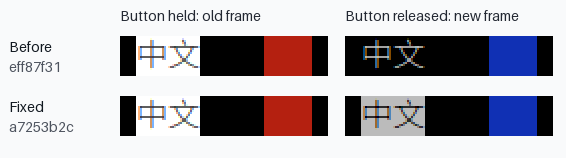

# Windows x64 试用版 89a3dd44：Shift 拖选跟随已显示的文字

[下载单文件](https://github.com/xiongnemo/nemoterm/actions/runs/44732574060/artifacts/14628095507)，解压后运行 `nemoterm.exe`（4,939,776 字节），SHA-256：`d7d8345bbda25470878c78eb1682c7c2b757b0950b21189cc80fc0dda6c84dc0`。

终端程序已经写出「明月」、但你眼前还是「中文」时，现在按住 Shift 拖选可以复制「中文」。如果新帧只改动选区旁边的内容，松手后仍保留高亮，默认右键只复制；如果新帧改动了选中文字，旧高亮会撤掉。GDI 和 DirectX 各通过 13/13，包括超过一秒的持续拖选、矩形选区、快捷键和可选的右键复制并粘贴。[修复前后截图和失败样本](sync-selection-3308de91.md) · [候选 EXE 的两份窗口和独立像素复核](https://github.com/xiongnemo/nemoterm/actions/runs/44733950374)。

真实 Codex、Claude Code、OpenCode 的 [10 个窗口场景](https://github.com/xiongnemo/nemoterm/actions/runs/44732574060/artifacts/14628310774)均能在应用接管鼠标时 Shift 拖选、复制 `中文`，高亮覆盖原来的四格。普通行编辑测试还覆盖编辑邻格、文字重排及选中格被替换时的按键和右键归属：[GDI](https://github.com/xiongnemo/nemoterm/actions/runs/44732574060/artifacts/14627072701)、[DirectX](https://github.com/xiongnemo/nemoterm/actions/runs/44732574060/artifacts/14626669473) 各通过默认右键 14/14、快捷键 4/4、可选右键复制并粘贴 6/6。

| 前端和负载 | 私有工作集峰值（字节） | 总工作集峰值 | 私有提交峰值 |
| --- | ---: | ---: | ---: |
| pterm，24 轮 Codex | 3,764,224 | 22,720,512 | 4,440,064 |
| Nemoterm GDI，24 轮 Codex | 5,529,600 | 34,574,336 | 6,918,144 |
| Nemoterm DirectX，24 轮 Codex | 9,785,344 | 44,924,928 | 11,313,152 |
| Nemoterm GDI，六种满屏负载 | 19,394,560 | 54,272,000 | 22,274,048 |
| Nemoterm DirectX，六种满屏负载 | 29,237,248 | 74,518,528 | 32,694,272 |

以上均在 GitHub 托管 Windows 上以 160×48、`SarasaTermSC Nerd Light` 复核；只计前端进程。[同机三组会话](https://github.com/xiongnemo/nemoterm/actions/runs/44732574060/artifacts/14627657267)与[满屏 GDI](https://github.com/xiongnemo/nemoterm/actions/runs/44732574060/artifacts/14628074656)、[满屏 DirectX](https://github.com/xiongnemo/nemoterm/actions/runs/44732574060/artifacts/14628048682) 分开统计。运行时的模块和进程采样没有发现已知浏览器组件；REA 的同一 EXE 静态检查覆盖 685 项普通导入和 11 项延迟导入，也没有发现已知 WebView 库。

[整组交互](https://github.com/xiongnemo/nemoterm/actions/runs/44732574060/artifacts/14628418223)通过 **79/81**。固定版本 Codex 的两个快捷键、两种输入方式：编辑器就绪后首次提交有正确图片 **4/4**；刚能看见输入文字时首次提交带正确图片 **0/4**，其中 **4/4** 次只收到文字。每一次首次缺图仍在原报告中记为失败。[实际发送的请求](https://github.com/xiongnemo/nemoterm/actions/runs/44732574060/artifacts/14628007864) · [其他终端的对照](codex-bitmap-requests.md)。

[实际单显示器 DPI 和设置窗口](https://github.com/xiongnemo/nemoterm/actions/runs/44732574060/artifacts/14627362847)：GDI 英文、简体中文各 12/12，涵盖独立窗口和标签窗口在 100%、125%、150%、175%、200% 的冷启动及运行中切换。每一帧核对宿主、终端区和设置窗口的实际 DPI；未测试不同 DPI 显示器之间移动。

`TERM=xterm`、`TERM=xterm-256color` 下，[Vim](https://github.com/xiongnemo/nemoterm/actions/runs/44732574060/artifacts/14627866945) 和 [tmux 中的 Vim](https://github.com/xiongnemo/nemoterm/actions/runs/44732574060/artifacts/14626738892) 共 8 个窗口验证鼠标、调整尺寸、宽字及矩形选择和粘贴；[Sixel](https://github.com/xiongnemo/nemoterm/actions/runs/44732574060/artifacts/14627352852) 的 GDI、DirectX 各四个画面与参考图逐像素相符。这些结果并不代表整个 WSL 作业通过：托管 WSL1 读取窗口像素尺寸仍有失败。

这是开发试用版。[完整回归作业](https://github.com/xiongnemo/nemoterm/actions/runs/44732574060)单独保留 [XTerm 宽字边界](column-edge-integrity.md)、[ReGIS 中间画面](regis-horizontal.md)和 [WSL1](wsl-relay-window.md)等严格对照结果。[本版验收包](acceptance-89a3dd44.zip)包含原始取样、截图、散列和各制品编号。
