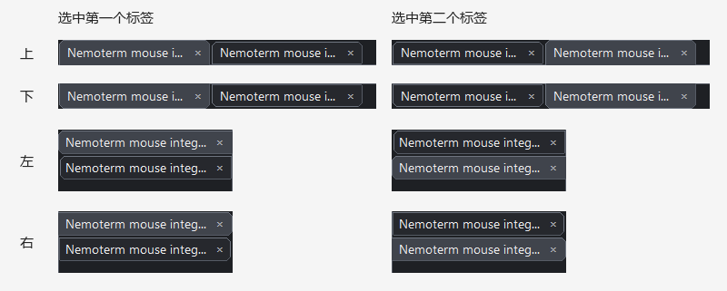
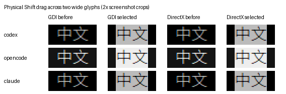
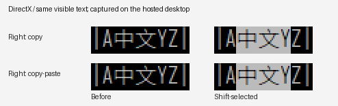

# Windows x64 单文件 `ba16d56b`：交互与内存验收

[下载 EXE](https://github.com/xiongnemo/nemoterm/actions/runs/44793711901/artifacts/14657592423) · [该提交的全量回归](https://github.com/xiongnemo/nemoterm/actions/runs/44793711901)。程序 4,942,336 字节，SHA-256 `b0b03507848b437aced6a326be2f2452035af53e16104234ba59e5ef984e3db8`。以下均为这个文件自己的结果。

[托管 Runner 汇总](https://github.com/xiongnemo/nemoterm/actions/runs/44798200528/artifacts/14657849985)：严格交互 **79/81**，全部执行。两项失败均为 Codex 刚显示提示时的图片粘贴，原失败保留。

## 终端前端的内存

私有工作集使用十进制 MB。三个真实 CLI 在 160×48、SarasaTermSC Nerd Light 下分别接收回复、选字、复制、编辑并重新提交。数值是从发现窗口到提交期间各个对应窗口的最高实测值，不含 agent、shell 或控制台宿主；采样之间的瞬时峰值未知。

| 客户端或负载 | GDI | DirectX |
| --- | ---: | ---: |
| Codex | 7.32 | 17.87 |
| Claude Code（三种窗口） | 11.88 | 18.15 |
| OpenCode | 11.87 | 17.97 |
| 24 轮 Codex 连续对话 | 5.50 | 9.73 |
| 六组满屏文字与图形压力测试 | 18.88 | 29.45 |

[真实 CLI 窗口](https://github.com/xiongnemo/nemoterm/actions/runs/44796396704/artifacts/14658982406)：759 次定时采样、50 次操作节点采样。同一组 24 轮 Codex 输入下，[原版 pterm](https://github.com/xiongnemo/nemoterm/actions/runs/44793711901/artifacts/14658387909) 为 3.77 MB；[本机原先约 8 MiB 的不同负载和轻量化原因](pterm-findings.md)。

六种满屏负载涵盖文字、静态/动画图片、Kitty、压缩 Kitty 和 Unicode 与 Kitty 混排。前端私有工作集：[GDI 18,882,560 字节](https://github.com/xiongnemo/nemoterm/actions/runs/44793711901/artifacts/14658929244)，[DirectX 29,446,144 字节](https://github.com/xiongnemo/nemoterm/actions/runs/44793711901/artifacts/14657644663)。总工作集峰值分别为 53.66 和 74.75 MB，与私有口径不同。

## 标签栏与键盘

在 **窗口 → 标签页**（Window → Tabs）选择停靠边。下图取自[该 EXE 在 GitHub 托管 Windows 上捕获的八张原图](https://github.com/xiongnemo/nemoterm/actions/runs/44793711901/artifacts/14657243031)，仅裁去空白并排显示。第一列选中第一项，第二列选中第二项。四个方向都保留经典 Win32 属性页的削角；选中标签和内容区相连，侧栏标题横排。该次运行也验证了四边悬停预览和点击后的键盘焦点。

[同一文件的 Backspace 实际按键回执](https://github.com/xiongnemo/nemoterm/actions/runs/44793711901/artifacts/14657622701)覆盖四种 Profile、每种 16 项。与使用同一份 terminfo 的 XTerm 412 比，模式查询、能力应答和送到子程序的按键字节 **64/64 完全一致**。与 Ubuntu 自带 terminfo 的严格对照仍为 **32/64**（按键本身 42/64），原失败保留。

## 实际选区、复制和粘贴

[18 个实际应用组合](https://github.com/xiongnemo/nemoterm/actions/runs/44793711901/artifacts/14659370506)下证实快捷键和右键策略正确；另有十个窗口验证 Shift 选中渲染出来的「中文」、关闭确认选「取消」后仍能键入并提交。启动与提交后的 20 份原始进程、模块快照未发现已知 WebView/浏览器标志。

[快速重选的修复前后](right-copy-ba16d56b.md)。[四个附加场景](https://github.com/xiongnemo/nemoterm/actions/runs/44797238231/artifacts/14659043179)在备用屏打开鼠标跟踪和括号粘贴：首次右键复制「中文」，78–94 ms 内重新选「中文Y」。从 PNG 复核只有预期的五格高亮。默认右键没有粘贴字节；启用复制并粘贴后恰好多一次完整的「中文」；随后 Ctrl+Shift+V 在两种配置均仅送入一次「中文Y」。

就绪后 Codex 两种按键、两种输入路径共 4/4 首次提交都只带一张正确原图。刚见提示的四种组合有三次只收到文字，一次带图；不能把窗口提示当作图片输入已就绪的信号。英、中各 12 个真实 DPI 用例通过。GDI/DirectX 的 8 帧 Sixel 与独立参考像素一致；Vim 和 tmux/Vim 在 `TERM=xterm`、`xterm-256color` 均完成矩形选区。

全量回归仍有差异，包括重绘前的 ReGIS 像素、宽字符边界以及 WSL1 的窗口尺寸和按行粘贴。这份交互与内存记录不代表所有协议均已通过。[保存的回执、像素与原始采样](acceptance-ba16d56b.zip)。
