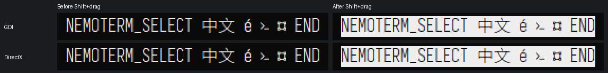

# Default copy and paste in actual agent tabs

Product: single Windows executable `4c3bc30`, SHA-256 `2d9c37cffac9f5316387be47edd4da1503930323d61a921e2f1bede8484a71d2`. The hosted desktop installed and verified `SarasaTermSC Nerd Light`. The pinned native clients were Codex CLI 0.167.0 and OpenCode 1.19.3; the fixture used disposable profiles, no credentials and a loopback provider returning generated responses. These are UI tests of real clients, not observations of an online model or physical input device.

[First exact-image run](https://github.com/xiongnemo/nemoterm/actions/runs/44231195615): five cases passed. Both clients received the generated clipboard image at its expected pixels. Real Codex under GDI and actual DirectX rendered a streamed reply, went through 32 window resizes, and submitted the exact selected reply text after Shift+drag, Ctrl+Shift+C and Ctrl+Shift+V. The clipboard was replaced by a sentinel before Copy. The loopback provider compared the new prompt, including its prefix, Chinese text, a decomposed accent, and two private-use icons. The same interaction passed in a 100×30 actual DirectX OpenCode tab. There the sentinel was image-only, and the paste source was left untouched between Copy and Paste.

[Replay with client-output recording](https://github.com/xiongnemo/nemoterm/actions/runs/44232291054): the original OpenCode wire prefix at the instant of the drag is retained. At byte offsets 337, 345 and 353 the client requested DEC mouse modes 1000, 1002 and 1003. No subsequent tracking-mode reset was observed before the drag. Thus this app explicitly requested all-motion reporting; the fixture did not turn it on. The copied text and the submitted text both still matched. Original preview images, raw bytes and both client hashes are in the archive.

| Real Codex frontend, before instrumentation | First run: peak private WS | Replay: peak private WS |
| --- | ---: | ---: |
| GDI | 6,959,104 bytes (82 samples) | 6,930,432 bytes (80 samples) |
| DirectX | 12,959,744 bytes (74 samples) | 13,176,832 bytes (73 samples) |

The separate [160×48 full-grid workloads](regis-resize.md) remain the stress acceptance. A [DPI replay on this same executable](https://github.com/xiongnemo/nemoterm/actions/runs/44231794172) passed all 24 real GDI cases (English and Simplified Chinese; standalone and tabs; 100–200% scale) and eight language interaction checks. The single-monitor runner did not verify moving between mixed-DPI monitors or using a real IME candidate UI.

[Original records](agent-native-roundtrip-evidence.zip): both complete agent artifacts, DPI JSON and report, and run/job/artifact metadata. Archive SHA-256 `52faf2e2da99f019a5ef3c81a69c0b1a82fa75c1c2be50f8c335cc40ed90453a`. Also retained: the [prior full rebuild](https://github.com/xiongnemo/nemoterm/actions/runs/44225194980) on `d243269`, which passed 27 of 30 jobs including the isolated single executable; the unchanged ReGIS/XTerm retained-frame comparisons still failed on GCC, Clang and MSVC. It is a different executable.

## Visible selection and mouse capture in OpenCode

The [stronger exact-image replay](https://github.com/xiongnemo/nemoterm/actions/runs/44233615511) passed all six real-client cases. An earlier DirectX capture taken immediately after mouse-up was identical to the source row, even while Copy and Paste were correct. The revised check first observes a stable source frame, then polls for the actual selection colours. On **both GDI and DirectX**, all 30 selected 8×20 cells changed their background from `#0A0A0A` to `#EEEEEE`; all their sampled background pixels changed, and all original background pixels in both guard cells were preserved. The server then confirmed the exact newly submitted prompt. The capture, clipboard and server assertions check three separate things. The cropped pairs below are taken from the actual renderer captures (2× nearest-neighbour enlargement).

The OpenCode output snapshot in each case includes `CSI ?1003h` before the drag. The harness injected no request to turn tracking on. The five uninstrumented frontend snapshots (startup, reply, copy, composer and submitted) reached **6,086,656 bytes GDI** and **8,937,472 bytes DirectX**. These are maxima among five observations, not continuously sampled session peaks. Both clients exited naturally and the runner restored the clipboard.

The same `4c3bc30` file was inspected without executing it using REA. It is an **amd64 PE32+** with a complete static import inventory: 668 standard function imports in 81 DLL descriptors and 11 delayed imports in a single `icu.dll` descriptor. Windows UI and graphics dependencies include `USER32`, `GDI32`, `DWrite`, `D2D1`, `DXGI` and `D3D11`. No WebView, Chromium, Electron or MSHTML DLL is declared in either table. The executable also imports the normal Windows dynamic loader; a static table cannot enumerate every module loaded at runtime. Source design and the real-client measurements are independent evidence. The [original pterm investigation](pterm-findings.md) explains why private working set and total working set differ.

[Original six-case artifact, run metadata and complete REA records](agent-highlight-native-evidence.zip), SHA-256 `3c3a69e2e8603982175f01259516edf0b3289299ef7f5656b3fa3b5db6b78275`. The underlying unmodified Actions artifact is `14396960866`, SHA-256 `6f1c3c07ed10c46d271cec3605f1a1be133f06532ead9aca5117b40dd04e4bc3`.
