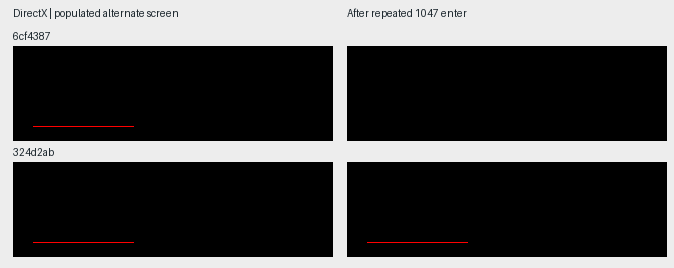

# When does DEC private mode 1047 clear the alternate screen?

The [original XTerm 412 captures](xterm-alt-switch-reference-603e095.zip) come from hosted run `44309410728`, artifact `14430211373` (archive SHA-256 `6b546f8294fab7a58f8720e19ad36dc049ad484a730a3772ecd37a83f916c5eb`). There were 94 scenes, no whole-versus-byte transport differences and no control failures. In the `alt-graphic-switch-1047` and `-1049` cases, a blank alternate screen received the word ALT and a red 101-pixel line. After a leave and a fresh entry both were absent, before and after an expose. **That observation alone cannot identify which of the two switches erased them.** In this VT340 build the separate mode 47 scene even kept both drawings visible; do not assume mode 47 is an interchangeable reference for this configuration.

In the [archived upstream source](regis-repaint-reference.zip), `charproc.c` handles `srm_OPT_ALTBUF` by entering without clearing; it clears on reset only when the alternate bank is active. `srm_OPT_ALTBUF_CURSOR` clears on entry, even on repeated entry. The new `nonempty-alt-repeat` cases separate those actions by repeating the enter command immediately after writing to a nonempty bank. The Windows fixture checks visible text and exact graphic pixels separately. The core fixture additionally inspects Nemoterm's banks via its non-erasing mode 47.

The initial replay (`44312059680`) was refused before launch: the vendor tree contained the added C test. The [unchanged-product rerun](alternate-1047-before-6cf4387.zip) (`44312594665`, fixture `0413532`) retained that identity check and left the whole vendor tree identical to the original. On the `6cf4387` MSVC image, all four jobs reached the alternate screen, verified the text marker and the red 101-pixel graphic, and lost all 101 pixels on the repeated 1047 enter. The post-repeat text assertion did not run after that pixel failure. Archive members are the original Actions downloads; `index.json` identifies each one.

On real XTerm 412 (run `44312059853`) all 96 scenes completed in both transports with no control or transport differences. The populated bank had 151 nonblack pixels: 101 red and 50 white. Repeating 1047 kept all 151; repeating 1049 left zero. Returning to main, repeating leave on main, and finally returning to main all retained its original 54 pixels. Expose did not change these frames.

On the candidate `324d2ab` (run `44312291749`), all 88 primary native checks passed in all four jobs. Actual GDI, actual DirectX and directly presented GDI independently retained the `A2Y` text in the screen buffer and 101 red pixels in the capture on repeated 1047, saw no marker and zero red on repeated 1049, and retained the original `M1X` on main. The OpenGL-request job fell back to GDI. See the [original upstream and four Windows artifacts with hashes](alternate-1047-results.zip). These cases establish the clear timing, not full ReGIS frame compatibility.

The illustration crops original DirectX BMPs to the same 320×95 rectangle. In the combined drawing scene even the populated scan has zero ink in the three text marker cells: the marker exists in the terminal buffer but is not visible in that rendered frame. Read this screenshot as evidence of graphic retention only. A separate text-only scene compares all three glyph cells byte for byte on repeated entry, without a ReGIS drawing on top.

The [text-only actual-window replay](alternate-1047-text-pixels.zip) on `a985632` (run `44315356306`) distinguishes buffer content from rendered glyphs. `A2Y` produced 62, 53 and 44 nonblack pixels in its respective cells. Repeating 1047 preserved all the original BGR bytes, repeating 1049 left zero ink in every cell, and returning to the main screen recovered the earlier `M1X` strip exactly. All four jobs passed 104 primary checks; the archive includes GDI, forced DirectX and directly presented GDI, with the additional requested-OpenGL artifact identified in its index.
