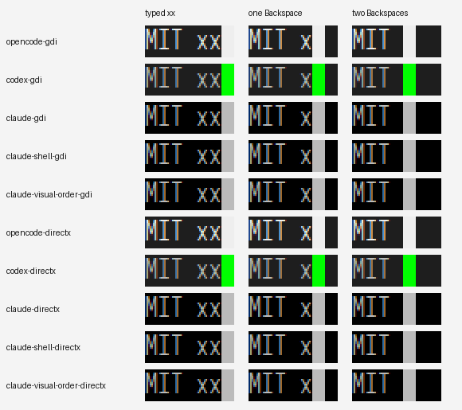

# Backspace：运行时模式、实际按键与两份 terminfo

[试用版 `706fe3ee`](acceptance-706fe3ee.md)（Windows x64 单 EXE，4,940,288 字节，SHA-256 `4aab33c307d391387aeabc28760339f5e800752179d6312f725cb56ad9e05373`）让应用在运行时选择 Backspace 发送 BS（`08`）还是 DEL（`7F`）。无关的 Profile 设置变更保留应用选择；终端硬重置恢复 Profile 默认值。在默认 xterm 键盘配置中，Ctrl 临时反转这两个字节，Shift 单独按住不反转。独立 Delete 键仍发送 `ESC [ 3 ~`。选择 Terminfo 键盘配置时，无修饰 Backspace 优先采用所选数据库的 `kbs` 值。

[原试用版的 Windows 实测](https://github.com/xiongnemo/nemoterm/actions/runs/44738471654)在 64 个场景中均把模式 67 报告为未知。实际错误不限于查询：默认 DEL 的配置在 `CSI ? 67 h` 后按 Shift+Backspace 收到 `7F`，而同条件的 XTerm 收到 `08`。新版本让前端状态、按键编码和查询使用同一模式；内置控制台接收已经编码的 BS/DEL 时，保持 VT 输入的原值，常规控制台读行仍走原来的编辑路径。

| 64 个场景，各自对照同一份 ncurses 来源 | 模式状态相同 | 解码后 `kbs` 相同 | 子程序收到的按键相同 | 三者均相同 |
| --- | ---: | ---: | ---: | ---: |
| 试用版 `89a3dd44` | 0 | 51 | 36 | 0 |
| [试用版 `706fe3ee`](acceptance-706fe3ee.md) | 64 | 64 | 64 | 64 |

[Windows 原始输入](https://github.com/xiongnemo/nemoterm/actions/runs/44739336945/artifacts/14629784071) · [独立验证原始字节及 EXE 身份的工作流](https://github.com/xiongnemo/nemoterm/actions/runs/44740494760)。两次 Linux 采集都使用真正的 XTerm 412 和真实按键，覆盖四种新会话，分别执行 16 个设置、查询、按键、保存恢复、软硬重置和切屏步骤。

**按原始字节逐一比对时，结果不同。** [采用产品所用 ncurses 源码的 XTerm](https://github.com/xiongnemo/nemoterm/actions/runs/44739167355) 有 51/64 完全相同；其余 13 次只差 `kbs` 应答里十六进制值的大小写（`7F` / `7f`），实际键值相同。[采用 Ubuntu 系统数据库的同版 XTerm](https://github.com/xiongnemo/nemoterm/actions/runs/44737657869) 则是 19/64 完全相同，32/64 的模式、能力值和按键都相同。两个 XTerm 在默认键盘的 32 个场景里一致；Terminfo 配置的 32 个场景均报告不同的能力值。系统数据库下有 22 次实际按键也不同。这两个参考各自保留，原来的逐字节比较仍报失败。

[同一窗口来回切换输入方式](https://github.com/xiongnemo/nemoterm/actions/runs/44740887816/artifacts/14629998901) 另外验证 6/6：原生 Windows 行编辑器在进入 VT 应用前和返回后均把 `abx`、Backspace、`c`、Enter 读成 `abc\r\n`；VT 应用分别用 `ReadFile` / `ReadConsoleW`，在两种模式下均收到预期的真实按键序列。此项和前表均在 GitHub 托管 Windows 上完成。

[真实 Codex、Claude Code、OpenCode 的首轮输入框回放](https://github.com/xiongnemo/nemoterm/actions/runs/44740132781) 在两种渲染器的十个窗口里均验证：应用接管鼠标时仍能 Shift 复制「中文」，取消关闭后能删掉错字，粘贴后提供方收到的精确文字只有一份。此轮 OpenCode/DirectX 的一对退格前后截图完全相同，因此不能用它们证明该帧已经呈现。[后续回放](https://github.com/xiongnemo/nemoterm/actions/runs/44741298405)直接读实际可见窗口，依次看到两个相同字形、一个字形和两个空格才释放下一次按键。10/10 个窗口均通过；其中 OpenCode/DirectX 两格内部的字形像素依次为 `38/38`、`38/0`、`0/0`。[另一台 Runner 复核原图、选区和收到的消息](https://github.com/xiongnemo/nemoterm/actions/runs/44742074375/artifacts/14631995636)，没有重启客户端或对图片做补画。

[同机 24 轮 Codex 的内存原始值](https://github.com/xiongnemo/nemoterm/actions/runs/44739336945/artifacts/14630581891)：私有工作集峰值（字节）pterm **3,764,224**，Nemoterm GDI **5,824,512**，DirectX **9,994,240**。测试字体 `SarasaTermSC Nerd Light`、网格 160×48，只计前端。该负载不能替代六种满屏压力测量。
