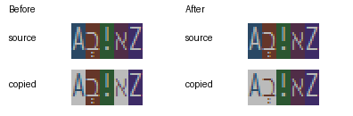

# Shift 双击混排文本的词

普通双击保留配置中的选词规则；按住 Shift 时，选词应当沿着窗口里相邻的字格扩展。剪贴板只包含实际高亮的原字符，并保留 Unicode 文本和组合附标的原始顺序。

旧版 `2c63154` 在混排场景中把 Shift 双击映射成逻辑选词：五个源字符分别使用不同底色，原始截图里的顺序是 `0,3,2,1,4`。词的中间有一个感叹号。Shift 双击屏幕最左边的 `A` 时，高亮的却是第 1 和第 4 格，剪贴板包含第 4 格的字母。系统键鼠在 GDI 和 DirectX 下都能重现。普通双击、点标点和 Shift 三击整行的对照则通过。

[首次失败记录](bidi-words-before-2c63154.zip)（[远程运行](https://github.com/xiongnemo/nemoterm/actions/runs/44515502201)，原始制品 `14525318140`）。首次软换行样本的上一行用了 79 个句点，夹具预期只选中尾部的 `Q`。实际配置把句点也视作词的一部分，因此后续分别验证整段句点应该入选、换成感叹号时只应包括 `Q`。前面的混排错误与这个预期错误相互独立。

候选 `0d8f731` 从屏幕上的格子寻找词边界，通过已有的双向文字映射查询每个原字符的选词类别。跨软换行时转入相邻行；普通硬换行仍然终止选词。每次只查一次当前行的映射，不为终端格子增加字段。无 Shift 的普通双击继续按逻辑字符选词。

[候选单文件的 REA 导入表](rea-0d8f731-imports.json.gz)与[旧版导入表](rea-2c63154-imports-20261119.json.gz)逐项比对，81 个普通 DLL 描述符、672 个普通导入和一个 ICU 延迟加载描述符的 11 个导入相同，未发现 WebView、Chromium 或 CEF 导入。本机安装的 pterm 0.85 的 REA 标识与[原有静态记录](native-imports-pterm-e02f0d0.zip)一致（8 个 DLL、319 个普通导入）。导入表本身不枚举运行中动态加载的库。旧版 Nemoterm 的[同一 EXE 实际客户端对照](selection-erase-pterm-2c63154.zip)另有 8 份运行中前端模块和关联进程快照，没有匹配被检查的浏览器引擎。

候选 EXE 为 4,858,368 字节，SHA-256 `8e8fdd89176d0204d72c05fd62b8bb62754eba052fab2c8e399bc8bc8fa7af12`，来自[源码构建](https://github.com/xiongnemo/nemoterm/actions/runs/44515756392/artifacts/14525912387)。[同一 EXE 的三个原始专项制品](bidi-words-ui-0d8f731.zip)覆盖 GDI/DirectX 的真实 WSL Sixel 显示、重绘、擦除，WSL1 下 tmux 3.4 内 Vim 的四组鼠标、矩形、粘贴与缩放，以及三种窗口在关闭确认后点 Cancel 继续输入。三种关闭场景的子进程都实际收到了 `A` 的按下和松开。

[10 项默认 160×48 窗口交互](bidi-words-agent-grid-0d8f731.zip)在这份候选 EXE 的 GDI 和 DirectX 上全部通过，分别使用真正的 Codex、OpenCode 或 Claude Code。[与安装版本相同的 pterm 0.85 对照](bidi-words-pterm-0d8f731.zip)为 10/10，均使用 SarasaTermSC Nerd Light、同一 Codex、相同网格。首轮回复后两次冷启动的前端私有工作集中位数范围（十进制 MB）：pterm 3.756–3.777，Nemoterm 单标签 GDI 5.067–5.177，单标签 DirectX 9.691–9.736。对应总工作集中位数是 21.811–22.581、33.075–34.058 和 44.610–44.646 MB。这些是稳定窗口观测，不是压力峰值。8 次候选前端运行的模块和关联进程快照也都没有匹配所检查的浏览器引擎。

使用[相同的两类跨行用例在旧版回放](bidi-words-before-paired-2c63154.zip)（[运行](https://github.com/xiongnemo/nemoterm/actions/runs/44516662134)，制品 `14526247185`）和[新版回放](bidi-words-after-0d8f731.zip)（[运行](https://github.com/xiongnemo/nemoterm/actions/runs/44516666888)，制品 `14525374307`）。下表要求按键和鼠标没有泄露给应用、屏幕高亮范围准确、剪贴板含原始组合附标，且跨行选词包含正确的上一行格子。

| 手势 | 旧 `2c63154` | 新 `0d8f731` |
| --- | ---: | ---: |
| 8 种双击／三击 × 2 种渲染器 × 2 种字体配置 | 12/32 | 32/32 |
| 真实系统鼠标、键盘、剪贴板，3 种双击 × 2 种渲染器 | 2/6 | 6/6 |

可用 `scripts/compare-bidi-word-records.py` 从两份下载的原始记录复核这 38 项，并用 `--image` 重建上图。上图取自系统鼠标回放的实际窗口，没有重新排版终端中的字。

[原始完整 CI](https://github.com/xiongnemo/nemoterm/actions/runs/44515756392)在独立单文件测试中保留的 `selection.log` 显示，`soft-wrap` 已选择正确的两个可视字格 `[0,1]`，但实际还包含上一行的句点，与首次夹具的短字符串预期不同。[修正夹具的独立单文件回放](https://github.com/xiongnemo/nemoterm/actions/runs/44517870299)复用同一源码构建的 EXE。两个运行单独记录；专项结果不能覆盖完整 CI 的初始失败。

实际客户端的另一组[30 项原始回执](https://github.com/xiongnemo/nemoterm/actions/runs/44515756392/artifacts/14525094466)为 29/30。24 项选区／快捷键／右键交互通过；OpenCode 两条贴图、Codex 正式编辑器的两条贴图也通过。Codex 启动时立即贴图的窗口接口仍失败，本轮系统键鼠路径通过。一次系统键鼠成功不代表启动草稿总能处理粘贴。[原始客户端记录](https://github.com/xiongnemo/nemoterm/actions/runs/44515756392/artifacts/14526645057)。

本版 [XTerm 边界对照](https://github.com/xiongnemo/nemoterm/actions/runs/44515756392/artifacts/14524883711)的两个观测 JSON 与上一版逐字段一致，只有 EXE 哈希变化：独立 1,872 格完整性检查通过，严格 XTerm 对照保留 3/728 格差异。原始大构建的 Windows 和单文件两条路径都因同一份旧 `soft-wrap` 预期提前退出；除独立选区和单文件回放外，[修正夹具后的完整回归](https://github.com/xiongnemo/nemoterm/actions/runs/44518463241)另行运行。不同源码运行的 EXE 要单独核对哈希。

[同一 EXE 的 12 项 160×48 压力测试原始档案](bidi-words-memory-0d8f731.zip)包含每组的 GitHub 制品编号、摘要、各阶段原始样本及子进程记录。下表只取前端进程；每列分别在六种压力任务中取最大值。

| 渲染器 | 通过 | 私有工作集峰值 | 总工作集峰值 | 私有提交峰值 |
| --- | ---: | ---: | ---: | ---: |
| GDI | 6/6 | 19,214,336 字节 | 53,956,608 字节 | 22,351,872 字节 |
| DirectX | 6/6 | 29,327,360 字节 | 74,698,752 字节 | 32,849,920 字节 |

GDI 和 DirectX 的前端私有工作集分别在 20 MB 与 30 MB 上限内；图像与 Unicode 压力下总工作集可超过约 50 MB。下载到 `dist/nemoterm.exe` 的测试版与上述记录的 EXE 哈希相同。

[原始交互总报告和两次构建的身份记录](bidi-words-build-identities.zip)保留了第一次完整运行的 75/80：四项选择测试使用了错误的句点预期；另一个失败是 Codex 启动草稿立即贴图。修正预期后，对 `dist` 的同一份 EXE 运行选区组得到 6/6。修正版完整 CI 重新编译的是另一份 EXE（4,874,240 字节，SHA-256 `c871d74deb71237775092028f88998ff1c0d5b478734309ab5f2459ab6410ae0`）。虽然两次都请求 `windows-2025`，构建日志分别记录了镜像 `20261116.315.1`、MSVC `19.52.37029.0` 和镜像 `20261103.298.1`、MSVC `19.51.36260.0`。这个差异本身不能确定每个字节为何变化。为检验实际交付文件，[完整交互回放](https://github.com/xiongnemo/nemoterm/actions/runs/44519691446)直接取原始制品，不再编译。

[双标签剪贴板回放](https://github.com/xiongnemo/nemoterm/actions/runs/44520778304)的 tabs 组为 9/9。[原始回执和四张截图](tab-clipboard-ownership-0d8f731.zip)绑定上述 `dist` 的确切 SHA-256。两个标签同时运行，各自打开应用鼠标和括号粘贴；GDI 标签选中 `A中Z`，DirectX 标签选中 `BéQ`。系统鼠标右键在默认标签只复制，在明确开启“复制并粘贴”的标签只粘贴一次。跨标签 Ctrl+Shift+V 仅把文本送入当前子进程；切回来用 Ctrl+Shift+C 仍能复制该标签的原选区，无须重选。六个阶段逐字节检查两个子进程的输入，两边界格的像素均未变化，两个子进程与前端正常退出。

用户截图涉及的 Sixel、ReGIS 两个复选框在同一 EXE 的 [DPI 制品](https://github.com/xiongnemo/nemoterm/actions/runs/44515756392/artifacts/14524984661)有专门的页面检查。[从原制品提取的截图与控件测量](settings-wrap-dpi-0d8f731.zip)包括英文、简体中文和 100%、125%、150%、175%、200% 的实际系统缩放。两种语言在独立窗口与标签窗口各做冷启动与打开窗口后的缩放切换，每种语言 12/12。五档缩放下，标签窗口中两个复选框的文字都能放入控件，也没有进入底部按钮区域；英文在 100% 时为两项各预留 29 像素高度。测试机只有一台显示器，未验证跨不同 DPI 的显示器拖动窗口。

[后续源码制品](https://github.com/xiongnemo/nemoterm/actions/runs/44521164017/artifacts/14528500843)已实测附带 runner 镜像版本、Windows SDK 版本，以及 `cl.exe`、`link.exe`、`MSBuild.exe` 的文件版本与 SHA-256。上述构建身份压缩包保留该清单。它仅补充构建可追溯性，不替换 `dist` 中通过专项测试的 EXE。
