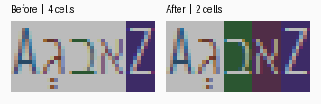

# 双向文字矩形选区

在一行 `AאבגְZ` 上，希伯来文字从右向左显示。这个测试给每个源字符涂不同的背景色，再从真实窗口图像中读取颜色顺序：`A`、`גְ`、`ב`、`א`、`Z`。Ctrl+Shift 矩形拖选按屏幕位置命中；复制时只按原文字顺序输出命中的字符，并保留组合附标。其余两行是从左向右的对照。

[原始回放与截图](block-bidi-before-83ee8a5.zip)使用 GitHub Actions `44387681332`、单文件 `83ee8a5`、测试 `6471c57`。GDI 和 DirectX 的四个用例各有三个失败。三行中间横跨 `A` 和最左侧希伯来字时，两者均复制出 `Aא` 而非 `Aגְ`；跨右边缘时复制出 `גְZ` 而非 `אZ`；跨双倍宽度的混排行时复制出 `אב` 而非 `בגְ`。完全在反向段内部的对照均通过。所有用例核对真实选区左、右和相邻像素、剪贴板、应用鼠标输入流。

`cad518c` 把矩形的边界保留为物理屏幕列。在显示行上判断高亮，复制时用同一行的双向映射找出原文中被选中的字符，再按源顺序输出。

[修复后的原始回放](block-bidi-after-cad518c.zip)来自 `44388392085`，制品 `14466929078`，Windows 单文件 SHA-256 `d63eb2ff75485d808282fd5883624d48b9f1537b73811f016fbc5e11afabc53b`。Sarasa Light 字体的真实 GDI 和 DirectX 各四项全部通过，原来的四个双宽行用例在两个渲染器上也全部通过。这一回放覆盖 Ctrl+Shift 矩形，不能据此推断普通 Shift 流式选择也正确。

普通 Shift 流式拖选另有独立失败：[修复前截图、窗口数据与剪贴板](shift-bidi-before-43f20e1.zip)来自 `44390670665` 的制品 `14469365681`，EXE 为 `43f20e1`，测试为 `6afc56f`。Sarasa 8×20 和默认字体 9×16 各跑 GDI、DirectX，四扇窗口都从真实画面识别出索引 `0,3,2,1,4`；普通拖选在左右单行边缘、跨两行和反向跨双宽行四项各自失败，整行被包在中间的对照各自通过。另一个用例检查一行文字自动折成两行后，剪贴板仍不多出换行符。

修复后的 `861f57f` 保留单击时的 Shift 选择方式，直到拖选松开。普通流在屏幕行内选连续范围，首行取后缀、末行取前缀，剪贴板按原文顺序提取字符；硬换行与自动折行仍按原行标记处理。[该提交的原始 sanitizer 任务](shift-bidi-core-861f57f.zip)在 Kitty Unicode 复制检查的内部模式断言失败：普通 Shift 模式现为视觉流（2），而测试仍要求逻辑范围（0）。保留原失败；后续测试明确检查视觉流模式，应用未收到鼠标字节、实际复制的图形占位符和附标等断言不变。

[修复后的四个窗口与全部截图](shift-bidi-after-861f57f.zip)来自 run `44390723897`，制品 `14467567898`；EXE SHA-256 `5fd8a96c6c93f11b4f7215272be682eed03636a6b1a8ffdca4ff183b243f044a`。两种字体和两种渲染器组合的五种普通 Shift 用例全部通过（20/20）。每个窗口原有的四种矩形混排和四种双宽行用例也全部通过。下图截取同一 GDI 字体窗口、同一行、同一拖动的原始截图：`A` 和附有元音点的 `ג` 在屏幕上相邻，旧版高亮四格、复制四个基字符；新版高亮两格并仅复制命中的两个基字符，保留元音点。后续 `3da2fc3` 的 Linux ASan/UBSan 任务也已通过，包括自动折行末尾在两个方向的复制测试及 Kitty 图形占位符检查。

[真实客户端的原始结果](bidi-client-layout-861f57f.zip)来自 run `44391745432`、制品 `14468167361`，仍是 `861f57f`。六次均使用默认 profile 的 160×48 Sarasa Light 窗口。Codex 的两个渲染器均显示期望顺序、只复制命中的两个字符并完成原有回贴提交。Claude Code 的原始 VT 流在送进终端**之前**已把 `AאבגְZ` 变成 `AגְבאZ`；其画面里的三个字形按与 Codex 相反的顺序排列，和同一真实窗口内隔离字符的像素摘要逐个匹配。OpenCode 把见证字符串折到下一行，原测试在拖选前因超出屏幕宽度而失败。不能据此说 OpenCode 复制错误。补充回放按收到的 VT 字节分别确定应显示的字形，独立定位客户端折好的行；如最终画面与提供给客户端的原文不符，仍单独判失败。另用「终端 → 功能」中关闭双向重排的配置检查已经预排文本的 Claude Code，默认配置独立保留。
