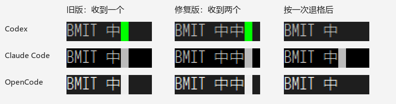

# Windows 合并字符消息：输入三个“中”，应用应该收到几个？

Windows 的 Unicode 窗口可以在一条字符消息的 `lParam` 低 16 位报告重复次数。旧版 `5ccb22b4` 在此路径只交付第一个字符。例如发送一次 `WM_CHAR`，码点 `U+4E2D`、计数 3，子程序用 `ReadFile` 和 `ReadConsoleW` 都只收到一个 `中`。这是受控的窗口消息测试；没有假设每次物理按住键或每种输入法都会合并消息。

`b04ca12a` 按消息给出的次数交付完整字符。普通文本以固定大小的缓冲分批发送；Kitty 键盘模式分别发送可独立编辑的字符事件。UTF-16 分别到达的高低代理必须能配对；不完整的单位不变成额外字符。零计数沿用原先一次的兼容行为，`UNICODE_NOCHAR` 探测仍然不产生输入。

| 真实子程序的读取方式 | 旧版（相同 18 项） | 修复版（相同 18 项） | 修复版额外的 4 项 |
| --- | ---: | ---: | ---: |
| `ReadFile`，UTF-8 | 4/18 | 18/18 | 4/4 |
| `ReadConsoleW`，UTF-16 | 4/18 | 18/18 | 4/4 |

两种读取均覆盖普通输入和 Kitty 关联文本，包括 `WM_SYSCHAR`、`WM_IME_CHAR`、UTF-16 代理对、UTF-32 表情、孤立代理及能力探测。额外用例跨过批次边界（65 个 `𠀀`），并检验高低代理的计数不相同时后续 ASCII 保持顺序。每个用例用两次 DSR 回复界定实际子程序读到的字节，核对程序自然退出。使用 `SarasaTermSC Nerd Light`。此专项与同作业的 XTerm 发行版 terminfo 比对分别计分；后者仍有原始差异。

[旧版 Windows 运行](https://github.com/xiongnemo/nemoterm/actions/runs/44806661031/artifacts/14663381712) · [修复版 Windows 运行](https://github.com/xiongnemo/nemoterm/actions/runs/44806811770/artifacts/14663783744) · [两份原始回复档案和来源 SHA-256](character-repeat-native.zip)。两份产品 EXE 的 SHA-256 分别为 `78a2596c83c1b413330c4eada560dc396dd7fd4406e8425878e415b66e10b945`、`ab0cba09fd6c33f3620fdf7e5ae92b49b60026b5376dfae8290171c5a84045cc`，均为 4,943,360 字节。

**真实输入框。** 托管 Windows 上的 [旧版十个窗口](https://github.com/xiongnemo/nemoterm/actions/runs/44807580176/artifacts/14663414752)收到 `WM_CHAR(U+4E2D, count=2)` 后都只显示一个“中”。[候选版的十个窗口](https://github.com/xiongnemo/nemoterm/actions/runs/44807693105/artifacts/14663729462)均显示两个：实测每个字占两格，各半格均有 22 个着墨像素。Codex 和 OpenCode 当场完成两次物理退格并提交了原本的选中文字。Claude 的第一次退格也留下一个完整的字，但原验证把 Claude 的单格方块光标和相邻空格当作一幅宽字，误判它有墨迹；这六个原始失败保留。下图来自 GDI 各窗口的客户区，仅裁剪并整倍放大。

[同一 EXE 的最终复核](https://github.com/xiongnemo/nemoterm/actions/runs/44808890579/artifacts/14665080971)：十个窗口均在原样复制「中文」后显示 `中中`，实际退格两次依次显示 `中` 和空白，随后正常粘贴、提交。独立读取 30 张最终截图，四个半字格的着墨数分别是 `22/22/22/22`、`22/22/0/0`、`0/0/0/0`；剩下的字与原字逐像素相同。[三轮原始截图、回执和逐图复核](character-repeat-composers.zip)保留了最初把光标当作笔画的失败，`source-map.json` 把原始成员名映射到压缩包内的原始字节。

[同机三种前端各进行 24 轮 Codex 对话](https://github.com/xiongnemo/nemoterm/actions/runs/44806811770/artifacts/14664482620)，从原始采样重算峰值（字节；不包括 shell、Codex 和控制台宿主）：

| 前端 | 私有工作集 | 总工作集 | 私有提交 |
| --- | ---: | ---: | ---: |
| pterm 0.85 | 3,809,280 | 22,761,472 | 4,489,216 |
| Nemoterm GDI | 5,771,264 | 37,138,432 | 7,155,712 |
| Nemoterm DirectX | 10,018,816 | 47,370,240 | 11,624,448 |

双标签均显示进度、160×48 Unicode 和 Kitty 图形时，[GDI](https://github.com/xiongnemo/nemoterm/actions/runs/44806811770/artifacts/14664945260) 为 19,181,568 字节，[DirectX](https://github.com/xiongnemo/nemoterm/actions/runs/44808615781/artifacts/14663949359) 为 28,934,144 字节，均指前端私有工作集。DirectX 的[首次压力运行](https://github.com/xiongnemo/nemoterm/actions/runs/44806811770/artifacts/14662704587)在新建第十个临时标签时超时，并未运行到满屏负载：PID 8960 已出现在已关闭的子进程里，同时又是新标签中存活的 Python。旧测试按 PID 去重。为每次启动单独命名控制文件后，同一份 EXE 完成了 12 个新建/关闭循环，记录了 15 次可区分的启动。这两项不代替六种不同满屏负载的验收。

[本版四边标签的八张原图](https://github.com/xiongnemo/nemoterm/actions/runs/44806811770/artifacts/14664641080)与[经典 Win32 轮廓对照图](tab-faces-ba16d56b.png)中的八处逐像素相同；四边均复制出 `Copy7`。[完整回归](https://github.com/xiongnemo/nemoterm/actions/runs/44806811770)还保留独立的 WSL、平台和 XTerm 对照差异。

## 此 EXE 的完整交互成绩

[GitHub 上的严格交互报告](https://github.com/xiongnemo/nemoterm/actions/runs/44806811770/artifacts/14664634506)是 **80/81，无跳过**。唯一失败的是 `agent-image-codex`：第一次显示输入提示就通过窗口消息送 `Ctrl+V`，首次提交只有文字。同阶段的物理按键通过；等输入框 idle 并重绘后，`Ctrl+V`、`Ctrl+Shift+V` 的物理按键和窗口消息四种路径均首次提交了正确图片。

Codex、Claude Code、OpenCode 的 [18 种复制与粘贴组合](https://github.com/xiongnemo/nemoterm/actions/runs/44806811770/artifacts/14665671150)通过，包括子程序已接管鼠标时用 Shift 拖选、默认右键只复制、可选右键复制并粘贴。十个窗口的启动和提交后共 20 次模块与进程快照，均未发现已知浏览器 / WebView 标记。字体为 `SarasaTermSC Nerd Light`。

六种独立 160×48 满屏场景，每项在两种实际渲染器上自然结束。下表为从前端逐次采样重算的**私有工作集峰值（字节）**：

| 满屏场景 | GDI | DirectX |
| --- | ---: | ---: |
| 纯文本 | 16,588,800 | 26,427,392 |
| 内嵌图片 | 17,403,904 | 26,796,032 |
| 动画 | 17,633,280 | 26,923,008 |
| Kitty | 17,195,008 | 26,828,800 |
| 压缩 Kitty | 17,354,752 | 26,718,208 |
| Unicode 与 Kitty | **19,972,096** | **28,622,848** |

[满屏与对话内存的远程复核](https://github.com/xiongnemo/nemoterm/actions/runs/44806811770/artifacts/14666321277)。GDI 距 20,000,000 字节只余 **27,904 字节**，DirectX 距 30,000,000 字节余 1,377,152 字节。六项中的总工作集峰值另为 56,778,752 / 71,843,840 字节；私有提交峰值为 22,704,128 / 32,415,744 字节。采样结果不保证两次采样之间或其他驱动上的峰值。

在 GDI、DirectX 上，[Vim](https://github.com/xiongnemo/nemoterm/actions/runs/44806811770/artifacts/14663133973) 和 [tmux 内的 Vim](https://github.com/xiongnemo/nemoterm/actions/runs/44806811770/artifacts/14664501733) 分别用 `TERM=xterm`、`TERM=xterm-256color` 跑过，矩形复制得到 `中文\r\nCU`。两种渲染器共[八帧 Sixel](https://github.com/xiongnemo/nemoterm/actions/runs/44806811770/artifacts/14664262176)通过像素复核。同作业的 WSL1 尺寸回读仍失败；完整回归的 ReGIS、宽字行尾及 terminfo 对照也有差异，不能据此宣称实现了所有转义序列和 OSC。

远程独立截图复核保留三次原始计分：[旧版 0/10](https://github.com/xiongnemo/nemoterm/actions/runs/44810590288/artifacts/14664314676)、[首次修复版截图 4/10](https://github.com/xiongnemo/nemoterm/actions/runs/44810594718/artifacts/14664254813)、[最终修复版 10/10](https://github.com/xiongnemo/nemoterm/actions/runs/44810584743/artifacts/14665321839)。中间一轮缺六个 Claude 窗口后续操作，不能从第一帧正确推断整轮通过。[六份原始 Actions 制品及 SHA-256](trial-b04ca12a.zip)包括这三轮、两个满屏采样回执及完整交互复核。
