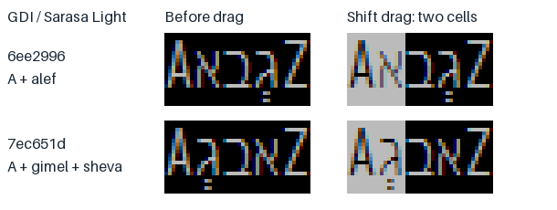

# Claude 混排：屏幕显示什么，Shift 拖选就复制什么

`7ec651d` 修正了默认 profile 在 Windows 原生 Claude Code 2.1.322.0 中再次重排已按屏幕顺序写入的希伯来文的问题。直接启动 `claude.exe` 和先启动 `pwsh` 再运行它，都不必改 profile；shell 自己输出的文字继续使用正常的双向排版。识别依据是实际写入进程和受测 PE 文件版本；其他版本、管道中转、其他客户端没有自动套用这个例外。[实现和依据](block-bidi-selection.md)。

[单文件制品](https://github.com/xiongnemo/nemoterm/actions/runs/44457337912/artifacts/14497589034)：`nemoterm.exe` 为 4,871,168 字节，SHA-256 `c149c2bc3a3a2e0d2594ae2a239520af15a47bbb5c4d49c4daae3dc998bf64ba`。下列产品交互与内存数字都来自该文件。桌面、输入、剪贴板和采样均位于 GitHub-hosted runner。

上排为旧版 `6ee2996`，系统剪贴板留下 `U+0041 U+05D0`（A、alef）；下排为新版，留下 `U+0041 U+05D2 U+05B0`（A、gimel 及其 sheva 附标）。两者都高亮两个字符格，差异来自选区下的实际字形。[裁图脚本](../scripts/crop-agent-writer-order.py)读取原始 GDI 截图，将三个希伯来字形的像素逐格与同屏独立样本的摘要比较，再核对剪贴板。图片来源为 Actions 制品 `14478670630`（旧）和 `14498823235`（新）。仓库保留[旧版原始 PNG 和观测](writer-order-pixels-before.zip)及[新版原始 PNG、观测和两段失败的 shell 输出](writer-order-pixels-after.zip)，可直接作为裁图脚本的前两个参数。

| 同一 EXE 的远程选区回放 | 结果 |
| --- | --- |
| [最初八项](writer-grid-direct-7ec651d.zip)：Codex、OpenCode、Claude 默认配置和 Claude 手动关闭重排，各跑 GDI、DirectX | 8/8 |
| [初次加入 PowerShell](writer-grid-pwsh-c0c8612.zip) | 8/10。两项嵌套场景的屏幕字形和实际复制提交正确，但测试 shell 把希伯来文输出成了三个 `?`，不能证明那段原文的字序标记。保留为失败。 |
| [显式 UTF-8 后的原始记录](writer-grid-pwsh-6070007.zip) · [Actions](https://github.com/xiongnemo/nemoterm/actions/runs/44458749628) | 10/10。两种渲染器均确认父进程 `pwsh`、子进程 `claude`、代码页 65001；shell 前后两串希伯来文没有标记，原生客户端串有标记。反向拖选另一次回复后复制、粘贴、提交，回环服务收到逐码点匹配的文本。 |

## 同一文件的内存

[Codex 实际回复后的原始样本](pterm-writer-memory-7ec651d.zip)来自[同一台远程 Windows runner](https://github.com/xiongnemo/nemoterm/actions/runs/44458494338)，SarasaTermSC Nerd Light、160×48，五种前端按正反两种顺序各启动一次（10/10 通过）。pterm 0.85 与本机 Scoop EXE 的 SHA-256 相同。下表列出回复后约 2.9 秒的前端**私有工作集中位数**，单位为十进制 MB，不含客户端及独立宿主进程。

| 前端 | 正序 | 反序 |
| --- | ---: | ---: |
| pterm 0.85 | 3.768 | 3.756 |
| Nemoterm GDI，单标签 | 5.415 | 5.411 |
| Nemoterm DirectX，单标签 | 10.023 | 9.990 |

同一阶段的模块与作业进程快照均未命中所检查的 WebView 引擎名称。[REA 的 EXE 导入观察](rea-7ec651d-imports.json.gz)有 81 个常规 DLL 描述符、671 个常规导入、11 个来自 ICU 的延迟导入。与 `6ee2996` 不同处为读取 PE 文件版本的三个 `version.dll` API 及原 `VerQueryValueW` 的导入来源；导入表和抽样时刻的运行快照各自只覆盖观察到的范围。[pterm 的架构：原生绘制、行复用、压缩回滚](pterm-findings.md)。

满屏图文另取峰值。[GDI 六种负载](writer-memory-gdi-7ec651d.zip)和 [DirectX 六种负载](writer-memory-directx-7ec651d.zip)全部通过。两种渲染器的最高私有工作集都出现在 Unicode 和 Kitty 图像同屏时；下列三个峰值分别统计，未必是同一次采样。

| 前端 | 私有工作集峰值 | 总工作集峰值 | 私有提交量峰值 | 距私有工作集上限 |
| --- | ---: | ---: | ---: | ---: |
| GDI | 19,963,904 B | 56,868,864 B | 22,953,984 B | 36,096 B |
| DirectX | 29,466,624 B | 74,780,672 B | 33,091,584 B | 533,376 B |

## 仍未通过的检查

[产品提交上的全量交互](writer-interaction-7ec651d.zip)核验 **76/78**。当时还没有两项嵌套回放，因此不能把 10/10 加到这个分数上。[真实客户端 30 项原始记录](writer-agent-cases-7ec651d.zip)中，两项失败均为 Codex 0.167.0 在刚显示输入时立即贴图，分别走窗口接口和 Windows 系统按键；同版待编辑器报告就绪的两项通过。[客户端边界和使用提示](image-paste-key-protocol.md)。

四项实际 Windows ReGIS 绘图作业通过，三项 ReGIS 组件对照仍为红色。[本版 MSVC 帧与两份原始 XTerm 参考的逐帧比较](writer-repaint-7ec651d.json)覆盖两种分包各 132 帧：5 帧与首次呈现不同而与强制重绘一致；另有 2 帧擦线结果与首次呈现一致、与强制重绘各差 101 像素。[两份参考的产生方式](regis-discovery.md#重绘与原始画面的差别)。这些差异仍计为对应对照的失败。

## Codex 贴图时机

[同一文件的分时回放](https://github.com/xiongnemo/nemoterm/actions/runs/44459723898)再次使用 Codex 0.167.0。[五个原始制品及 SHA-256](codex-paste-timing-7ec651d.zip)区分每次新会话中的第一次快捷键；通过须由回环服务收到逐像素匹配的 32×16 PNG。

| 第一次粘贴时点 | Windows 实按 | 窗口接口 |
| --- | ---: | ---: |
| 输入框首次画出已输入的文本 | 2/2 | 0/2 |
| 前台窗口标题首次显示项目名 | 1/2（Ctrl+V 成功；Ctrl+Shift+V 未出现附件） | 未测试 |
| 客户端报告 idle 且输入区重绘 | 2/2 | 2/2 |

两次标题检查均记录 `Nemoterm` 已变成 `work`。这次结果推翻了用标题作为可靠就绪提示的做法。完整交互中实按的立即贴图也有失败，所以不能以本轮 2/2 改写其结果。手动使用时，在输入区看到图片附件后再发送；不要根据标题判断贴图成功。
