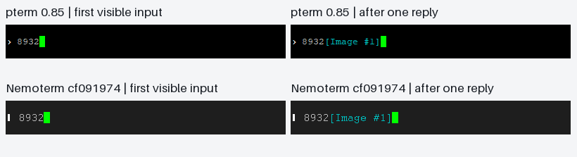
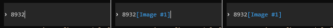

# Codex 启动时，Windows 何时收到位图读取请求？

**换一个终端也会发生。** [微软 Windows Terminal 实际窗口](#微软-windows-terminal-的真实窗口)把 Ctrl+V 转给 Codex 后，与原版 pterm、Nemoterm 一样，都观察到刚能打字时提交纯文字，稍后同一个快捷键能贴图。

在不运行 Nemoterm 的[独立回放](https://github.com/xiongnemo/nemoterm/actions/runs/44292905252)里，同一版本 Codex 分别由 Windows 系统 ConPTY 和 WinPTY 启动。刚看到输入文字时发送同一组原生按键，两边都只提交文字（0 张图）；完成一轮回复后发送，服务端各收到 1 张逐像素匹配的 32×16 PNG。这是两个控制台宿主的对照，没有运行 Windows Terminal 或 Alacritty 的图形界面。[四个场景的原始回执](https://github.com/xiongnemo/nemoterm/blob/fca0e61388f99dd460811c231950d5d7c19a775e/research/codex-independent-image-4db9c54.zip)与[另一次系统 ConPTY 在首次文字可见时即成功的记录](https://github.com/xiongnemo/nemoterm/blob/fca0e61388f99dd460811c231950d5d7c19a775e/research/codex-independent-image-212034f.zip)共同说明：文字已经出现，不能据此判断是哪一个编辑器在接收按键。

同一份 `e02f0d0` 的 Nemoterm 上，固定的 Codex 0.167.0 有三次在输入文字已经显示、但还没有 idle 信号时收到了测试手势。Windows 在接下来的约 20 秒里没有要求剪贴板所有者提供位图，屏幕上也没有附件。等到同一份草稿就绪，再按一次，三次都出现了附件，回环服务端均只收到一张像素正确的 32×16 图片。**发键时已经有 idle 信号的五次，第一次就成功了。** 这个信号用于对齐测试记录，不能把窗口标题当作同等的用户可见提示。

| 配置 | 首次发键前已有 idle | 第一次就取得图片 | 首次未取得；第二次成功 |
| --- | ---: | ---: | ---: |
| 窗口接口，立即发键 | 1/2 | 1/2（Ctrl+Shift+V） | 1/2（Ctrl+V） |
| 实际键盘，立即发键 | 0/2 | 0/2 | 2/2 |
| 窗口接口，等待就绪 | 2/2 | 2/2 | 0/2 |
| 实际键盘，等待就绪 | 2/2 | 2/2 | 0/2 |

[高精度时钟回放](https://github.com/xiongnemo/nemoterm/actions/runs/44482367652)的[原始制品及逐例记录](https://github.com/xiongnemo/nemoterm/blob/fca0e61388f99dd460811c231950d5d7c19a775e/research/codex-bitmap-reads-44482367652.zip)保留全部四个作业。首次成功的五例中，从开始发键到所有者收到 `WM_RENDERFORMAT` 为 4.561–12.775 毫秒；重试的三例为第二次开始发键后 2.998–7.711 毫秒。八例都自然退出并恢复了测试剪贴板。两个立即粘贴作业保留失败，因为第一次的手势不能用第二次的结果补分。

**怎样观测。** 普通剪贴板验收使用立即提供的 `CF_DIB`；这项独立实验只改变同一图片的供给方式：隐藏窗口声明有 `CF_DIB`，收到 Windows 的 [`WM_RENDERFORMAT`](https://learn.microsoft.com/windows/win32/dataxchg/wm-renderformat) 时才提供像素。每个作业均先验证：在不取数据时连续查询格式可用性，不会触发该消息；实际读取两次，都得到正确的原始字节，只触发一次消息。操作系统缓存了已提供的像素，故**不能把消息数当作读取次数**。八例都没有返回打开剪贴板的窗口句柄，因此单靠这个消息不能认定取图的进程。另行核对了真实客户端回显、原始输出、按键时间和收到的图片像素。普通剪贴板测试的分数保持独立。

**首轮计时错误。** [原始失败运行](https://github.com/xiongnemo/nemoterm/actions/runs/44482033870)和[四个原始制品](https://github.com/xiongnemo/nemoterm/blob/fca0e61388f99dd460811c231950d5d7c19a775e/research/codex-bitmap-reads-44482033870.zip)均保留：该 runner 的首次时钟采样会把进入回调与提供完毕记录在同一刻，测试却要求严格大于。[修正](https://github.com/xiongnemo/nemoterm/commit/6eca999)改用性能计数器，同时允许同次回调内的两条记录具有相等时间；仍要求成功提供数据、时间不倒退、剪贴板在发键之前发布、窗口显示附件且服务端收到正确图片。两轮使用的 EXE SHA-256 都是 `be28e4e503383070855dac42d679c5427e224a68c3fb13195f7d2b820d0f2120`，实际客户端是 `edfdd48f8b458af0906e507b4cb05217b326c3d6e515e9f024e05e3b8d650f70`。每个证据包附 GitHub 原始制品 ID 和 SHA-256。

这些观测与[固定版本客户端在启动草稿中禁用图片的源码和历史记录](codex-file-draft-order.md)吻合。对使用者而言，第一次没看到附件时，可以在编辑器就绪后再次粘贴，看到附件再发送。终端不自动重发手势，以免已就绪的客户端收到两次粘贴。

## `476a2c76`：没有 idle 信号也可能已经能贴图

[同一 EXE 的四台托管 runner](https://github.com/xiongnemo/nemoterm/actions/runs/44567002127)使用延迟提供位图的剪贴板。等客户端报告 idle 再发键的四种组合（实按或窗口接口，各用 Ctrl+V 与 Ctrl+Shift+V）均第一次得到正确图片。刚见到输入文字就发键的四次，**都还没观察到 idle**：一次实按 Ctrl+Shift+V 当场成功；其余三次约 20 秒内没有附件，也没有位图提供请求。同一份草稿就绪后，测试明确再按一次，这三次均收到 `WM_RENDERFORMAT`，提交时各带一张正确的图片。

因此 idle 是可靠的测试等待点，却不是 Codex 能收图的必要条件；首个画面同样不能证明图片编辑器已经接手。第二次手势来自测试，不是终端自动补发。原始首次失败仍按失败计分。[四份原始制品、屏幕、手势和剪贴板时间记录](codex-reads-476a2c76.zip)。

## 原版 pterm 和 Nemoterm 的真实窗口

[同一台托管 Windows 的八个新会话](https://github.com/xiongnemo/nemoterm/actions/runs/44593038636)使用了与本机安装文件散列相同的官方 pterm 0.85，以及本项目的 `cf091974` 单文件 GDI 窗口。两边都启动固定的 Codex 0.167.0，字体为 SarasaTermSC Nerd Light、网格为 160×48。在真实窗口按一次快捷键，只提交一次。下表是本次带 `8932` 的聊天请求里收到的图片数；有图片的三次均为一张逐像素相符的 32×16 PNG，有且仅有相应的三个窗口出现了 `[Image #1]`。八个窗口均自然退出。

| 真实窗口与快捷键 | 首次看见键入的 `8932` | 一轮回复已经显示后 |
| --- | ---: | ---: |
| 原版 pterm，Ctrl+V | 0 | 1 |
| Nemoterm，Ctrl+V | 0 | 1 |
| 原版 pterm，Ctrl+Shift+V | 0 | 0 |
| Nemoterm，Ctrl+Shift+V | 0 | 1 |

对照使用默认按键绑定。刚能打字时不附图，原版 pterm 也确实能复现；这不表示每次启动都会错过，也不表示必须先提交第一条消息。完成一轮只用于得到稳定的阳性对照。原版 pterm 的 Ctrl+Shift+V 在本次稳定阶段没有附图，不能用它来判断 Codex 就绪与否。这八个窗口只包括 pterm 和 Nemoterm；Windows Terminal 的独立实测见下节，Alacritty 不在本次样本中。

[全部八张原始窗口截图、实际按键、服务端回执和文件身份](pterm-gui-images-44593038636.zip)。[首轮原始记录](pterm-gui-images-44592058260.zip)已经出现三个正确位图回执，但测试只识别纯数字标记，未将 `8932[Image #1]` 识别为对应的提交，三例超时。后续使用相同 EXE 和客户端，允许这个精确的附件标记；原始失败没有覆盖或计入产品的 81 项验收。较早一次[分派错误的作业](https://github.com/xiongnemo/nemoterm/actions/runs/44591368740)只执行了内存测试，不作为贴图证据。

## 微软 Windows Terminal 的真实窗口

[第一轮完整回放](https://github.com/xiongnemo/nemoterm/actions/runs/44666609875)和[保留后续画面的复测](https://github.com/xiongnemo/nemoterm/actions/runs/44667306079)各启动十个新窗口，使用官方便携 Windows Terminal 1.25.3131.0、Nemoterm 单文件 `a96e10b4` 和同一版 Codex 0.167.0。网格均为 160×48，字体为 SarasaTermSC Nerd Light；Windows Terminal 子进程逐一回报了预期的 profile GUID 和不同的会话 ID。每个窗口只对目标草稿按一次贴图键、提交一次。下表各格是**收到一张正确图片的次数 / 实际提交数**。每列来自两轮各一次，二十个目标草稿全部有回执；没有图的请求也都包含本次测试文字。七次带图的请求各有且仅有一张逐像素正确的 32×16 PNG。

| 窗口和按键 | 刚回显测试文字 | 已显示上一轮回复 |
| --- | ---: | ---: |
| Windows Terminal 默认，Ctrl+V | 0/2 | 0/2 |
| Windows Terminal 默认，Ctrl+Shift+V | 0/2 | 0/2 |
| Windows Terminal 取消自身的 Ctrl+V 绑定，Ctrl+V | 0/2 | 2/2 |
| Nemoterm 默认，Ctrl+V | 1/2 | 2/2 |
| Nemoterm 默认，Ctrl+Shift+V | 0/2 | 2/2 |

微软这版的两个默认键均绑定到终端自身的粘贴操作。只把 Ctrl+V 交给应用后，**刚能打字却贴不上图**在 Windows Terminal 也复现了；同一设置下，稍后 Codex 能收到正确图片。这个结论限于所测客户端、按键和剪贴板格式（只有位图）。完成一轮回复只是用来确定稳定的对照时点，正常使用并不要求先发一条消息。Nemoterm 的早期 Ctrl+V 两轮分别是零张、一张；首次出现文字并不是可靠的就绪判据。全部二十个窗口都正常退出并恢复剪贴板，没有残留进程需要终止。

下面三张原始裁剪来自同一个 Windows Terminal 窗口，均在同一次 Ctrl+V 之后、唯一一次回车之前。测试读到控制台缓冲区的附件标记后，首张截图（采集结束于 32 毫秒）仍是纯文字；297 和 1016 毫秒处均已显示 `[Image #1]`。不能仅凭最早一张截图判定贴图失败；这三个时间也不是 Codex 启动后要等待的时间。

[首轮失败](https://github.com/xiongnemo/nemoterm/actions/runs/44665424784)的六个微软窗口没有通过准备阶段，没有按键或目标提交，不能当成六次零图。修正的是测试进程的环境、profile 选择和错误记录，产品 EXE 和真实客户端都没换。正式的 81 项验收仍保留启动早期的两项失败。原始上传包、散列、各次完整截图，以及标明无提交、纯文字和有图的索引均保存在[证据包](windows-terminal-codex-images.zip)中。
