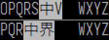

# 左移后清理行尾：字应该留在哪一格？

在 22 列宽的区域右端放置 `中V`。向左删除两格后，旧 Nemoterm 和 XTerm 412 都把 `中` 移到正确位置，但原先紧跟它的 `V` 在 Nemoterm 中仍然存在，在 XTerm 中变成了空格。这解释了 [此前 728 格回放](selection-column-edits.md)的三处差异：DCH、DECDC 和 SL 触发了同一种结果。

为区分“保留完整字”和“逐格复制 XTerm”，新对照分别改变左移距离（1、2、3、4 格）、旧宽字后半格相对于清空区的位置，以及边界前是否还有第二个宽字。包括未编辑的对照在内，两端接受完全相同的 72 条输入，各返回 1,872 个有位置编号的单元格校验。两端只有 **21 格**不同，分布在 21 条输入中。

关键反例是右端放 `中界` 并左移三格：XTerm 对 `界` 的首格返回 `0x754C`，却对其后半格返回空格 `0x0020`；Nemoterm 返回首格和宽字续格 `0x0000`。这里记录的是终端报告的单元格，不把校验值当作屏幕截图。XTerm 在 **12/72** 条输入中报告了不成对的宽字符，Nemoterm 在本组中为 **0/72**。固定上游源码的 `screen.c` 中，`ScrnDeleteChar` 先移动文字，`ClearCells` 遇到清空区起点残留的续格标记会将清空范围再向左扩一格。这既可能抹掉移来的 `V`，也可能抹掉另一个宽字的新续格。

实现保留完整的源字，避免为了匹配一个格子而丢掉一个可复制的字符。严格 XTerm 字节对照继续报告差异；独立的字符完整性检查按完整源字和移动后的目的位置计算预期。两项分别记录。

[上游原始回复](https://github.com/xiongnemo/nemoterm/blob/fca0e61388f99dd460811c231950d5d7c19a775e/research/column-edge-xterm412.zip) · [旧版 `b7bf0fd` 原始回复](https://github.com/xiongnemo/nemoterm/blob/fca0e61388f99dd460811c231950d5d7c19a775e/research/column-edge-b7bf0fd-retained.zip) · [首次 Windows 回放](https://github.com/xiongnemo/nemoterm/blob/fca0e61388f99dd460811c231950d5d7c19a775e/research/column-edge-b7bf0fd.zip)。第一次 Windows 回放产物漏收了新增的 72 行；补齐上传路径后，在保持生产源码和 EXE 相同的分支上重新回放。两份原始包都保留。

候选 `2c0152c` 的[同一 EXE 回放](https://github.com/xiongnemo/nemoterm/blob/fca0e61388f99dd460811c231950d5d7c19a775e/research/column-edge-2c0152c.zip)核对了独立推导的全部 1,872 个目的格，没有差异。严格对照仍是 25/28 行、725/728 格，三个不同值及各自原始字节均在同一制品里。后续 `ci.yml` 的 `scope=full` 使用同一个工作流，保留两个检查各自的结果。

## 测试版 `b3274ed` 实际能选到什么

[远程窗口回放](https://github.com/xiongnemo/nemoterm/actions/runs/44549439772)先让子程序接管鼠标，在行尾的 `V` 或 `界` 的后半格按住 Shift 和左键，再让应用左移该行，最后反向拖选。四种窗口组合（GDI、DirectX 各配 Sarasa Light 或 profile 默认字体）各通过 4 项窗口消息检查；两个 Sarasa 窗口分别再用 Windows 实际键鼠输入通过 2 项。共 **20/20**。每次都核对移动前后字形像素、腾出的空格、边界外的 `W`、松手后的高亮和子程序输入；右键复制及 `Ctrl+Shift+C` 均得到 `中V` 或 `中界`，没有鼠标事件漏给子程序。

图中两行为远程 GDI 窗口原始截图的局部，按整倍数放大。上行为 DCH 左移两格，下行为 DCH 左移三格后从 `界` 的右半格反向框选。选区外的 `WXYZ` 可作位置参照。

[该 EXE 的原始回执与 20 张窗口截图](selection-margin-b3274ed.zip)还保留了独立的整份格子查询制品。按完整源字计算，1,872 格全部相符；逐格对比 XTerm 412 仍是 **725/728**，差异仍在 DCH、DECDC、SL 的第 20 列。这是两项不同的结论。
