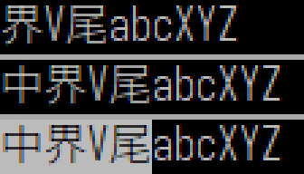

# 左移后清理行尾：字应该留在哪一格？

在 22 列宽的区域右端放置 `中V`。向左删除两格后，旧 Nemoterm 和 XTerm 412 都把 `中` 移到正确位置，但原先紧跟它的 `V` 在 Nemoterm 中仍然存在，在 XTerm 中变成了空格。这解释了 [此前 728 格回放](selection-column-edits.md)的三处差异：DCH、DECDC 和 SL 触发了同一种结果。

为区分“保留完整字”和“逐格复制 XTerm”，新对照分别改变左移距离（1、2、3、4 格）、旧宽字后半格相对于清空区的位置，以及边界前是否还有第二个宽字。包括未编辑的对照在内，两端接受完全相同的 72 条输入，各返回 1,872 个有位置编号的单元格校验。两端只有 **21 格**不同，分布在 21 条输入中。

关键反例是右端放 `中界` 并左移三格：XTerm 对 `界` 的首格返回 `0x754C`，却对其后半格返回空格 `0x0020`；Nemoterm 返回首格和宽字续格 `0x0000`。这里记录的是终端报告的单元格，不把校验值当作屏幕截图。XTerm 在 **12/72** 条输入中报告了不成对的宽字符，Nemoterm 在本组中为 **0/72**。固定上游源码的 `screen.c` 中，`ScrnDeleteChar` 先移动文字，`ClearCells` 遇到清空区起点残留的续格标记会将清空范围再向左扩一格。这既可能抹掉移来的 `V`，也可能抹掉另一个宽字的新续格。

实现保留完整的源字，避免为了匹配一个格子而丢掉一个可复制的字符。严格 XTerm 字节对照继续报告差异；独立的字符完整性检查按完整源字和移动后的目的位置计算预期。两项分别记录。

[上游原始回复](https://github.com/xiongnemo/nemoterm/blob/fca0e61388f99dd460811c231950d5d7c19a775e/research/column-edge-xterm412.zip) · [旧版 `b7bf0fd` 原始回复](https://github.com/xiongnemo/nemoterm/blob/fca0e61388f99dd460811c231950d5d7c19a775e/research/column-edge-b7bf0fd-retained.zip) · [首次 Windows 回放](https://github.com/xiongnemo/nemoterm/blob/fca0e61388f99dd460811c231950d5d7c19a775e/research/column-edge-b7bf0fd.zip)。第一次 Windows 回放产物漏收了新增的 72 行；补齐上传路径后，在保持生产源码和 EXE 相同的分支上重新回放。两份原始包都保留。

候选 `2c0152c` 的[同一 EXE 回放](https://github.com/xiongnemo/nemoterm/blob/fca0e61388f99dd460811c231950d5d7c19a775e/research/column-edge-2c0152c.zip)核对了独立推导的全部 1,872 个目的格，没有差异。严格对照仍是 25/28 行、725/728 格，三个不同值及各自原始字节均在同一制品里。后续 `ci.yml` 的 `scope=full` 使用同一个工作流，保留两个检查各自的结果。

## 测试版 `b3274ed` 实际能选到什么

[远程窗口回放](https://github.com/xiongnemo/nemoterm/actions/runs/44549439772)先让子程序接管鼠标，在行尾的 `V` 或 `界` 的后半格按住 Shift 和左键，再让应用左移该行，最后反向拖选。四种窗口组合（GDI、DirectX 各配 Sarasa Light 或 profile 默认字体）各通过 4 项窗口消息检查；两个 Sarasa 窗口分别再用 Windows 实际键鼠输入通过 2 项。共 **20/20**。每次都核对移动前后字形像素、腾出的空格、边界外的 `W`、松手后的高亮和子程序输入；右键复制及 `Ctrl+Shift+C` 均得到 `中V` 或 `中界`，没有鼠标事件漏给子程序。

图中两行为远程 GDI 窗口原始截图的局部，按整倍数放大。上行为 DCH 左移两格，下行为 DCH 左移三格后从 `界` 的右半格反向框选。选区外的 `WXYZ` 可作位置参照。

[该 EXE 的原始回执与 20 张窗口截图](selection-margin-b3274ed.zip)还保留了独立的整份格子查询制品。按完整源字计算，1,872 格全部相符；逐格对比 XTerm 412 仍是 **725/728**，差异仍在 DCH、DECDC、SL 的第 20 列。这是两项不同的结论。

## Windows 程序读回的文字是否与画面一致

右边界在第 22 列，边界外第 23 列是 `W`。先在第 21–22 列画一个 `中`，再让应用向右插入一列。`8f375f7d` 的终端查询正确报告第 22 列为空格、第 23 列为 `W`，Windows 程序用 `ReadConsoleOutputW` 却读回了 `中` 的首格和续格。另一个独立错误是 CSI SL/SR 横向滚动：终端显示的文字移动了，内置控制台却仍保留原行，纯 ASCII 就能复现。

| 相同输入，每种渲染器单独核对 | 修复前 `8f375f7d` | 修复后 `10f0390f` |
| --- | ---: | ---: |
| 终端的 VT 查询符合完整字符及空白的位置 | 65/65 | 65/65 |
| Windows API 读回的字符和宽字首尾标志均正确 | 39/65 | 65/65 |
| Windows API 读错的单元格（每行 26 格） | 372 | 0 |

修复使内置控制台执行相同的左右滚动，在移动源格之前清理跨越裁切线的宽字，避免单独写半个字时跨界补全。新版另外测试了 55 项，包括跨左右边界的汉字、光标在区域外、编辑相邻行，以及滚动距离大于区域宽度。GDI、DirectX 各自 **120/120**，各检查 3,120 格的 VT 回复及 Windows 读回结果。[旧版运行](https://github.com/xiongnemo/nemoterm/actions/runs/44655207026) · [新版全量运行](https://github.com/xiongnemo/nemoterm/actions/runs/44655885414) · [前后原始回复、控制台读数及鼠标截图](column-edit-native.zip)。VT 用零表示续格，Windows 用宽字码元加续格标志；严格的 XTerm 412 比较仍单独报告 725/728。

[旧版的实际选区回放](https://github.com/xiongnemo/nemoterm/actions/runs/44655207231)已能正确复制：应用接管鼠标时按住 Shift 与左键，插入一列或将整块右移，把 `中U` 正好移到右边界后反向拖选。四组真实系统手势与八组窗口消息均复制出 `中U`；区域外的 `W` 像素保持不变。新版在相同的 12 项中也全部通过。两版原始截图、剪贴板和应用输入记录均在上面的压缩包中。这确认了故障发生在 Windows 程序读回的屏幕缓冲区。

## 行尾输入一个汉字时，下一行的第一个字消失

这与上面的「左移后保留 `V`」是两种情况。开启插入模式（`CSI 4 h`），让下一行已有 `界V尾abcXYZ`。将光标放到上一行的最后一格，输入两格宽的 `中`。它应换行并插在 `界` 前面，得到 `中界V尾abcXYZ`。

[Windows 旧版回放](https://github.com/xiongnemo/nemoterm/actions/runs/44832637710/artifacts/14677541761)直接使用已交付的 `83d584d8`：GDI、DirectX 各跑八组。两种字宽模式都复现，终端报告 `中V尾abcXYZ`，而同一进程通过 `ReadConsoleOutputW` 能读到完整的 `中界V尾abcXYZ`。其余六个对照各自通过：覆盖模式应当覆盖 `界`，直接在目标行插入应保留 `界`，先在行末写 ASCII 再触发延迟换行也应保留 `界`。

修复 `7faa7fac` 把为插入字符腾出空间的时机移到确定目标行和字宽之后，维持原本覆盖模式的行为。[终端字格回归](https://github.com/xiongnemo/nemoterm/actions/runs/44832796282)在 MSVC、GCC 和 Clang 上通过，也覆盖了设置左右栏边界、边界外文字不能跟着移动的情况。

[同一组输入的新旧版本对照](https://github.com/xiongnemo/nemoterm/actions/runs/44832796247/artifacts/14676459213)：新单文件为 4,947,968 字节，SHA-256 `7d81e9130dbb4193e8d60b60ed4de3216aa7aad753518f976391e2d448a91608`。按八组输入分别核对 VT 和 `ReadConsoleOutputW`（含宽字的首格/续格标志）：旧版 GDI、DirectX 各 6/8，新版各 8/8。四组原先失败的画面状态现在保留完整的 `中界V尾abcXYZ`。旧版的原始失败和 728 格 XTerm 左移对照仍分别保留。

[真实窗口画面与物理复制](https://github.com/xiongnemo/nemoterm/actions/runs/44833479543/artifacts/14676627685)：两种渲染器的窗口都使用 `SarasaTermSC Nerd Light`。插入后的 14 格和另行直接绘制的正确文字逐像素相同。子程序开启鼠标跟踪后，从「中」的右半格拉到「尾」的左半格，高亮恰好覆盖七格；改写剪贴板后，再按 Ctrl+Shift+C 仍读回 `中界V尾`。

