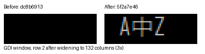
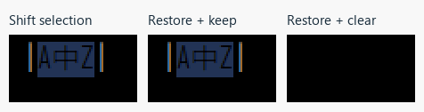

# 应用切换 80／132 列时，窗口、文字和子程序是否一致？

`5f2a7e46` 修复了两个能分别复现的问题：请求保留屏幕再改宽时，旧版会清空文字；即便前端已经遵守 profile 的禁止改宽设置，旧版内置控制台仍可能让 Windows 子程序读到 132 列。现在由前端决定是否调整窗口，内置控制台从实际窗口接收尺寸。普通启动尺寸仍由 profile 或 `--cols` / `--rows` 决定。

图为两次托管 GDI 窗口的同位置原始像素裁剪，放大三倍。两张原图的客户区都是 1058×482。

| 远程版本 | 对照 XTerm 412 的 132 个阶段（每种渲染器） | profile 禁止调整时的结果 |
| --- | --- | --- |
| [旧版 `dc8b6913`](https://github.com/xiongnemo/nemoterm/actions/runs/44640791228) | GDI 和 DirectX 均为 0/132 个阶段的全部回复逐字节相同；这不表示每条回复都有误 | 窗口仍是 80 列，但请求清掉了文字，光标也回到原点。 |
| [仅修前端 `16d30a9b`](https://github.com/xiongnemo/nemoterm/actions/runs/44642708257) | 两者各 132/132 | 文字、光标及可见窗口正确；子程序第一次和一秒后均读到 132×24，与可见的 80×24 不符。 |
| [前端与内置控制台 `5f2a7e46`](https://github.com/xiongnemo/nemoterm/actions/runs/44642856432) | 两者各 132/132 | 每种渲染器又独立核对了 135 个阶段的子程序尺寸（132 个参考阶段 + 3 个本地策略阶段）。各 135/135；被拒请求前后子程序均为 80×24，文字与光标保留。 |

[原版 XTerm 412 参考](https://github.com/xiongnemo/nemoterm/actions/runs/44639595050)用六种启动配置，每种独立运行 22 个阶段，包括模式查询、保存恢复、复位、屏幕切换、光标、字符尺寸和四个字符格的校验和。`A中Z` 占四格，结果为 `65, 20013, 0, 90`，其中 `0` 是宽字的后半格。Windows 端还对照实际窗口客户区，并分别验证 `-132` 和 `+132` 覆盖与之相反的 profile。第一版前端修复曾让保存模式表增大四字节，被[原有断言拦下](https://github.com/xiongnemo/nemoterm/actions/runs/44641236320)；后续版本在原来的 58 字节内分别保存三个标志，通过原断言及 ASan、UBSan。

[同一份候选 EXE 的真实键鼠复测](https://github.com/xiongnemo/nemoterm/actions/runs/44643685117)在应用开启鼠标报告时用 Shift 拖过 `A中Z`。GDI、DirectX 各自独立通过三种情况：要求保留文字且允许换宽，或本地禁止换宽，原选区都仍然高亮，按 `Ctrl+Shift+C` 得到 `A中Z`；明确要求清屏并成功改宽，旧选区高亮则消失。测试同时读取实际窗口像素和子程序收到的字节。

[八份原始作业制品及其身份清单](column-modes.zip)保留上述三版及鼠标复测的 GDI、DirectX 原始 ZIP；`sources.json` 给出 Actions ID 和每份原包的 SHA-256。候选 EXE 为 `ca6c7c8b9e70ec6af35246f25a685aac6284fc76e10ca0480fc7b93656728cb3`。这些记录覆盖可见文字、协议和子程序报告的尺寸，不覆盖原生控制台缓冲区的全部内容、所有滚动历史或其他全量回归项。

后续直接从 Windows 子程序调用 `ReadConsoleOutputW` 的[两组原始回放](https://github.com/xiongnemo/nemoterm/actions/runs/44645231017)发现：`5f2a7e46` 的窗口文字、光标和尺寸每端 12/12 正确，子程序的读取结果却每端只过 6/12。允许换宽且指定保留时，原生缓冲区把 `KEEP` 擦成四个空格；打开本地禁令时也能复现。`GetConsoleScreenBufferInfo` 报告的正确几何不能证明可读文字正确。

`32e588e7` 把本地改宽权限同步给这个标签自己的内置控制台。前端持有可更新的事件，控制台只继承有等待权限的副本；子程序向同一会话写入修改列数和文字时，缓冲区按原顺序处理。允许改宽且请求保留：窗口与子程序均为 132×24、光标归位、文字仍是 `KEEP`。禁止改宽：双方均保持 80×24、光标停在第 7 行第 11 列、文字未变。明确要求清屏且获准时，双方都读回四个空格。

| 读的是什么 | GDI | DirectX |
| --- | ---: | ---: |
| 旧版 `5f2a7e46`：前端协议正确，Windows 原生文字、光标、尺寸也正确 | 6/12 | 6/12 |
| [修复后同一组输入](https://github.com/xiongnemo/nemoterm/actions/runs/44646064546) | 12/12 | 12/12 |
| [同一份 EXE 加入启动策略、真实设置窗口和连续写入](https://github.com/xiongnemo/nemoterm/actions/runs/44646746945) | 22/22 | 22/22 |

22 项包含原有 12 项。扩展回放在同一次运行中两次打开 Profile Settings：禁用并保存后，程序不能擦掉 `KEEP`；重新允许后，它能改宽。在一段连续写入中改宽，随即覆盖第二个字母，双方最终都读到 `K!EP`。[六份完整原始制品与散列](column-native-readback.zip)含失败和成功版本、每步可见／原生观测、实际 UI 操作回执；新 EXE 的 SHA-256 为 `81542ed8bf334eb2804894ee59e02ff31a76ef4d79f5bbdf560f0b914ca2dd65`。这 22 项使用 ASCII 检查原生文字；独立的 `A中Z` 检查验证前端宽字符、可见选区和剪贴板，不能外推为所有 Win32 宽字符编码或所有 DEC 模式的原生缓冲区都一致。

## 恢复应用临时改过的列宽设置

[旧试用版 `32e588e7` 的首次回放](https://github.com/xiongnemo/nemoterm/actions/runs/44649798687)里，窗口与 Windows 子程序在三种恢复路径上读到了相反的文字。之后，把相同的字节发给[原版 XTerm 412](https://github.com/xiongnemo/nemoterm/actions/runs/44650802334)，又发现“保存时关闭了保留文字，所以恢复后应当清屏”这个预期并不成立。XTerm 412 用 `CSI ? 95 s` 保存、再用 `CSI ? 95 r` 恢复后会保留文字；明确再发 `CSI ? 95 l` 才会在下次获准改宽时清屏。保存列宽时如果应用已禁用改宽，原有保存值也不会被覆盖。普通设置列宽会重置滚动边界，恢复保存的列宽则保留边界。这些结论针对实际测试的 XTerm 版本和 VT520 配置。

[固定参考 ZIP](../testdata/upstream/xterm412-saved-column-modes.zip)是远程原始制品 `14590962150`，SHA-256 `ea953b1e76800eb51ecbfb993d2f2b266244dc480222365244415ea9172b6eaf`。Windows 每种渲染器分开比较 51 项逐字节回复（三种启动配置 × 17），以及 17 项本地禁止改宽策略。每项都独立检查 Windows 子程序的 `ReadConsoleOutputW`、光标、尺寸是否符合相同预期。[按这个标准重放旧 EXE](https://github.com/xiongnemo/nemoterm/actions/runs/44651044887)：GDI 和 DirectX 各 **53/68**，其中本地禁止改宽各 **17/17**。例如，程序暂时关闭改宽后尝试保存 80 列，再开启并恢复：原版 XTerm 回到 132 列，旧 EXE 停在 80 列。[逐项读数及原始失败制品](column-saved-readback.zip)。

在候选 `8f375f7d` 上，[同样 68 项](https://github.com/xiongnemo/nemoterm/actions/runs/44651165951)在 GDI、DirectX 各 **68/68**。普通改宽的 22 项原生读回与两个标签互不影响的 7 项也继续通过。更贴近使用时的[实际键鼠回放](https://github.com/xiongnemo/nemoterm/actions/runs/44651889509)每端 **5/5**：应用接管鼠标时用 Shift 拖选四格 `A中Z`。恢复 132 列并保留画面后，高亮仍在原来的四格，按 Ctrl+Shift+C 从系统剪贴板读到 `A中Z`，应用没收到复制按键；明确清屏后四格均不再高亮。此图来自同一份 EXE 在托管 GDI 窗口的对应区域，最近邻放大两倍。

