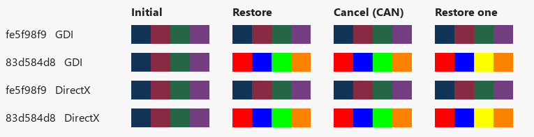

# VT525 调色板：终端回复与应用恢复是两个命令

`fe5f98f9` 能正常显示应用通过 OSC 4 设置的颜色。应用改用 DEC 恢复命令时，Windows 子程序读到的色值变了，但已经画好的终端文字仍是旧颜色。四个远程 Windows 窗口都出现同样的问题。

[VT520/VT525 手册](https://vt100.net/dec/ek-vt520-rm.pdf)印刷页 5-113/114、5-118、5-161 区分调色板查询、报告和恢复。[微软用 VT525 实机取得的参考值](https://github.com/microsoft/terminal/pull/17708)可用于比对 HLS 与 RGB。应用发 `CSI 2;1 $u` 或 `CSI 2;2 $u` 查询，终端的回复以 `DCS 2 $s` 开头；要恢复，应用把相同载荷放进 `DCS 2 $p … ST`。原封不动把 `$s` 回复写回屏幕，不应改色。这里不涉及 `CSI 1 $u` 的一般终端状态报告。

| 同一窗口的观察 | `fe5f98f9`，GDI / DirectX，整段或逐字节写入 |
| --- | --- |
| 查询 256 色 HLS、RGB | 应有 3,020 和 3,016 个字节；两项实际均为 0 |
| `$p` 恢复后，检查早已画好的第 0、1 号色块 | 窗口仍是 `#123456`、`#892a45`；Win32 API 已读到红、蓝 |
| 随后用 CAN 取消一次白色恢复 | 屏幕仍是初始色；Win32 API 却读到白、白 |
| 13 项协议断言 | 四种组合各 4/13；初始画面、Win32 和协议三方均通过基准色检查 |

[四份未改动的 Windows 制品](dec-colour-restore-baseline.zip)保留完整截图、逐阶段子程序读数、OSC 回复和构建身份。`sources.json` 列出每个制品的 GitHub 编号及 SHA-256；[原始失败运行](https://github.com/xiongnemo/nemoterm/actions/runs/44826940424)用试用版 EXE 与独立的测试提交 `1b508eb2`。

较早的[探测](https://github.com/xiongnemo/nemoterm/actions/runs/44825262905)和[首轮候选回放](https://github.com/xiongnemo/nemoterm/actions/runs/44826571948)把 `$s` 当作恢复命令，后者即使显示 12/12 也不能证明兼容；该候选未放入 `dist`。修正命令后，候选 `83d584d8` 的[完整回归](https://github.com/xiongnemo/nemoterm/actions/runs/44827444033)另计，不以试用版或首轮候选的结果代替。

**`83d584d8` 的 Windows 结果。** 四种组合分别通过 **14/14** 项协议检查（合计 56/56）。除原先的 13 项外，新用例在两个合法色值后发 `ESC [` 而非 `ESC \`，确认未结束的恢复不会生效。四个窗口读回的 HLS、RGB 报告分别为 3,020、3,016 个字节；另一个 256 色全白报告为 4,504 字节，跨越 4 KiB 后仍能原样读回并恢复。将 `$s` 报告直接送回窗口没有改色。

四个窗口各有四个阶段。每个阶段从**已经画好的字格**取样，并核对子程序读到的四项 OSC 4 回复及 Win32 可见的前两项。原来分歧的红、蓝现在一致；CAN 取消保留红、蓝，只恢复第 254 号色时其余三格也保持不变。截图中的色块只在首阶段写过一次；其他阶段通过第二行独立标记确认新画面已呈现。

[四份本版原始 Actions 制品及前后读数](dec-colour-restore-83d584d8.zip)，含逐字节写入的两组。[构建制品](https://github.com/xiongnemo/nemoterm/actions/runs/44827444033/artifacts/14675625577)中的单文件是 4,947,456 字节，SHA-256 `fa9d5c62c8179cdee89308c96f97ecbdfff087f0f8a9f189321f6109e13593e8`。数字仅覆盖 DEC 调色板，不代表其他协议或整套交互通过。
