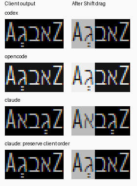

# 单文件预览 3da2fc3：按屏幕选择混排文字

[Windows x64 单文件](https://github.com/xiongnemo/nemoterm/actions/runs/44391854501/artifacts/14469532051)来自 `3da2fc3b3e1191def43fd10783ebe57f809a8edb`，4,867,072 字节，SHA-256 `7c6c0144626638e6ce046fab51f1b94963e87d55c62904a3b5fcc81c3e5676d1`。下列交互均来自 GitHub 托管的 Windows runner，同一份 EXE。

**Shift 拖选按屏幕上的字符取文本。** 即使两个字符在原文中不相邻，复制也不会夹入中间没有高亮的字。中文宽字覆盖两格，组合附标跟着基字符，自动折行不插入额外换行。[四个真实窗口的图和剪贴板](selection-3da2fc3.zip)覆盖 Sarasa 8×20、默认字体 9×16 × GDI、DirectX。四种双宽行、四种双向矩形和五种普通双向拖选在每个窗口均通过。修复前后相同坐标的变化见[选区调查](block-bidi-selection.md)。

[三个真实客户端的系统鼠标键盘回放](bidi-client-selection-3da2fc3.zip)，run `44393112562`，制品 `14468628589`，测试 `08f239b`。字体 SarasaTermSC Nerd Font Light，160×48。每次先记录进入终端的 VT 流，再用同一行内孤立显示的三种希伯来字形辨认选区的真实字序。在全部八个窗口中，Shift 拖选、Ctrl+Shift+C、中文宽字、取消关闭后输入，以及 Ctrl+Shift+V 并向测试服务提交原文都通过。另行严格比较“显示字序是否与提供给客户端的原文预期相符”：六个通过，默认配置的两个 Claude Code 窗口失败，所以这组总成绩为 **6/8**。

| 客户端和配置 | 混排中鼠标选到的两个字符（GDI / DirectX 同） | 与原回复的预期字序一致 | 交互期间最高私有工作集：GDI / DirectX |
| --- | --- | --- | ---: |
| Codex，默认 | `Aגְ` | 是 | 6,881,280 / 17,625,088 B |
| OpenCode，默认 | `Aגְ`，客户端实际把这段折到下一行 | 是 | 13,979,648 / 17,686,528 B |
| Claude Code，默认 | `Aא`，与实际高亮匹配 | 否 | 11,767,808 / 20,615,168 B |
| Claude Code，显式保留应用字序 | `Aגְ` | 是 | 11,608,064 / 17,489,920 B |

如果用这个版本的 Claude Code 看希伯来语，可为它建一个单独的 profile，在 **终端 → 功能 → 禁用双向文字显示** 勾选后保存。这个客户端发来的混合文本已预排；开关让终端保留它传来的次序。Codex、OpenCode 在此次观察中发送普通逻辑顺序，默认配置显示正确。首次误以为三种客户端都发送相同字节的[原始失败](bidi-client-layout-861f57f.zip)保留。下图截自同一组真实 GDI 窗口；每行左边是原始回复，右边是拖选同两格后的画面。

[关闭确认](profile-close-3da2fc3.zip)的单标签、整窗、独立窗口均通过，点取消或按 Esc 后不用再开设置；[WSL Vim](wsl-vim-3da2fc3.zip)在 `TERM=xterm`、`TERM=xterm-256color` 和两种渲染器的四个组合通过；[真实 WSL Sixel](wsl-sixel-3da2fc3.zip) 的 GDI 和 DirectX 窗口通过显示、重绘和清除检查。

[REA 对本文件的完整静态导入记录](rea-3da2fc3-imports.json.gz)为 81 个普通 DLL 描述符、669 项函数导入，另一个延迟加载的 ICU 描述符有 11 项。与 `fd19411` 比对，少一个 `IsProcessorFeaturePresent`，无新增 DLL/函数；未见 WebView、CEF 或 Chromium 导入。导入表不能单独证明运行时不会加载其他模块。

160×48 长历史、行内和动画图片、Kitty 图像与密集 Unicode 等六种压力负载分别在 [GDI 原始记录](memory-gdi-3da2fc3.zip)和 [DirectX 原始记录](memory-directx-3da2fc3.zip)中通过，合计 **12/12**。两种渲染器均在密集 Unicode 与 Kitty 图片混合时达到以下最高值。指标只计前端进程，用原始字节表示；判定门槛是 GDI 私有工作集 <20,000,000 B、DirectX ≤30,000,000 B。

| 渲染器 | 峰值私有工作集 | 峰值总工作集 | 峰值私有提交量 |
| --- | ---: | ---: | ---: |
| GDI | 18,944,000 B | 53,735,424 B | 22,163,456 B |
| DirectX | 28,643,328 B | 71,630,848 B | 32,350,208 B |

[同机十次 Codex 回复对照](pterm-codex-pair-3da2fc3.zip)，run `44393585386`，制品 `14469493403`。每种前端正序、逆序各启动一次，160×48、SarasaTermSC Nerd Font Light、同一 Codex 客户端和回环回复。表中前两项是回复后各轮中位数的范围，最后一项取两次完整前端轨迹中的最大私有工作集。单位为十进制 MB，不含 Codex 和后台控制台宿主。十次均返回预期回复、正常退出，回复阶段的前端模块和作业内进程清单没有命中已检查的 WebView 名称。

| 前端 | 回复后私有工作集 | 回复后总工作集 | 完整轨迹最高私有工作集 |
| --- | ---: | ---: | ---: |
| pterm | 3.76–3.78 | 21.82–22.59 | 3.78 |
| nemoterm-tab | 5.06–5.08 | 33.08–33.94 | 5.31 |
| nemoterm-standalone | 5.07–5.10 | 32.72–32.76 | 5.32 |
| nemoterm-directx-tab | 9.68–9.72 | 44.58–44.62 | 9.72 |
| nemoterm-directx-standalone | 9.72–9.73 | 44.22–44.24 | 9.74 |

八个真实客户端窗口各在启动、提交后记录一次前端模块和测试作业进程名；16 份运行时清单中均未出现所检查的浏览器引擎模块或进程。[拖放回放](wsl-drop-3da2fc3.zip)的 GDI 和 DirectX 两项通过，包括文件和目录的 shell 路径处理。原始 [MSVC 终端组件与 XTerm 的固定参照比对](regis-original-3da2fc3.zip)仍有五帧不同：向上滚动 1 帧、向下滚动 2 帧、换行滚动 1 帧、共享调色板 1 帧；整段与逐字节输入均如此。这是提交对应的组件回放，不是 Windows 单文件窗口截图。

[30 项独立客户端交互的原始回执](agent-interaction-3da2fc3.zip)，制品 `14469723753`：28/30。三个客户端在 GDI、DirectX 的默认右键仅复制、显式右键复制并粘贴均通过。OpenCode 的图片粘贴和 Codex 正式编辑器就绪后的图片粘贴（窗口接口及系统输入）通过；Codex 首次显示输入标记就立即贴图的两条路径仍失败。该 30 项与上文有混排字形检查的 8 项分别计分。

两项独立诊断也保留原始失败：[Windows 键盘记录](picture-keys-3da2fc3.zip) 9/10，无绘制的系统按键用例未读到预期阶段的快照，不能据此判定快捷键丢失。[Unicode 边界](unicode-boundary-3da2fc3.zip) 3/4：Nemoterm 的 GDI、DirectX 和系统 Claude 对照通过；独立 winpty/Claude 对照在等待退出 18 秒后超时。
