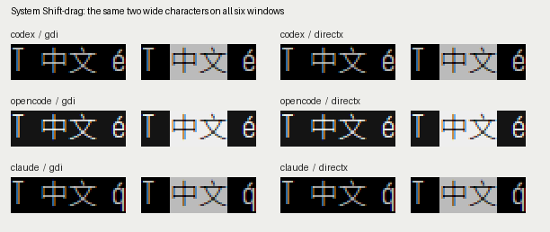

# `823d8e4`：单文件交互验收与 xterm 能力

[完整交互与内存原始记录](interaction-823d8e4.zip)来自 [GitHub Actions 44326592417](https://github.com/xiongnemo/nemoterm/actions/runs/44326592417)。交互汇总 `14439201036` 验证了同一份 Windows EXE 的 **74/74** 项：4,860,928 字节，SHA-256 `c43a39d7a8341d3076a16528c3d8518e0d42cc19fa9de680ce8a64885cc51eca`。该数字仅为交互套件，非全部 CI。

| 160×48 满屏压力测试，字节 | GDI | DirectX |
| --- | ---: | ---: |
| 前端私有工作集峰值（验收指标） | 19,410,944 | 29,687,808 |
| 总工作集峰值 | 56,184,832 | 74,874,880 |
| 私有提交峰值 | 22,544,384 | 33,427,456 |

两种渲染器各六种负载。[真实客户端原始证据](agent-receipts-823d8e4.zip)包括 30 项交互和 6 项默认网格回放。使用 SarasaTermSC Nerd Light，三种客户端在 GDI / DirectX 下从汉字的后半格起拖都选中了完整的“中文”。系统输入覆盖默认快捷键，以及[选中后松开 Shift 再右键的十二组原始窗口记录](agent-right-click-823d8e4.zip)：三个客户端 × 两种渲染器 × 两种右键策略。默认策略要再按粘贴键，开启“复制并粘贴”则没有额外的粘贴按键；十二组提交均只含一份选区文本。剪贴板和回环服务收到的提示都参与验证。Codex 刚启动时的图片输入本次也通过，但[此前的真实客户端和独立宿主](agent-unicode-boundary.md)表明它存在时序差异。

上图为六个独立窗口原始截图按字符格裁切后放大两倍。每对左为拖选前、右为拖选后；四格中文字完整高亮，两侧不变。[原始截图、选区数据和 Codex 贴图时序](agent-interaction-details-823d8e4.zip)保留了对应记录。四个首次出现输入标记后的 Codex 手势都提交了正确的 32×16 图片；三个手势前已记录到客户端 idle 通知，另一个窗口 API 的 Ctrl+V 当时未记录到该通知。这不能反推出按键送达时客户端的内部状态。

[REA 对这份已发布 EXE 的静态读取](rea-823d8e4-imports.json.gz)完整解析了 81 个普通 DLL 描述符中的 669 个函数和延迟加载的 11 个 ICU 函数，没有已知浏览器引擎的导入名。上述六个默认网格窗口启动和提交时的 12 份进程/模块快照也没有匹配已检查的浏览器运行时。这是对实际受测路径的佐证；静态导入表本身无法排除任意动态加载。

[同一 EXE 的独立 WSL 回放](wsl-terminfo-823d8e4.zip)来自 [44329395419](https://github.com/xiongnemo/nemoterm/actions/runs/44329395419)。Ubuntu 24.04 的真实 Bash 继承了 `TERM=xterm-256color`。应用调用系统 `tput` 生成光标寻址序列，再向终端询问当前位置。下面的位置为应用接收到的 1 起始行、列；不是测试自行解码 `tput` 的输出。颜色数由 WSL 系统条目声明，并不测量渲染器的色深。

| 实际 `TERM` | `tput colors` | `tput cup`（0 起始） | 实际终端回复 |
| --- | ---: | --- | --- |
| 继承的 `xterm-256color` | 256 | `2 3` | `ESC [ 3 ; 4 R` |
| 子进程显式 `xterm` | 8 | `5 8` | `ESC [ 6 ; 9 R` |

`TERM` 兼容性和原版 XTerm 的逐帧一致性分开报告：[原始 ReGIS 比对](regis-six-frames.md)仍有五帧不同。完整协议的实现与缺口见[支持表](../docs/PROTOCOLS.md)。

Windows 跳转列表用 `@配置名` 快捷启动。它与 `--profile 配置名` 在 `823d8e4` 上并不等价：[修复前回放 44333547537](profile-term-before-823d8e4.zip) 中四个子进程均自然退出。两个普通启动都得到了正确的三个变量。`@` 启动在父环境没有设置变量时三个变量全部缺失；当父环境设置了 `TERM=dumb` 时，子进程保留了 `dumb` 和另两个不相关的父值。该包中的 `identity.json` 和 `profile-term-environment.json` 是此回放证据；同包内早先的其他协议观察并非本次测试。`1fef0e3` 将三个变量的设置移到解析快捷启动之前；该修复的全量 CI 为 [44333779700](https://github.com/xiongnemo/nemoterm/actions/runs/44333779700)。

[修复后原始四组子进程环境](profile-term-after-1fef0e3.zip)：`1fef0e3` 的单文件 SHA-256 为 `db670d8c07d5e03ba8e2f72a4c4b4ee7e7ce2882b10638683e2a495a3c198220`。普通和跳转列表启动在父变量缺失或不相符时均正确得到 `xterm-256color`、`truecolor`、`nemoterm`，四组均自然退出。

[真实 `less` 首次回放](wsl-less-initial-823d8e4.zip)，运行 `44331273695`，制品 `14440013432`。在 `823d8e4` 的 WSL 中，`less` 590 打开并显示了第 1–41 行。窗口 API 发送向下键后的观察里仍是第 1–41 行；末行从 `pager.txt` 变成 `:`。该回放失败，未运行到翻页、搜索、恢复或单独的 `TERM=xterm` 分支。Windows 清理临时目录时另遇到占用错误。它不推翻前面的真实 `tput` 光标回复，也不能单凭画面断定 Linux 收到的按键序列。
