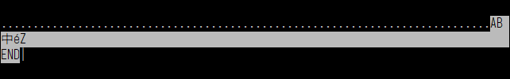

# Interaction preview `85fe9b1`

The [source build](https://github.com/xiongnemo/nemoterm/actions/runs/44236147822) produced one x64 `nemoterm.exe`, 4,853,760 bytes, SHA-256 `2a0a82cc2357ee8184cddc21d8610a49bccc9855711b09318c82daef87ca6688` (artifact `14397786086`). The interaction, DPI, and agent runs below verified this file's hash before use. This is a preview: the [ReGIS comparison](regis-history-limit.md) still reports ten historical frame differences, and Tektronix emulation is not implemented.

## What you can try

In a terminal tab, hold **Shift** and drag with the left mouse button over the displayed reply. Press **Ctrl+Shift+C**, then **Ctrl+Shift+V** in the prompt. This works even when the tested application requests mouse events. The default right click copies; the saved optional mode copies then pastes. **Ctrl+drag** selects a rectangle. All of these were exercised with `SarasaTermSC Nerd Light` on GitHub-hosted Windows.

[The interaction replay](https://github.com/xiongnemo/nemoterm/actions/runs/44236971871) passed **42 of 42** cases in 12 groups. Both real Codex and OpenCode submitted the exact selected Unicode reply to a loopback provider on GDI and DirectX. OpenCode's 30 selected cell backgrounds changed from `#0A0A0A` to `#EEEEEE`; both unselected neighbours stayed unchanged. Actual image paste was checked with both clients. The selection group also verified 16 rectangle gestures per renderer and the saved right-click behaviour.

The new linear selections cross an automatic wrap and a hard line break. In the main screen, a forward drag copied `ABC中éZ`, then CRLF and `END`. In the alternate screen, the double-width `中` was forced onto the next row because only one column remained. A backward drag copied `AB中éZ`, then CRLF and `END`: no extra space or newline at the soft wrap. On both renderers the selected cells changed and the guards did not. The child received exactly one bracketed paste, with UTF-8 for the text and one carriage return for the hard break, between two ordered status replies. It received no mouse reports or extra shortcut bytes. The original capture below shows this backward selection; the right-hand `|` after `END` is outside it.

## Memory of this executable

Values are decimal MB; the counters cover the frontend, with the shell, agent and console-host processes accounted separately. The native frontend was not instrumented for the memory gates.

| Hosted workload | GDI private working set | DirectX private working set |
| --- | ---: | ---: |
| Real Codex: sampled during the reply and 32 resizes | 6.93 MB | 12.97 MB |
| Real OpenCode: highest of five phase samples (not a continuous peak) | 6.06 MB | 9.01 MB |
| Six 160×48 workloads: highest sampled | **19,030,016 B** | **28,864,512 B** |

The dense Unicode Kitty workload reached each renderer's maximum in all three reported counters. Peak total working set was 55,783,424 B (GDI) and 71,643,136 B (DirectX); peak private commit was 22,728,704 B and 32,325,632 B respectively. The GDI total exceeds the approximate 50 MB guide; the required private working set gates are strictly below 20,000,000 B for GDI and at most 30,000,000 B for DirectX. [Original selection, agent and memory artifacts plus all group receipts](interaction-85fe9b1.zip), SHA-256 `86c8ee42ed70348d427a00dfcf5c01bf00e796bf78aefb510377c7dfac8cdc5e`.

## Native rendering and DPI

REA inspected the downloaded executable without running it. It has **668 ordinary imports in 81 DLL descriptors, plus 11 delay-loaded functions from `icu.dll`**. There is no declared WebView/CEF/Chromium import. In [a separate six-case agent replay](https://github.com/xiongnemo/nemoterm/actions/runs/44238424890), the controller used read-only Windows module and job queries on this same executable. It identified the exact frontend and pinned client images in each sample. The frontend had 70–77 loaded modules across eight snapshots (startup and after response/resize or final submission, both clients and renderers). None matched a tested WebView, Chromium, CEF or other browser-engine DLL name; no matching browser subprocess was observed among the enumerated job members. The frontend and console host were separately running instances of the same EXE. The snapshots don't track intervening short-lived loads or enumerate every possible engine name.

[The DPI run](https://github.com/xiongnemo/nemoterm/actions/runs/44236971940) passed **24/24** real single-monitor GDI cases at 100%, 125%, 150%, 175% and 200%, including live transitions for standalone and tabbed windows in English and Simplified Chinese. All eight language-interaction checks passed. This is not an observation of two physical monitors with different scaling. [Complete agent artifact, REA records, and selected original DPI reports](native-runtime-85fe9b1.zip), SHA-256 `2a57fb94eee7e0bc2f7e4a4109fbb9c628339ba136a689ab84009708dd1dc212`.

The [single-executable suite](https://github.com/xiongnemo/nemoterm/actions/runs/44236971821) completed **170 distinct checks** with only `nemoterm.exe` in its run directory. The downloadable product ZIP contained one file, byte-identical to both preview copies in `dist`. [Checks, binary identity and original artifact receipts](single-exe-85fe9b1.zip), SHA-256 `a3a496a128be24f82ae4d7015ebb5a9536c516e21ebe3ca4769041359c27b32b`. [Full regression, with an independent build](https://github.com/xiongnemo/nemoterm/actions/runs/44238887555). A separate build has its own binary identity. The previous `4c3bc30` file [passed its 170-group single-file suite](https://github.com/xiongnemo/nemoterm/actions/runs/44231794967); that result belongs to the previous file.

The separate `163b3ea` build had a failed OpenCode/GDI **observation before selection** in its aggregate: Windows returned error 31 when the observer queried a job member's image name. In [the subsequent agent replay](https://github.com/xiongnemo/nemoterm/actions/runs/44241463083), all six cases passed on that same `c896d59b…` executable, including OpenCode/GDI highlight pixels, copying and submission. The observer retains incomplete enumerations and requires a complete pass; the passing OpenCode/GDI run obtained both complete snapshots on its first attempts, so it does not prove why the earlier Windows query failed. [Original failure and exact-image replay records](agent-snapshot-163b3ea.zip). Neither result is assigned to the `85fe9b1` image.
