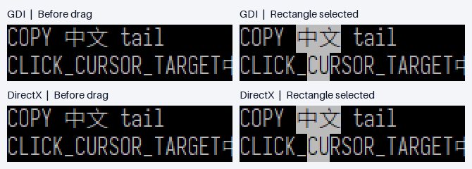

# a9c8150 的交互验证

远程构建的四舍五入大小约 4.86 MB（4,860,928 字节）；SHA-256 `a1b2e279d105575649ffc73a913129085d931200d53a2036409891cd8a5764a4`。[源构建](https://github.com/xiongnemo/nemoterm/actions/runs/44338343977)的制品 ID 为 `14443251390`。以下结论仅针对这一份可执行文件。

[WSL 原始回放](wsl-less-verified-a9c8150.zip)来自 [44339705048](https://github.com/xiongnemo/nemoterm/actions/runs/44339705048)，制品 ID `14441894634`，ZIP SHA-256 `02517c08f057abdc43527a24b147aabb99a815b2bbb40e87d46725ad393225bf`。Ubuntu 24.04 `less` 590、SarasaTermSC Nerd Light。`TERM=xterm` 和继承的 `xterm-256color`，分别使用调试接口按键与 runner 系统键盘、分别直接运行与在 `script(1)` 中运行，共 **8/8**。每次都从第 1 行开始，向下后首行为 2，翻页后为 34，搜索后为 220；按 `q` 恢复了打开前的可见文本，子程序自然退出，WSL 清理记录确认 shell 已退出。已核对八组共 48 张截图的哈希。

四份原始 PTY 输入日志均为 `1b 4f 42`（下）、`1b 5b 36 7e`（下一页）、`/ZEBRA_NEEDLE`、回车、`q`，前两项和 WSL 的 `tput kcud1`、`tput knp` 一致。修复前 API 错发 `1b 4f 72` 的[同组对照](wsl-less-diagnostic-1fef0e3.zip)仍保留。这验证了上述交互，不等于全部键盘协议或全部 terminfo 行为都已验证。

[同一 EXE 的六组真实客户端窗口报告](agent-grid-a9c8150.zip)：正式网格 160×48，字体 SarasaTermSC Nerd Light。Claude Code、Codex、OpenCode 分别在实际 GDI 和 DirectX 下，从汉字后半格开始的系统鼠标拖选均复制出完整的 `中文`，六组回环服务都收到了选区。原始 Actions 制品 `14443536380`。

[WSL `img2sixel` 首次尝试](wsl-sixel-first-a9c8150.zip)，运行 `44339704723`，制品 `14443925929`：两种渲染器的显示前黑底检查均通过。Ubuntu 的 `libsixel-bin 1.10.3-3build1` 默认量化只定义了四个 Sixel 颜色寄存器，`sixel2png` 将原 PNG 的 36 个黑点全部解成 `(247,0,0)`。测试在独立解码与原 PNG 的比对处失败，尚未测到两个渲染器画图后的像素。保留了两个原始 PNG、实际 Sixel 字节、上游工具身份及错误。后续回放使用同像素的 RGB PNG 和明确的 xterm256 调色板，仍要求检查原图、独立解码及实际终端像素。

[WSL Sixel 回放的原始字节和截图](wsl-sixel-verified-a9c8150.zip)来自 [运行 44340989668](https://github.com/xiongnemo/nemoterm/actions/runs/44340989668)，制品 `14444296324`，ZIP SHA-256 `132a304f394ecb5e63f8bf81f2a72bcf45ea527e33fd1fa269318e4baaa1592e`。编码后 3,855 字节，独立解码出的 24×18 像素与原始图完全相同。实际 GDI 和实际 DirectX 的显示前、显示后、重绘、清除四个阶段，图像和四边外一像素组成的 26×20 区域均为零像素差异。原始图、独立解码图和两个渲染器保存的八张窗口截图均已离线复核；这是对真实应用这条输出路径的验证。

[同一产品的 30 项客户端交互结果](agent-interaction-a9c8150.zip)来自 `14443806686`。28 项通过，包括三个客户端、两种渲染器各自的默认右键仅复制与可选复制并粘贴。未通过的两项为 Codex 刚出现首次输入标记时贴图（系统输入及调试接口）；正式输入框就绪后两种方式均通过，OpenCode 贴图也通过。此前的[独立宿主与客户端源码对照](agent-unicode-boundary.md)区分了 Codex 启动草稿与正式输入框。这些失败未被覆盖。六个默认网格窗口的启动和提交阶段共有十二份进程和模块记录，均没有匹配测试所检查的浏览器引擎模块或进程。

真实客户端操作期间的前端私有工作集（字节）：每个单窗口、单标签在启动、回复、复制、编辑和提交五个时刻分别采样，取这五点的最大值。未计入 shell 或 agent 进程。它们不是整个运行期间的连续峰值，也不是六种压力负载的结果。

| 客户端 | GDI | DirectX |
|---|---:|---:|
| Codex | 6,733,824 | 12,787,712 |
| Claude Code | 6,938,624 | 12,922,880 |
| OpenCode | 6,995,968 | 12,828,672 |

[完整交互汇总和十二组内存采样](interaction-full-a9c8150.zip)核对通过 72/74，未通过项：`agent-image-codex`、`agent-image-system-codex`。六种 160×48 负载每种渲染器均通过；前端进程的采样峰值（字节）如下。

| 渲染器 | 私有工作集 | 总工作集 | 私有提交 |
|---|---:|---:|---:|
| gdi | 19,791,872 | 56,586,240 | 22,753,280 |
| directx | 28,491,776 | 71,376,896 | 32,264,192 |

[真实 WSL Vim 9.1 的四组交互](wsl-vim-verified-a9c8150.zip)，运行 [44343384985](https://github.com/xiongnemo/nemoterm/actions/runs/44343384985)，制品 `14444727456`，ZIP SHA-256 `0b8b67b7a3d7f5f82516d94128f154e4baef3681a8f0ca42cb5f2b4106da37fd`。实际 GDI / DirectX × 默认 `xterm-256color` / 显式 `xterm` 均通过。Vim 的 SGR 鼠标开启时，普通点击让编辑器光标到第 3 行第 5 列；在第 2 行按 Shift 跨两个汉字的中间两格拖选，截图中四个字符格高亮，两侧格子不变。Ctrl+Shift+C 得到完整 `中文`，Vim 的光标和缓冲区都保持不变。窗口从 60×20 放大到 72×24，再缩小到 52×16；四组都收到了两次正确的 `VimResized`，且前端网格一致。进入编辑状态后按 Ctrl+Shift+V，保存文件的 UTF-8 字节完全吻合；退出后恢复启动 Vim 之前的屏幕。包内保留了编辑器版本、每次状态、截图和最终文件。

[REA 对此预览的完整静态导入表](rea-a9c8150-imports.json.gz)覆盖 81 个常规 DLL 描述符、669 个常规导入和 11 个 ICU 延迟导入。本次已逐项与 `823d8e4` 的 DLL、函数名和序号比对，完全相同。与前述真实客户端窗口的十二份运行时快照一起，这些证据没有显示 WebView 引擎；静态导入不能证明所有动态执行路径。

[矩形选区的四组 Vim 原始回放](wsl-vim-rectangle-a9c8150.zip)来自 [44344995440](https://github.com/xiongnemo/nemoterm/actions/runs/44344995440)，制品 `14445592439`，原始 ZIP SHA-256 `fc79a006039282d65f11872493d2957324e377e6d247f4220229d9899c053b50`。按住 Ctrl+Shift，从 `中` 的后半格开始跨行拖选，在左键仍按下时松开两个修饰键，然后移动到最终位置。在上行，四个汉字格完整高亮；在下行，只有两格 ASCII 字母高亮。剪贴板是精确的 `中文`、CRLF、`CU`；Vim 光标和文件内容不受影响。下图为显式 `TERM=xterm` 的远程窗口原图裁切，最近邻放大两倍。

[同一 EXE 的 Codex 图片手势分项](agent-image-timing-a9c8150.zip)。两个首次输入标记用例各含两个手势：窗口接口的 Ctrl+Shift+V 成功，Ctrl+V 未出现附件；系统键盘的 Ctrl+V 成功，Ctrl+Shift+V 未出现附件。独立正常输入框对照的四个手势均成功。成功的窗口接口 Ctrl+Shift+V 在发送前尚未记录到 idle；失败的两个手势在发送前也都没有 idle。发送前的输出和客户端真正消费该键的时刻不同，不能把 idle 简单等同于成功或失败。

[同一份 Codex 草稿内第二次按粘贴的对照](codex-same-draft-a9c8150.zip)，[运行 44346400935](https://github.com/xiongnemo/nemoterm/actions/runs/44346400935)，保留四个原始制品。窗口接口的两种启动手势均未在原限时内显示附件；初次失败始终计为失败。确认正式输入框已就绪、同一草稿仍保留标记且没有附件或提交后，测试员在原会话再次按原快捷键。两次均发送了恰好一张像素匹配的 32×16 图片，子进程正常退出。系统键盘的两个启动手势本次都首次成功；正式输入框对照的四个首次手势也全部成功。二次操作由测试模拟用户发起，产品不会延迟重送；20 秒是观察首次失败的测试期限，不是用户需要等待的时间。
