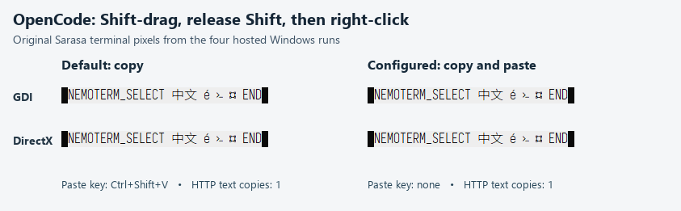

# Right-click a real OpenCode selection

The [hosted Windows replay](https://github.com/xiongnemo/nemoterm/actions/runs/44262013021) ran 12 agent cases on the single `fa6f10f` executable, SHA-256 `72f18c9de36874a8d3952730350a0e10650e68116f43792b068fc527ea8bc061`. The four new cases used Windows system mouse and keyboard input with the pinned real OpenCode client, a loopback provider and SarasaTermSC Nerd Light. The client itself enabled mouse tracking. The fixture typed a unique prefix in the composer, Shift-selected the actual reply, and released Shift **before** right-clicking. An image-only clipboard sentinel installed after mouse-up prevents automatic selection copying from satisfying the right-click assertion.

| Profile | Result after one ordinary right click | Extra paste keys sent | Exact HTTP user text |
| --- | --- | --- | --- |
| Default (setting absent) | Clipboard became the selected Unicode text; composer did not receive it | One Ctrl+Shift+V | Prefix plus one copy |
| `RightClickCopyAndPaste=1` | Clipboard became the selected text and the composer received it | None | Prefix plus one copy |

GDI and DirectX passed both policies. In each case all 30 selected cells and both neighbouring guards matched the expected highlight (minimum selected/guard ratio 1.0). The selection included Chinese, a decomposed accent and two Nerd Font characters including a supplementary code point. The provider receipt required both an exact text part and one occurrence of that selection in the latest user message. The client restored the clipboard and all jobs exited naturally. Peak sampled *frontend* private working set in the four cases was 6,361,088 / 6,549,504 bytes for GDI and 9,121,792 / 9,220,096 for DirectX (default / copy-and-paste). See the [original replay archive](opencode-right-fa6f10f-verified.zip), SHA-256 `dd84b75c79d77d763789e210ad2e466c4a8cf548d955648eec273459724fa205`.

The [first replay](https://github.com/xiongnemo/nemoterm/actions/runs/44260943105) passed 11/12. Default DirectX copied correctly and its final provider log included the expected submission. The controller failed because it indexed `requests` in an unavailable JSON snapshot before the positive receipt could be observed. The next fixture continues polling on that condition, records unavailable polls, and still requires a positive receipt before the **same 30-second deadline**. The original [failed artifact](opencode-right-fa6f10f-initial.zip) was kept. Its SHA-256 is `f328367ac30790337111292696a204278c52d8176bebb817f6657765d2512b2c`.

The [source aggregate](https://github.com/xiongnemo/nemoterm/actions/runs/44260021672) passed all original 46 interaction cases in 12 groups, with no remaining or forcibly terminated job processes. The six 160×48 workloads peaked at **19,275,776 bytes GDI** and **29,216,768 bytes DirectX**; on the dense Unicode/Kitty workload, total working sets were 56,168,448 / 74,407,936 and private commit was 22,671,360 / 33,042,432 bytes. The [source aggregate receipts and full memory samples](interaction-fa6f10f-receipts.zip) are specific to this image. Four of the replay's 12 agent cases are new, giving 50 distinct cases across these two runs. The separate [private Sixel comparisons](private-sixel-terminator.md) retain their remaining differences.

For this exact candidate, [REA's complete static PE import record](rea-imports-fa6f10f.json.gz) identified 669 ordinary imports in 81 DLL descriptors and 11 delay-loaded ICU functions. None of the checked WebView, Chromium, CEF, MSHTML, Qt WebEngine or Gecko module names appeared. The four successful right-click cases also collected eight live snapshots on the hosted Windows runner (startup and submission): 70–75 frontend modules, verified frontend and client identities in each job, no matching browser runtime module or process. This supports the native rendering claim for the tested paths; import tables alone cannot rule out arbitrary dynamic loading. The installed upstream executable's SHA-256 still matches the original [pterm lightweight architecture investigation](pterm-findings.md).
