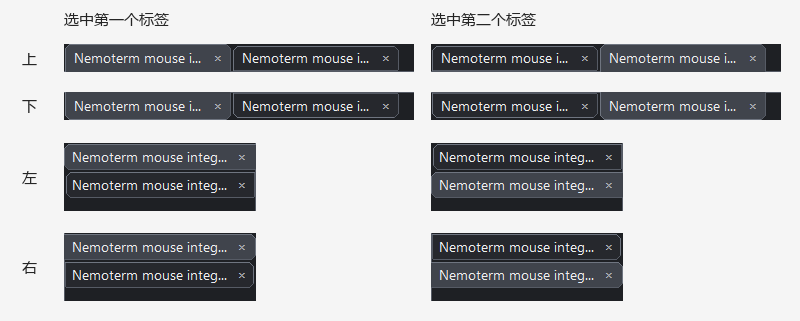

# 新标签打开在哪个目录：OSC 7 的本地文件 URI

应用可以用 OSC 7 告诉终端当前工作目录。若已开启目录继承，实按 `Ctrl+Shift+T` 后，新标签应在这个目录启动。[RFC 8089 §2、附录 B](https://www.rfc-editor.org/rfc/rfc8089.html#section-2) 允许 `file:/absolute/path` 和 `file:///absolute/path` 两种写法；[RFC 3986 §3.1](https://www.rfc-editor.org/rfc/rfc3986.html#section-3.1) 规定 URI 的方案名不区分大小写。Windows 上的例子是 `file:/C:/work`、`file:///C:/work` 以及 `FILE:/C:/work`。

旧版 `b04ca12a` 只接受小写的 `file://` 开头。若应用之前报告的是另一个目录，复制目录 URI 和新标签的起点都会悄悄停在旧位置。候选 `c55cca64` 只改变方案和可选主机的解析；本机主机名检查、路径解码、长度限制及对无效输入的处理保持原样。不为每个标签增加常驻数据。

测试在 GitHub 托管 Windows 上运行，字体为 SarasaTermSC Nerd Light。每项先将原窗口的目录元数据置为 `previous`（不同于配置的 `start`），再让真实子进程发 OSC 7；目的目录名含空格、中文、分号、`#` 和 `%`。控制序列后跟一个状态查询，子进程读到回复后才复制目录 URI，并实按新标签快捷键。回执分别保留 Windows 剪贴板的 URI、同一前端中新子进程的 `getcwd()`、进程标识以及实际渲染器。

[旧单文件的 Windows 回放](https://github.com/xiongnemo/nemoterm/actions/runs/44814111787/artifacts/14668213913)：GDI 和 DirectX 各 4/7；单斜线、混合大小写及大写单斜线均打开 `previous`。标准 URI 打开目标目录，远端主机保留在复制的 URI 中但新标签打开配置的 `start`；相对 URI 与含编码 NUL 的 URI 均保留 `previous`。没有把这些负对照改成有效路径。

[候选单文件的同一套 Windows 回放](https://github.com/xiongnemo/nemoterm/actions/runs/44814333692/artifacts/14669675584)：GDI **7/7**、DirectX **7/7**。三个原失败的写法均进入目标目录，复制的 URI 也正确。两个原窗口均自然退出，没有兜底终止。该作业还通过了四边标签切换、悬停预览和鼠标手势测试。[解析器地址和未定义行为检查](https://github.com/xiongnemo/nemoterm/actions/runs/44814333692/artifacts/14669420883)通过；[归档的原始窗口回执及解析器日志](osc7-tab-directory.zip)含 GitHub 制品编号、压缩包散列和受测 EXE 散列。

[试用版 `c55cca64` 的下载制品](https://github.com/xiongnemo/nemoterm/actions/runs/44814333692/artifacts/14669630337)中，`nemoterm.exe` 为 4,943,360 字节，SHA-256 `039723403523cc6c5d5de964b6d84f251f1bfc2b727b4a37f19ee3fbce584b7b`。本项 14 次实际新开标签不代替[完整回归](https://github.com/xiongnemo/nemoterm/actions/runs/44814333692)或该 EXE 的满屏内存采样。

## 同一份试用版：四边标签与实际应用

在 **Profile Settings → Window → Tabs** 选择位置。八张标签栏截图（四边各切换一次）的 RGB 像素与存档中同方向、同选中状态的八张原图分别相同。当前页向终端敞开，左右侧标题仍是横排。四边均观察到后台内容变化后预览更新，切换后键盘到达选中的终端，实际拖选能复制 `Copy7`；中键的五种操作逐边检查，20/20。当前 EXE 的八张原图在[这份已归档的 Windows 制品](osc7-tab-directory.zip)内的 `14669675584.zip`；[窗口缩放和标签交互](https://github.com/xiongnemo/nemoterm/actions/runs/44814333692/artifacts/14670291012)另有 9/9 项通过。

[十个实际应用窗口的原图](https://github.com/xiongnemo/nemoterm/actions/runs/44814333692/artifacts/14669183055)覆盖 Codex、Claude Code 和 OpenCode 的 GDI、DirectX 两种渲染。复读原图时，用同一行三个独立希伯来字形的笔画掩码识别屏幕顺序，再看 Shift 拖选前后的两格及左右邻格。正向和反向共 20 次，两个选中格的背景像素全部改变，两个邻格的背景像素均未改变；剪贴板都包含 `U+0041 U+05D2 U+05B0`，保留了组合符。反向拖选后，十个窗口发往本地服务的请求均含相同文字。[独立服务端、截图与内存复核](https://github.com/xiongnemo/nemoterm/actions/runs/44816458463/artifacts/14670495356)还确认十个窗口都显示了重复的两个“中”，两次退格分别删除一个。[实际快捷键记录](https://github.com/xiongnemo/nemoterm/actions/runs/44814333692/artifacts/14670325872)中，就绪后贴图通过，两个 Codex 首次显示窗口的贴图用例失败，保留原结果。

[同机 24 轮 Codex 对话](https://github.com/xiongnemo/nemoterm/actions/runs/44814333692/artifacts/14669248402)中，前端私有工作集采样峰值为 pterm **3,768,320**、Nemoterm GDI **5,578,752**、DirectX **9,695,232** 字节。十个实际应用交互窗口中的采样峰值为 GDI **16,699,392**、DirectX **18,309,120** 字节（两者均是 Claude Code）。这两项负载和六种满屏压力负载分别计分。

[WSL 粘贴与退出记录](https://github.com/xiongnemo/nemoterm/actions/runs/44814333692/artifacts/14670150460)保留了四个窗口超过两秒退出时限的失败。Windows 作业记录显示，每次留下的都是两个名为 `init` 的进程，约在时限后 13 秒退出，无需强制终止。同一 runner 上不启动 Nemoterm、只让 WSL 输出一行的两组对照（直接及带 relay）也留下两个 `init`，时间相同。这个对照能解释为什么单测退出时限也会失败，不能推断旧运行中未识别的进程就是 `init`。
