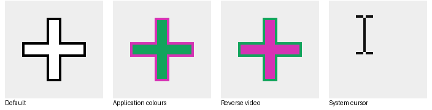

# Mouse pointer colours: upstream observations

[GitHub-hosted collection 44239923080](https://github.com/xiongnemo/nemoterm/actions/runs/44239923080) ran XTerm(412) on a private Xvfb display. All four profiles completed all 19 stages. The [original artifact](pointer-colour-reference.zip) contains the control bytes, exact replies, per-stage XFixes cursor ARGB images, source excerpts and build identity. Its SHA-256 is `9d53c96d09b1e313c853f9767e246c403d1f86a681437e79e15b1e3a055bb346`. The observed XTerm binary SHA-256 is `9f440380b493c91dbd1fcb8a6277df1ca121390b23fe526baa24c15525f4df64`.

OSC 13 and 14 independently set and query foreground and background inks. With the default profile and the explicitly selected `xterm` pointer shape, 28 foreground, 58 background and 58 transparent pixels were observed. After setting green and magenta those exact colours appeared in both replies and cursor pixels. Reverse video swapped the pixel regions while the two query replies retained their logical order. With `GetColor` denied, no query replies were received but the actual cursor still changed. With `SetColor` denied, both replies and cursor pixels retained the defaults. These observations distinguish request handling from presentation.

Colour changes survived a soft reset and switching to and from the alternate screen. Popping the palette restored the saved red/blue pair. The final hard-reset and both reset requests in this sequence also reported red/blue; a preceding isolated foreground reset had instead restored its initial value. These are observations at specific points in the transcript. The stock Windows cursor has its own dimensions and hotspot; compare the actual ink colours and their reverse-video swap, not the X11 silhouette.

The Windows `pointer-colour` replay uses the exact previously built executable, a real foreground terminal, and the child input stream. `GetCursorInfo` and `DrawIconEx` record the selected native cursor separately from protocol replies. All stored raw observations remain available when a comparison fails. This focused suite does not measure renderer memory.

[Windows baseline 44240870471](https://github.com/xiongnemo/nemoterm/actions/runs/44240870471) ran against the published `85fe9b1` preview. The child received its trailing status reply at every stage, but none of the 19 stages produced any OSC 13/14 query reply. The initial cell glyph contained black and white, but the requested green and magenta did not appear. The frontend exited normally and the job had no surviving children. The [original failed replay](pointer-colour-baseline-85fe9b1.zip), SHA-256 `b63c2d3508522c8c44509825368ab67acc19e8c23957ba4680117eae238754ca`, includes the image identity, replies and actual Windows cursor images.

A [second upstream run](https://github.com/xiongnemo/nemoterm/actions/runs/44241602173) exercised 31 stages in all four profiles. Both soft and hard resets retained the pair; separate ordinary OSC 113 and 114 requests then restored the startup colours. A reset with a payload did nothing. After a push/pop with just the foreground changed in between, both restored colours remained unchanged on reset; explicitly setting only the background made it resettable again. An unchanged push/pop did not have that effect. [Original 124-stage reference](pointer-colour-resets-reference.zip), SHA-256 `45d1b8c67962304696bf583e035c051bfbf257d362ec1ffadd1a799d80974770`.

## Native Windows result

[Replay 44242688639](https://github.com/xiongnemo/nemoterm/actions/runs/44242688639) verified all 31 OSC replies and actual cursor presentations on the candidate `57217fd` executable, SHA-256 `cf3b726d6d9ca97f74e6be696da902c0fcaa930e28c9a64e062c7345ef12b694` (4,856,320 bytes). Exact `#12a45c` and `#d632b4` covered 176 and 100 pixels; the cell cursor retained its (15,15) hotspot. Reverse video swapped every corresponding coloured pixel without changing the logical query replies. Both resets recovered the actual system I-beam handle. Two tabs retained distinct colours; all 25 samples stayed on the foreground cursor during the hidden tab's change, and activating that tab displayed its new inks. The frontend exited normally; no job members remained. [Unmodified replay artifact and 31 cursor captures](pointer-colours-57217fd-window.zip), SHA-256 `3b9f368adeb1e73ba52cc3abae43787ffb72addf6290093a16383952d798db35`.

[Component run 44242055139](https://github.com/xiongnemo/nemoterm/actions/runs/44242055139) matched 31 original XTerm query responses under whole and bytewise delivery in GCC, Clang and MSVC. The original Windows component job failed separately on the final GDI-object count after restoring the stock cursor; [its failing log](pointer-colour-native-first.zip) is retained. [Independent controls 44243210212](https://github.com/xiongnemo/nemoterm/actions/runs/44243210212) reproduced exactly the three-object difference in a fresh process using only Win32. Loading, selecting and drawing a stock cursor did not create it. Creating a colour cursor with `CreateIconIndirect`, selecting it, destroying it and releasing all caller-owned bitmaps and DCs left 6 GDI objects versus an initial 3. The second cycle ended at exactly 6 again. In the product, the selected cursor accounted for one USER object; counts stayed at 106 USER/113 GDI across 120 changes, and returned to 105/110 after restoring the original handle. [Original independent and application logs](pointer-colour-resource-controls.zip).
