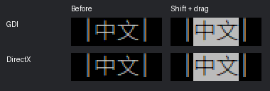

# 打字后按 Shift 拖选：`355c73f8`

[托管 Windows 的单文件候选](https://github.com/xiongnemo/nemoterm/actions/runs/44785665334/artifacts/14653593498)：4,942,336 字节，SHA-256 `12b0ba38581401d4e2a858c0c5d644fa2abe057e8cbe306dc3b0babd43b14e50`。

`CSI > Ps p` 让应用指定何时在打字时隐藏鼠标。`0` 从不隐藏，`1`（也是省略参数时的值）只在没有鼠标跟踪时隐藏，`2` 和 `3` 都会在打字时隐藏。输入前、子程序收到字符后和鼠标实际移动后的可见状态由操作系统读取。新 EXE 在两种 profile 默认设置下各 **16/16** 与同一套输入的原版 XTerm 412 一致；旧版是 **6/16、11/16**。软重置、硬重置、切换备用屏和省略首参数均在内。此处没有实测指针不动而焦点改变时模式 `2` 和 `3` 的区别。

两个渲染器的独立窗口都加载了 SarasaTermSC Nerd Light。在应用启用 `1002`/`1006` 鼠标跟踪、打字隐藏指针后，从同一位置按 Shift 和左键，再拖过「中文」并按 Ctrl+Shift+C。两次都只有四个字格高亮，指针在拖动时重新可见，Windows 剪贴板精确读回「中文」。子程序返回了两项跟踪模式的确认和 DSR，随后只收到实按的 `ab`，没有收到被本地选区接管的鼠标或复制快捷键。

- [原版 XTerm 实际指针记录](https://github.com/xiongnemo/nemoterm/actions/runs/44784674949)、[旧版 Windows 失败记录](https://github.com/xiongnemo/nemoterm/actions/runs/44784851810)、[二者原始制品](pointer-hiding-baseline.zip)。
- [新 EXE 的 32 项测试](https://github.com/xiongnemo/nemoterm/actions/runs/44785665334/job/136463457368)、[同一 EXE 两种渲染器的实际拖选](https://github.com/xiongnemo/nemoterm/actions/runs/44786774037)、[原始记录、完整截图与该文件的 REA 导入表](pointer-hiding-355c73f8.zip)。新版的静态导入相较 `3da1ebb8` 只少了 `USER32!ShowCursor`，没有增加 DLL 或函数。
