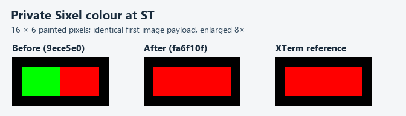

# Private Sixel colours at the end of a picture

In the default private-palette mode, a final RGB or HLS definition was changing already-painted pixels at the string terminator (ST). `fa6f10f` now validates the pending parameters without installing the colour. A payload command such as `$` still completes the definition and immediately updates pixels belonging to that register. This extends the [shared-register fix](shared-register-terminator.md) without changing raster bounds, resource limits or dangling-repeat validation.

The [independent reference](https://github.com/xiongnemo/nemoterm/actions/runs/44258149069) drew two eight-column halves, then redefined register 1. In the identity scene both halves were initially red but used different registers. In the overwrite scene half the red pixels were repainted using a blue register. The first pictures in the ordinary and full-repaint captures agree on both transports:

| First picture | RGB definition immediately followed by ST | Definition followed by `$` then ST |
| --- | --- | --- |
| Equal original colours, distinct registers | red / red | green / red |
| Left half overwritten with blue | blue / red | blue / green |

The oracle includes the exact digit strings used by the old test that expected red to change to green at ST. Both the original and explicitly terminated inputs are now tested, preserving the register identity and overwrite assertions under the termination the reference actually requires. The [original XTerm archive](private-sixel-terminator-xterm.zip) contains all scenes and both images per step. Its SHA-256 is `43325228851c7292d71a3dc846f64e8cacaef99ef98b394a5ecc5016cee91b4c`.

The [old native image replay](https://github.com/xiongnemo/nemoterm/actions/runs/44259827376) failed in all four jobs on the new `private-register-identity-st` step: 48 green and 48 red pixels instead of 96 red. The preceding 64 geometry checks passed. The [before component comparison](https://github.com/xiongnemo/nemoterm/actions/runs/44259701573) differed on four of the eight private frames per compiler/transport. The [corrected product run](https://github.com/xiongnemo/nemoterm/actions/runs/44260021672) produced a 4,857,856-byte EXE, SHA-256 `72f18c9de36874a8d3952730350a0e10650e68116f43792b068fc527ea8bc061`. GDI, DirectX and directly presented GDI pass all 72 geometry checks plus all 12 scrollback checks apiece. The OpenGL request fell back to GDI. The rendered halves continue to match after redraw. [Original before/after window artifacts and compiler observations](private-sixel-terminator-product.zip), SHA-256 `9ae6b9d09a7841de69c77b8d2cad57200fe2f1fd4a5495dc39bfb5cd512e850f`.

## What happens to the next picture

The new component test compares **both stages**, including the next image. Six of eight frames now agree on MSVC, GCC and Clang in both transports. The remaining two differ only in the subsequent 16×6 block (96 pixels each). Nemoterm applies the new picture's own explicit green definition. The pinned XTerm instead paints its default green `#33CC33` when the preceding picture finished with a pending definition. No second-stage frame was removed from the test; the older six-of-131 historical mismatches remain separately reported.

[A separate XTerm capture](https://github.com/xiongnemo/nemoterm/actions/runs/44260117268) isolated the first byte of the next DCS. After a pending definition, starting that next image with `#2;2;0;0;100!8~` paints eight default-green pixels, whereas `$#2;2;0;0;100!8~` paints eight explicit-blue pixels. Starting with `~` loses that first graphic column; starting with `!8~` paints just one default-green pixel before the following completed blue definition. Printing text, toggling palette mode, or sending RIS between the pictures does not restore the leading selector on this XTerm build. A third picture paints its explicit blue normally in all eight scenes. Whole and bytewise delivery, ordinary and exposed frames all agree. The source shipped in the [original 83-scene capture](sixel-next-dcs-xterm.zip) initializes the digit accumulator and selected register at picture start but retains the static colour-command parser state across picture boundaries. Archive SHA-256 `3ee59b3b25bc95feaa4abcf31d5c2eb19a1772277e3c80468cb6154b61e3b9fb`. This describes the pinned reference, not a general claim about DEC terminals or a waiver for the two differences.
