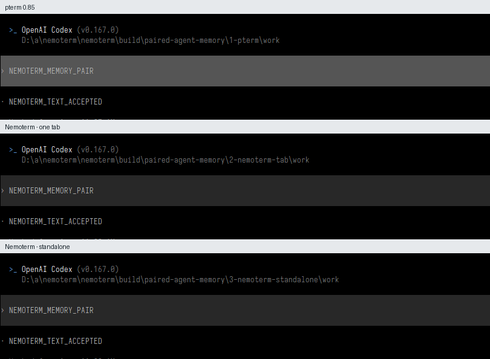

# pterm 0.85：轻量化证据与 NemoTerm 设计依据

调查日期：2026-11-12（Australia/Sydney）。仅查询已运行进程，不输入命令、不读取终端画面、不修改 PuTTY 配置、不清空工作集、不终止用户进程。

[本次试用版 `fe5f98f9` 的 24 轮 Codex 同机对照](trial-fe5f98f9.md)：原版 pterm、Nemoterm GDI、DirectX 前端私有工作集采样峰值分别为 **3.76、5.47、9.76 MB**。

[`b04ca12a` 的同机 24 轮 Codex 实测](character-repeat.md)：原版 pterm 前端私有工作集峰值 **3.81 MB**，Nemoterm GDI **5.77 MB**，DirectX **10.02 MB**。三者总工作集分别为 22.76、37.14、47.37 MB；与最初用户桌面上看到约 8 MB 的场景和口径分开记录。

[此前 `ba16d56b` 的原版 pterm、GDI、DirectX 同机对照](acceptance-ba16d56b.md)：24 轮 Codex 中三个前端的私有工作集峰值分别为 **3.77、5.50、9.73 MB**。

[此前 `355c73f8` 单文件的同机对照](acceptance-355c73f8.md)：同样的 24 轮 Codex 下，原版 pterm、Nemoterm GDI、DirectX 的前端私有工作集峰值分别为 **3.75、5.50、9.70 MB**。

[与 `3da1ebb8` 单文件试用版的同机对照](acceptance-3da1ebb8.md)：使用相同的字体、160×48 网格和 24 轮 Codex 对话，原版 pterm、Nemoterm GDI、DirectX 的前端私有工作集峰值分别为 3.77、5.52、9.78 MB。[上次以 `03d0e0bc` 对照的数据](acceptance-03d0e0bc.md)仍单独保留。下表的 7.13–7.85 MiB 则是最初调查时，你机器上五个既有窗口的实测值。

## 已回答的问题

| 问题 | 当前结论 | 证据种类 |
| --- | --- | --- |
| 指定程序是谁 | 官方 PuTTY 0.85 Windows pterm，amd64 原生 PE；不是 Unix GTK pterm，也不是同名 Go 包 | 本机 SHA-256、版本资源、Scoop manifest、官方校验表、REA |
| 8 MB 是否真实 | 既有 5 个窗口的私有工作集约 7.13–7.85 MiB；总工作集约 29.38–34.49 MiB | 当前 Windows 性能计数器 |
| 为什么能轻量 | 小型 C/Win32 程序、GDI 字符绘制、压缩并限制回滚行、复用行对象、按变化合并重绘、ConPTY 与子进程分开计费 | 发布源码与导入表；具体节省多少是推论 |
| 是否可以合法复用 | MIT 许可允许修改、分发、商业使用，需保留版权与许可 | 官方许可与发布包 LICENCE |
| 是否天然满足全部现代协议 | 否。已有 xterm 鼠标和 bracketed paste；Sixel、OSC 8、同步更新等仍需专项实现和测试 | 源码检查，非完整协议认证 |

## 制品身份

- 本机路径：`C:\Users\nemo\scoop\apps\pterm\0.85\pterm.exe`。
- 大小：1,060,008 bytes（约 1.01 MiB）。
- SHA-256：`8580a3df4afe7696758c1cef43d0e88e3db5fd41c35c60166241aee72dd3ba3b`。
- 版本资源：`Release 0.85 (with embedded help)`；产品 `PuTTY suite`；描述 `PuTTY-style wrapper for Windows command prompts`。
- `current\pterm.exe` 的散列与指定 0.85 文件相同。
- [官方 SHA-256 清单](https://the.earth.li/~sgtatham/putty/0.85/sha256sums) 中 `w64/pterm.exe` 与本机散列完全一致。
- [官方发布源码](https://the.earth.li/~sgtatham/putty/0.85/putty-0.85.tar.gz) SHA-256：`13fd4db2936d03b73812a7bcc2a658e4dd29cc776a56c3670a7fc6f1a0ee8af8`，与下载文件和官方清单一致。工作区源码见 `vendor/putty-0.85/`。

这建立发布版本关联；没有进行可复现编译来证明该源码每个字节与二进制对应，也没有做 Authenticode 信任链验证。

## REA 证据

`rea-pterm-evidence.json` 是 REA `inspect_pe_imports` 的完整 Evidence bundle。

Evidence ID：`ev_580d5500e9863e85ce7e2692fb641d356d62a8a35c47b714b88b2ad855b6422a`。

REA 完整解析了 8 个 DLL、319 个导入、0 个延迟导入：GDI32（51）、IMM32（5）、ole32（3）、USER32（116）、KERNEL32（126）、SHELL32（1）、COMDLG32（6）、ADVAPI32（11）。可见 `ExtTextOutW`、`CreateFontA`、`BeginPaint`、`CreateWindowExW`、`HeapAlloc`、`CreateProcessW`、`GetProcAddress` 等。

这个静态证据支持原生 Win32/GDI 架构；导入表不证明某函数实际执行，也不能排除动态加载。对既有真实 pterm PID 22668 的模块快照另见 `pterm-loaded-modules.json`：没有发现 Chromium/WebView2/Node/CLR 模块；存在系统输入法和 UI 引入的 `dwrite.dll`、`d3d11.dll` 等，不能据此宣称它绝不加载任何 GPU 相关组件。

REA session 报告 Ghidra 未配置，故没有伪装成已完成反编译或调用栈/分配栈分析。此次使用无需深层 provider 的 PE 解析，配合同版源码与只读运行证据，不需要安装额外反编译器。没有开启需要关闭的原生分析 session。

## 内存：三个数必须分开

原始采样见 `pterm-memory-snapshot.json`；进程身份和直接子进程见 `pterm-process-tree.json`。采样约 2026-11-12 01:40–01:42 +11:00；各接口顺序查询，非原子快照。

| 真实 pterm PID | 私有工作集 bytes | 总工作集 bytes | 私有提交 bytes |
| --- | ---: | ---: | ---: |
| 47016 | 7,471,104 | 31,756,288 | 9,502,720 |
| 25396 | 7,655,424 | 33,775,616 | 9,527,296 |
| 45236 | 8,228,864 | 31,772,672 | 10,113,024 |
| 46392 | 7,573,504 | 30,806,016 | 9,428,992 |
| 22668 | 7,737,344 | 36,163,584 | 9,740,288 |

用户看到约 8 MB 的现象与私有工作集一致；不需要假定是误读。另有 5 个同名 Scoop shim，路径是 `scoop\shims\pterm.exe`，它们仅是启动器，也有约 6.9–7.2 MiB 总工作集，不能误计为终端本体。

每个真实 pterm 都有独立 `conhost.exe` 和 `cmd.exe` 子进程。此表仅统计窗口前端，不包括 ConPTY 控制台宿主、shell 或 agent。若要求整个 agent 会话低于 20 MB，这张表不能证明它。

[Microsoft 的工作集定义](https://learn.microsoft.com/en-us/windows/win32/memory/working-set) 指当前驻留物理内存的页，其中可能包含可共享页；[PROCESS_MEMORY_COUNTERS_EX](https://learn.microsoft.com/en-us/windows/win32/api/psapi/ns-psapi-process_memory_counters_ex) 的 PrivateUsage 则是私有提交，不等于当前实际驻留内存。测试 NemoTerm 时应同时记录三项，不能通过 `EmptyWorkingSet` 或最小化窗口人为压低验收值。

上表是历史快照，未验证这五个窗口内各自运行的应用。现在通过 GitHub 托管 Windows 做可复现的对照，不在开发电脑上采集。

## 同一台 Runner 上的真实 Codex 对照

[运行 44296258971 的原始记录](https://github.com/xiongnemo/nemoterm/blob/fca0e61388f99dd460811c231950d5d7c19a775e/research/pterm-pair-aa84ac2.zip)使用了与本机散列完全一致的官方 pterm 0.85，以及 Nemoterm `ba91594` 的 GDI 单文件构建。三个前端配置轮流在同一个 Windows Runner 上运行固定的 Codex 0.167.0：160×48 字符、1122×818 像素的终端绘图区、10 磅 `SarasaTermSC Nerd Light`，相同的提示词和本地回复。先按表中顺序运行，再倒序各运行一次。六次均核对了真实请求、终端上的回复以及正常退出。

| 前端 | 启动 Codex 前：私有工作集 (MB) | 回复稳定后：私有工作集 (MB) | 回复稳定后：总工作集 (MB) |
| --- | ---: | ---: | ---: |
| pterm 0.85 | 2.92–2.96 | 3.75–3.78 | 21.79–22.59 |
| Nemoterm，默认单标签 | 4.70–4.72 | 5.39–5.40 | 35.70–36.57 |
| Nemoterm，独立窗口 | 4.57–4.62 | 5.43–5.47 | 35.38–35.41 |

每个范围的两端是两次运行各自的中位数，单位为十进制 MB。以约 100 ms 的间隔采样；启动客户端前观察 2 秒，收到回复后观察 3 秒，仅统计终端前端。在这个短会话中，默认标签版的稳定私有工作集比官方 pterm 高约 1.6 MB。这里没有模拟长时间滚屏、复制或图形重绘；这些操作的[实际采样峰值和验收门槛](https://github.com/xiongnemo/nemoterm/blob/fca0e61388f99dd460811c231950d5d7c19a775e/research/memory-budget.md)另计。

原始归档含各次采样、截图、窗口与进程身份；制品 `14422924994`，归档 SHA-256 `a216af52a38ce1ada5e9f039ca9a12eeb180c4d3064af847a5e35b439098b8b9`。可通过[远程交互验收入口](../docs/INTERACTION_ACCEPTANCE.md#pterm-memory)复现。

## 源码中的节省机制

以下路径相对于官方 0.85 源码根目录。代码在此处是同版源代码观测，具体内存贡献未做分配剖析。

1. **紧凑的本机前端。** `windows/CMakeLists.txt:155–174` 的 pterm 目标由 C 源文件组成，链接终端、GUI、事件循环、设置、网络和工具库；不链接 PuTTY SSH 的 crypto/keygen 部分，并使用 no-gss/no-rand 等桩。没有浏览器布局引擎、DOM 或脚本 VM。
2. **保留字符单元而不是富文档对象树。** `terminal/terminal.h:26–58` 以 `termchar`、`termline` 保存字符、属性、真彩色和组合字符链；主屏、备用屏、回滚分别存储。组合字符只在需要时占用额外单元。
3. **回滚内容压缩。** `terminal/terminal.c:403–414` 明确采用 RLE；`:700–755` 分别对字符、属性、真彩色和组合字符流编码。`:2636–2655` 达到回滚行上限就释放旧行，并复用当前行作为底部新行。`:1211–1214` 在访问回滚时解压，避免所有历史行都常驻展开结构。
4. **按变化绘制与更新合并。** `terminal/terminal.c:40` 默认约 50 Hz 更新冷却；`:1323–1341` 合并待更新请求，`:6100` 起对比显示缓存并只绘制 dirty run。`windows/window.c:2784` 的 WM_PAINT 处理与 `:3823` 的 `ExtTextOutW` 路径说明其主要终端文字由 GDI 绘制。
5. **ConPTY 把会话任务分到独立进程。** `windows/conpty.c:29–47` 动态加载 Create/Close/ResizePseudoConsole，`:202` 起创建伪控制台与管道，后续创建子进程。终端窗口不承担 agent 的解析、模型客户端或 shell 本身的堆。

因此它的秘诀主要是架构和数据生命周期，而不是某个神秘的内存优化开关。压缩/有界历史、按需数据、直接 Win32 绘制和模块裁剪适合继承；单靠选 C 语言不足以保证相同结果。

## 对 NemoTerm 的含义与未完成验证

- 以此 MIT C/Win32/ConPTY 基础构建能复用成熟 xterm/Unicode/输入法/设置代码，保留 [PuTTY 许可](https://www.chiark.greenend.org.uk/~sgtatham/putty/licence.html)。改名和功能补齐应有独立配置命名空间，避免污染用户原 PuTTY 设置。
- “所有转义序列”需要协议清单和逐项测试，不是 `TERM=xterm-256color` 环境变量就能证明。原版 `terminal/terminal.c:3135` 支持 SGR 鼠标 1006，`:3165` 支持 bracketed paste 2004；此检查并未认证完整 xterm、Windows Terminal 或 Alacritty 行为。
- 在官方 `terminal/` 范围搜索 Sixel、OSC 8、kitty、同步更新等未找到对应实现；这是后续开发线索，不是严格的全程序不可达证明。
- Sixel 解码图像和大窗口会改变预算：例如一张 1024×1024 RGBA 位图就需要 4 MiB。应对图像总量、尺寸和回滚存储设明确有界策略，并测试滚动、覆盖与释放。
- 需要实际 Sarasa 字体、真实 agent、活动窗口、长输出、resize、回滚和图片组合负载；上面的稳定读数不能代替新终端的峰值验收。
- 未完成：分配栈剖析、特性逐项协议一致性测试、长时间滚屏和图形混排在相同条件下的跨终端对比。没有把这些未知项说成已验证。

## 同一份 38de2ad EXE 的 GDI 与 DirectX

[十次同机实测的原始截图、进程和采样](https://github.com/xiongnemo/nemoterm/blob/fca0e61388f99dd460811c231950d5d7c19a775e/research/pterm-codex-pair-38de2ad.zip)，[运行 44351722529](https://github.com/xiongnemo/nemoterm/actions/runs/44351722529)，制品 `14448627465`，ZIP SHA-256 `2421ad318b09ba307c9be76537d7ba6041bd026bd12ca4d1aa3af73aa2c30f72`。同一工作区和固定的 Codex 0.167.0、160×48、SarasaTermSC Nerd Light；五组正序和反序各跑一次。下表是收到同一回复后三秒观察中，两次各自中位数的范围，十进制 MB，只计前端，不计 Codex/伪控制台。

| 前端 | 私有工作集 | 总工作集 | 私有提交 |
|---|---:|---:|---:|
| 官方 pterm 0.85 | 3.74–3.78 | 21.81–22.62 | 4.43–4.48 |
| Nemoterm GDI，单标签 | 5.06–5.08 | 33.10–33.99 | 6.17–6.50 |
| Nemoterm GDI，独立窗口 | 5.09–5.13 | 32.78–32.83 | 6.35–6.46 |
| Nemoterm DirectX，单标签 | 9.68 | 44.63 | 11.27 |
| Nemoterm DirectX，独立窗口 | 9.68–9.70 | 44.24–44.25 | 11.18–11.22 |

八个 Nemoterm 实例在测量前后均通过 HWND 属性确认实际渲染器；十个实例均自然退出，作业未残留子进程，真实回复阶段的模块/进程快照未匹配已列 WebView 引擎。前端 SHA-256 `7e096d2aa87d5a86d5e5edfed26ac6b9d6d26b2e40502ae32edd26c478e5eec7` 的 [REA 导入表](https://github.com/xiongnemo/nemoterm/blob/fca0e61388f99dd460811c231950d5d7c19a775e/research/rea-38de2ad-imports.json.gz) 有 81 个常规 DLL 描述符、669 个常规导入及来自 ICU 的 11 个延迟导入；和 `a9c8150` 的全部 DLL、函数名和序号相同。进程快照和 PE 导入表各自只能证明已观察范围。普通回复的稳定中位数不代替满屏压力测试的峰值。

[同一 38de2ad 单文件的 74 项交互回放](https://github.com/xiongnemo/nemoterm/blob/fca0e61388f99dd460811c231950d5d7c19a775e/research/interaction-full-38de2ad.zip)（[44350839896](https://github.com/xiongnemo/nemoterm/actions/runs/44350839896)）全部通过。在其中各六种满屏压力负载中，[GDI 的前端私有工作集](https://github.com/xiongnemo/nemoterm/blob/fca0e61388f99dd460811c231950d5d7c19a775e/research/interaction-memory-gdi-38de2ad.zip)最大为 18,915,328 字节，[DirectX](https://github.com/xiongnemo/nemoterm/blob/fca0e61388f99dd460811c231950d5d7c19a775e/research/interaction-memory-directx-38de2ad.zip) 为 29,007,872 字节，均在 Unicode + Kitty 图片负载观察到；对应前端总工作集分别为 53,641,216 和 72,175,616 字节。该记录只适用于这一 EXE，不替后续的设置和输入修复验收。

## Exact focus-fix image (`fd19411`)

[Ten ordered and reversed runs, original records and screenshots](https://github.com/xiongnemo/nemoterm/blob/fca0e61388f99dd460811c231950d5d7c19a775e/research/pterm-codex-pair-fd19411.zip) from [44358568277](https://github.com/xiongnemo/nemoterm/actions/runs/44358568277); artifact `14452494158`, SHA-256 `3441de761e466f42cc096f5adce23f25da5774998075718b9bd0d9995babdc4a`. This experiment used the pterm 0.85 image matching the installed Scoop file and the [same single Nemoterm EXE as the focus-fix replay](https://github.com/xiongnemo/nemoterm/blob/fca0e61388f99dd460811c231950d5d7c19a775e/research/close-confirmation-and-rendering.md), pinned Codex and SarasaTermSC Nerd Light at 160×48. All ten got the expected reply and exited with no residual child process. The first three columns give the range of two per-run medians after the reply; the last is the largest sample across both full traces. Values are decimal MB and count the frontend only.

| Frontend | Post-reply private WS | Post-reply total WS | Post-reply private commit | Peak private WS in the full trace |
|---|---:|---:|---:|---:|
| pterm | 3.76–3.78 | 21.80–22.60 | 4.43–4.46 | 3.78 |
| nemoterm-tab | 5.03–5.12 | 33.05–34.02 | 6.46–6.52 | 5.35 |
| nemoterm-standalone | 5.09–5.10 | 32.76–32.78 | 6.48–6.48 | 5.37 |
| nemoterm-directx-tab | 9.65–9.67 | 44.57–44.59 | 11.26–11.28 | 9.67 |
| nemoterm-directx-standalone | 9.68–9.71 | 44.20–44.24 | 11.21–11.23 | 9.72 |

The [current REA import record](https://github.com/xiongnemo/nemoterm/blob/fca0e61388f99dd460811c231950d5d7c19a775e/research/rea-fd19411-imports.json.gz) covers all 81 standard DLL descriptors (670 functions) and one delay-loaded DLL (11 ICU functions). Against `38de2ad` the only added import by DLL/name/ordinal is `IsProcessorFeaturePresent` from `api-ms-win-core-processthreads-l1-1-1.dll`; none disappeared. The captured frontend module and job process lists had no match for the fixture's WebView names. These observations describe the inspected builds and workloads.

On the same image, the [GDI](https://github.com/xiongnemo/nemoterm/blob/fca0e61388f99dd460811c231950d5d7c19a775e/research/interaction-memory-gdi-fd19411.zip) and [DirectX](https://github.com/xiongnemo/nemoterm/blob/fca0e61388f99dd460811c231950d5d7c19a775e/research/interaction-memory-directx-fd19411.zip) stress receipts contain six 160×48 workloads each. All twelve passed. The maximum sampled frontend private WS was **19,070,976 bytes (GDI)** and **29,372,416 bytes (DirectX)**, both for Unicode + Kitty. The total WS peaks for those workloads were 53,886,976 and 74,584,064 bytes; total WS is separate from the private WS limits. The original archives are artifacts `14452404271` (SHA-256 `8ec88440b379525a0736f07e10b26ff909dbf67322b0d3318e213c17646813fc`) and `14452518495` (`2852427697e68fe20b3f2720611f8eb9fba4a47ff464721a26df7afbdf12d773`).

The [unaltered interaction rollup](https://github.com/xiongnemo/nemoterm/blob/fca0e61388f99dd460811c231950d5d7c19a775e/research/interaction-rollup-fd19411.zip) from [44355490628](https://github.com/xiongnemo/nemoterm/actions/runs/44355490628) verified **72/74** on the exact same file. The two red cases were `agent-image-codex` and `agent-image-system-codex`: the visible image attachment marker timed out on Ctrl+V in the first case and Ctrl+Shift+V in the second. The OpenCode image-paste cases and the six existing default-grid text selection cases passed. This rollup does not certify all product checks.

## f564927 普通 Codex 会话实际驻留了什么

[十个原始记录、工作集页组成和截图](https://github.com/xiongnemo/nemoterm/blob/fca0e61388f99dd460811c231950d5d7c19a775e/research/pterm-codex-residency-f564927.zip)来自[同机正序和倒序各一次的回放](https://github.com/xiongnemo/nemoterm/actions/runs/44376987056)，制品 `14461658892`，ZIP SHA-256 `e923432c68d6f8181db907ee7cc8182928805d5298bf02990b93d6f9a8bb16fc`。官方 pterm 与本机 Scoop 0.85 文件散列相同；Nemoterm 是[这份单 EXE](https://github.com/xiongnemo/nemoterm/blob/fca0e61388f99dd460811c231950d5d7c19a775e/research/interaction-f564927.md)。每次启动同一份真实 Codex 和 Sarasa 字体，等待相同回复出现在 160×48 控制台。十次均自然退出；前端模块及作业内进程未匹配测试列出的 WebView 引擎名称。

| 前端 | 稳定私有工作集（每次中位数范围） | 稳定总工作集 | 其中由前端 EXE 映射的私有页 | 其中 MEM_PRIVATE 类型的私有页 |
| --- | ---: | ---: | ---: | ---: |
| pterm 0.85 | 3.74–3.78 MB | 21.82–22.62 MB | 20 KiB | 2.78–2.81 MB |
| Nemoterm GDI 单标签 | 5.04–5.12 MB | 33.05–34.01 MB | 32 KiB | 3.28–3.37 MB |
| Nemoterm GDI 独立窗口 | 5.07–5.09 MB | 32.73–32.75 MB | 32 KiB | 3.31–3.33 MB |
| Nemoterm DirectX 单标签 | 9.67–9.73 MB | 44.58–44.63 MB | 32 KiB | 7.73–7.79 MB |
| Nemoterm DirectX 独立窗口 | 9.66–9.73 MB | 44.18–44.25 MB | 32 KiB | 7.72–7.79 MB |

MB 为十进制。最后两列来自正常取样结束、截取窗口像素之前的单独页清单。`QueryWorkingSet` 给出同一批驻留页与共享标志，`VirtualQueryEx` 随后查询映射类型，使用实际已加载模块的路径和基址识别前端文件。十次均完成分类，未知页为零。以第一次 GDI 单标签为例，5.12 MB 私有工作集中，约 0.03 MB 是自身 EXE 的私有映像页，1.70 MB 是其他映像里的私有页，3.37 MB 属于私有分配，另有 0.03 MB 属于映射段。可共享的页也占总工作集，但不计入本项目的私有工作集门槛；可共享不代表当时必有多个进程共享。DirectX 与 GDI 单标签间的差额主要在私有分配中。这个观察不能分辨一页由字体缓存、终端历史还是显卡驱动分配，也不能用 EXE 的磁盘大小推导运行内存。

## Same-host control for `3da2fc3`

The [ten-run original archive](https://github.com/xiongnemo/nemoterm/blob/fca0e61388f99dd460811c231950d5d7c19a775e/research/pterm-codex-pair-3da2fc3.zip) and [per-frontend table](https://github.com/xiongnemo/nemoterm/blob/fca0e61388f99dd460811c231950d5d7c19a775e/research/interaction-3da2fc3.md) pair the shipped Scoop pterm 0.85 hash with this exact single-file build. At 160×48 with Sarasa Light and the same real Codex reply, the median private working sets after the reply were 3.76–3.78 MB for pterm, 5.06–5.08 MB for a tabbed GDI Nemoterm, and 9.68–9.72 MB for its DirectX tabbed configuration. Those values are decimal MB, distinct from the total resident pages and the heavier image/scrollback workloads. The [REA PE import observation](https://github.com/xiongnemo/nemoterm/blob/fca0e61388f99dd460811c231950d5d7c19a775e/research/rea-3da2fc3-imports.json.gz) and the reply-time module/process snapshots are separate static and runtime evidence about the absence of a browser dependency in this configuration.

`b7f4bfa` 的[同机十次对照](https://github.com/xiongnemo/nemoterm/blob/fca0e61388f99dd460811c231950d5d7c19a775e/research/pterm-codex-pair-b7f4bfa.zip)来自 `44405220813`，制品 `14473254184`，SHA-256 `386d9847da16ab880c5ee95818c1eaf66c1a0bc931211be6a9c9f42f6d500b47`。正序、逆序各一次，真实 Codex 收到相同的回环回复，10 个前端都自然退出。回复后私有工作集中位数：原版 pterm **3.75–3.78 MB**，单标签 GDI **5.05–5.08 MB**，单标签 DirectX **9.71–9.76 MB**（十进制 MB）。不计子进程；不是图像和历史缓冲压力峰值。运行时列出的前端模块与所观察进程未命中所查的浏览器引擎名称。[本文件的 REA 静态导入证据](https://github.com/xiongnemo/nemoterm/blob/fca0e61388f99dd460811c231950d5d7c19a775e/research/rea-b7f4bfa-imports.json.gz)与 `3da2fc3` 逐项比较 DLL 名、函数名和序号均相同：81 个常规 DLL 描述符、669 项常规函数、1 个 ICU 延迟加载描述符及 11 项延迟导入。

两次 pterm 的文件哈希均与开发机 Scoop 的 `0.85/pterm.exe` 相同（`8580a3df4afe7696758c1cef43d0e88e3db5fd41c35c60166241aee72dd3ba3b`）。以回复后驻留页快照解释这些数字：pterm 总工作集 **21.83–22.59 MB**，其中 **18.08–18.81 MB** 的页面可共享，私有分配对应的驻留页只有 **2.79–2.81 MB**，主 EXE 映像自身的私有驻留页为 20,480 字节。相同回复下，Nemoterm 单标签 GDI 的私有分配驻留页为 **3.30–3.33 MB**，DirectX 为 **7.77–7.82 MB**。这是按 Windows 工作集页属性分类的观察；“可共享”不保证当时已有第二个进程使用该页，“私有分配”也不能仅凭这些数据细分到某个堆、字体或图形驱动。

`6ee2996` 单文件的[十次同机 Codex 对照](https://github.com/xiongnemo/nemoterm/blob/fca0e61388f99dd460811c231950d5d7c19a775e/research/pterm-paired-6ee2996.zip)仍使用本机 Scoop pterm 的相同哈希。在两次 pterm 回环回复后的页面清单中，总工作集 21.84–22.61 MB、私有工作集 3.78–3.79 MB；**18.06–18.81 MB 可共享**。pterm 自身 EXE 的私有驻留映像页均为 20,480 B，私有分配的驻留页为 2.82–2.83 MB。相同工况下，Nemoterm 默认 GDI 单标签为 5.04–5.10 MB、DirectX 单标签为 9.68–9.71 MB（均为前端私有工作集）。[对应新文件的 REA 导入证据](https://github.com/xiongnemo/nemoterm/blob/fca0e61388f99dd460811c231950d5d7c19a775e/research/rea-6ee2996-imports.json.gz)没有新增 DLL、函数名或序号。完整产品 SHA 与测量边界见[本版记录](https://github.com/xiongnemo/nemoterm/blob/fca0e61388f99dd460811c231950d5d7c19a775e/research/regis-discovery.md)。

## `b3274ed`：同一份交互候选的普通 Codex 会话

[十次托管 Windows 原始记录](https://github.com/xiongnemo/nemoterm/blob/408a251dca608961d936f0200001cdd2f649079b/research/selection-enter-pterm-b3274ed.zip)使用同一 runner、固定的 Codex 0.167.0、160×48 与 SarasaTermSC Nerd Light。五种前端配置正序、逆序各跑一次；十次均收到指定提示的回环请求、在屏上显示回复并自然退出。表中为每次回复可见后 3 秒内采样的中位数范围，单位为十进制 MB，仅计窗口前端。

| 单窗口配置 | 私有工作集 | 总工作集 | 私有提交量 |
| --- | ---: | ---: | ---: |
| 原版 pterm 0.85 | 3.76–3.78 | 21.83–22.60 | 4.44–4.48 |
| Nemoterm 默认单标签，GDI | 5.37–5.41 | 35.71–36.63 | 6.59–6.89 |
| Nemoterm 单标签，DirectX | 9.95–10.04 | 47.17–47.25 | 11.56–11.78 |

Nemoterm EXE 的 SHA-256 为 `c7f4f4be019a2fb0262f984d15e7f6177eb47da043558dd81971cf953af5979a`。各组也保留了模块、进程和驻留页清单；在这十次回复后的快照中没有观察到已登记的 WebView 运行库。不能用这 3 秒的中位数推断长时间运行峰值。

[交付文件的 REA 静态导入表](rea-b3274ed-imports.json.gz)覆盖 82 个标准及延迟 DLL 描述符、671 个普通和 11 个延迟函数导入。对比上一份 `9d1da87`，没有新增 DLL 或导入函数；少了 `IsProcessorFeaturePresent` 的一个普通导入，不能仅凭导入变化归因到某段代码。静态表没列出 WebView，普通会话的模块和进程快照提供了独立的运行时观察。

## 同一 EXE 连续 24 轮追问

[托管 Windows 回放 44547892210](https://github.com/xiongnemo/nemoterm/actions/runs/44547892210)在同一台 runner 上依次启动原版 pterm、单标签 GDI 和单标签 DirectX。仍使用上表的 EXE、真实 Codex 0.167.0、160×48 和 `SarasaTermSC Nerd Light`。每个窗口收到首个回复后，实际按键输入 24 条不同的追问。每条回复含 16 行中英文及唯一的结束标记；每轮核对收到的提问、已发回复的摘要、控制台画面中的末行和标记，再留 5 秒观察内存。另有每个窗口 25 条自动生成标题的请求，单独计数。三个前端各收到且依次显示全部 24 条追问的回复，均正常退出。

| 窗口前端 | 采样时长（秒） | 私有工作集峰值 (MB) | 总工作集峰值 (MB) | 私有提交峰值 (MB) |
| --- | ---: | ---: | ---: | ---: |
| pterm 0.85 | 132.81 | 3.80 | 22.76 | 4.49 |
| Nemoterm，GDI | 132.66 | 5.73 | 37.10 | 7.11 |
| Nemoterm，DirectX | 132.03 | 10.08 | 47.42 | 11.69 |

表中是从窗口启动到最后一轮结束的**采样峰值**，单位为十进制 MB，约每 100 毫秒一次，不含客户端或控制台宿主。它覆盖反复输入与中文滚屏；对重图形负载仍采用[六项压力场景的独立测量](https://github.com/xiongnemo/nemoterm/blob/b5c51524819bd4990f9a7d643a5f4d1e0c18252a/research/preview-b3274ed.zip)，不能用这里较低的数字替代。

[完整原始制品及清单](https://github.com/xiongnemo/nemoterm/blob/b5c51524819bd4990f9a7d643a5f4d1e0c18252a/research/agent-session-b3274ed.zip)包含三份最终窗口截图、每轮原生控制台记录和全部内存采样。GitHub 原始 ZIP 的 SHA-256 为 `7e9dc6129f5a289b6482d70aea02aca2ce2f87e93c3471508b2b556f383b2df7`，测试源码 `0d58809d`，产品仍为 `b3274ed`。对同一画面并行读取：逐格读取在三个窗口都读到校准文字 `CELL中Z` 和 24 帧回复；旧读法要求每行返回的 UTF-16 单元数等于列数，在这 72 帧全部没有返回有效画面。此前先后遇到[把额外请求当作对话](https://github.com/xiongnemo/nemoterm/blob/0d58809d6fc4919b69f1a25c0fc20aba3fbfbad8/research/agent-session-first-44545003499.zip)、[标题引用了后续提示词](https://github.com/xiongnemo/nemoterm/blob/0d58809d6fc4919b69f1a25c0fc20aba3fbfbad8/research/agent-session-second-44545823667.zip)和[回复已发送但未读到画面](https://github.com/xiongnemo/nemoterm/blob/0d58809d6fc4919b69f1a25c0fc20aba3fbfbad8/research/agent-session-diagnostic-44546763189.zip)；这些原始失败均保留。

### 矩形高亮修复版 `97f8b05b` 的同机对照

[GitHub Windows 回放](https://github.com/xiongnemo/nemoterm/actions/runs/44558252074)在净启动的三个窗口中分别对同一个固定版本的 Codex 键入 24 条追问，并读取实际显示的回复。每项约 132 秒，记录前端进程（不含控制台宿主或客户端）的全程采样峰值。使用 SarasaTermSC Nerd Light，单位为十进制 MB。

| 前端 | 私有工作集 | 总工作集 | 私有提交量 |
| --- | ---: | ---: | ---: |
| 原版 pterm 0.85 | 3.82 | 22.76 | 4.52 |
| Nemoterm 默认单标签，GDI | 5.86 | 37.19 | 7.25 |
| Nemoterm 单标签，DirectX | 10.09 | 47.41 | 11.74 |

终端和客户端均正常结束。会话结束时的模块／进程快照没有匹配到受检的 WebView 组件；这仅限该采样点。[原始日志、窗口截图和制品清单](https://github.com/xiongnemo/nemoterm/blob/cd7d4675ec01a63301f9c6c7d5953fb10b21299b/research/agent-session-97f8b05b.zip)。[真实 Vim、tmux、颜色、Sixel 及默认网格回执](https://github.com/xiongnemo/nemoterm/blob/cd7d4675ec01a63301f9c6c7d5953fb10b21299b/research/xterm-clients-97f8b05b.zip)也验证的是同一份 EXE，SHA-256 `c66b366f2c67e216c219d6674e0e368181bdcfbdd884dd6f6c11b61a1bed84b5`。

### 多行粘贴版 `476a2c76` 的同机对照

[托管 Windows 原始制品](https://github.com/xiongnemo/nemoterm/blob/cd6f5c5e8ebdb0e6bc0c4f4272550630a926f1cf/research/agent-session-476a2c76.zip)来自[独立工作流 44565305744](https://github.com/xiongnemo/nemoterm/actions/runs/44565305744)。每种配置新开一个 160×48 的 SarasaTermSC Nerd Light 窗口，在同一台 runner 上启动同一版 Codex，得到首轮回复后再逐条发出 24 条追问。下表取每个前端从启动到最后一轮的全部采样峰值，单位为十进制 MB，三列的峰值未必在同一时刻。

| 前端 | 私有工作集 | 总工作集 | 私有提交 |
| --- | ---: | ---: | ---: |
| pterm 0.85 | 3.77 | 22.68 | 4.47 |
| Nemoterm GDI | 5.45 | 34.44 | 6.75 |
| Nemoterm DirectX | 9.74 | 44.77 | 11.32 |

每组有 1,227–1,280 份采样。pterm 的 SHA-256 与本机指定文件相同；Nemoterm 的 SHA-256 为 `5b9ede235d557ccafbe6545dd369867b0c2f135ead7ee9205a1c794c9835ca14`。三个窗口会话结束时均未观察到 WebView 运行库或子进程。这些数字不包含 Codex 和控制台宿主的内存，也不能替代六种图文压力工作负载。见[该 EXE 的静态导入证据](https://github.com/xiongnemo/nemoterm/blob/408a251dca608961d936f0200001cdd2f649079b/research/paste-lines-476a2c76.zip)。

### 局部滚屏选区版 `42232a2d` 的同机对照

[同一台 GitHub Windows runner](https://github.com/xiongnemo/nemoterm/actions/runs/44572628962)上，新开三个单标签窗口，各用相同的 SarasaTermSC Nerd Light、160×48 网格和 Codex 0.167.0，首轮回复后再做 24 轮追问。只统计窗口前端进程。全程采样峰值（十进制 MB）如下；各列取峰值的时间可以不同。

| 前端 | 私有工作集 | 总工作集 | 私有提交 |
| --- | ---: | ---: | ---: |
| 原版 pterm 0.85 | 3.78 | 22.68 | 4.45 |
| Nemoterm GDI | 5.49 | 34.53 | 6.78 |
| Nemoterm DirectX | 9.66 | 44.72 | 11.18 |

[完整采样与进程、模块快照](https://github.com/xiongnemo/nemoterm/blob/ba1cc8fec99470377b668bd3a3a8cc6275b203a8/research/agent-session-42232a2d.zip)：三组均正常退出，每组服务端记录首轮加 24 轮共 25 个请求。采样时未观察到 WebView 运行库或子进程。pterm 文件与指定的本机安装 SHA-256 相同；[REA 的静态导入记录](https://github.com/xiongnemo/nemoterm/blob/408a251dca608961d936f0200001cdd2f649079b/research/selection-region-after-42232a2d.zip)以及[真实 Vim、tmux、颜色与 Sixel](https://github.com/xiongnemo/nemoterm/blob/ba1cc8fec99470377b668bd3a3a8cc6275b203a8/research/xterm-clients-42232a2d.zip)均对应 SHA-256 `f6e2acd5d51db02e3ff0095e65da72c13e38d4f1ea1f12c7c55ba3eb8efb874d` 的 Nemoterm。

## 逐字节粘贴版 `9b5e1111` 的同机对照

[同一个 runner 的逐次采样和实际画面](https://github.com/xiongnemo/nemoterm/blob/b34d1a21f80027faf082357a522132b98fb0fdf0/research/agent-session-9b5e1111.zip)使用安装版 pterm 0.85 对应的同一 SHA-256、单标签 Nemoterm GDI 和单标签 DirectX，字体均为 SarasaTermSC Nerd Light，160×48。各完成 24 轮追问、自然退出。每轮在同一帧看到全部 16 行中文回复及其结尾；过程中未观察到 WebView 相关模块或进程。[同一 EXE 的 PE 导入表](https://github.com/xiongnemo/nemoterm/blob/408a251dca608961d936f0200001cdd2f649079b/research/paste-quote-native-9b5e1111.zip)提供独立的静态检查。以下是整个会话的**峰值**，单位为十进制 MB，仅统计终端前端：

| 前端 | 私有工作集 | 总工作集 | 私有提交 |
| --- | ---: | ---: | ---: |
| 原版 pterm 0.85 | 3.76 | 22.70 | 4.46 |
| Nemoterm GDI | 5.49 | 34.52 | 6.77 |
| Nemoterm DirectX | 9.74 | 44.83 | 11.30 |

[六类图文压力场景](https://github.com/xiongnemo/nemoterm/blob/b34d1a21f80027faf082357a522132b98fb0fdf0/research/interaction-9b5e1111.zip)分别测得 GDI、DirectX 前端的私有工作集峰值 19.33、28.91 MB，总工作集峰值 56.21、72.11 MB；均未超过对应的**私有**工作集上限。

## `cf091974`：资源管理器拖放修复后的同机对照

[固定版本真实 Codex 的 24 轮回放](https://github.com/xiongnemo/nemoterm/actions/runs/44589529202)在一台托管 Windows runner 上分别启动原版 pterm 0.85、Nemoterm GDI 和 DirectX。字体为 SarasaTermSC Nerd Light，网格为 160×48；三个窗口都收到了首轮及其后 24 轮的全部 25 条聊天回执，并正常退出。[原始采样、模块清单与窗口截图](agent-session-cf091974.zip)记录的是终端前端，计量单位为十进制 MB。下表各列是独立的采样峰值，不代表一定在同一时刻达到。

| 前端 | 私有工作集 | 总工作集 | 私有提交量 |
| --- | ---: | ---: | ---: |
| 原版 pterm 0.85 | 3.79 | 22.74 | 4.48 |
| Nemoterm GDI | 5.49 | 34.54 | 6.89 |
| Nemoterm DirectX | 9.70 | 44.75 | 11.20 |

此工作负载中，GDI 前端私有峰值比原版高约 1.70 MB。三个进程的采样都没有发现浏览器组件；候选的 PE 常规及延迟导入表同样没有这些模块（见[同一二进制的 REA 导入证据](https://github.com/xiongnemo/nemoterm/blob/408a251dca608961d936f0200001cdd2f649079b/research/drop-shell-after-cf091974.zip)）。这些观测不能替代图片、滚动及密集字形的压力测试。

## `f2f553b9`：为什么磁盘上的单文件大小不是窗口私有内存

[同一台 Windows 的采样及驻留页分类](https://github.com/xiongnemo/nemoterm/actions/runs/44677163967/artifacts/14603266328)同时记录了启动 Codex 前的空窗口和随后 24 轮对话。原版 pterm 与本机 Scoop 0.85 文件逐字节散列相同，三种前端使用 160×48 和 SarasaTermSC Nerd Light。下表单位为字节，前三列是**空窗口同一次页分类**，末列是整段会话的采样峰值。

| 前端 | 可执行文件自身的私有驻留页 | 私有分配区域的私有驻留页 | 整个空窗口的私有工作集 | 会话前端私有工作集峰值 |
| --- | ---: | ---: | ---: | ---: |
| pterm 0.85 | 20,480 | 2,797,568 | 3,772,416 | 3,776,512 |
| Nemoterm GDI | 32,768 | 3,297,280 | 5,062,656 | 5,464,064 |
| 同一 Nemoterm EXE，DirectX | 32,768 | 7,741,440 | 9,691,136 | 9,740,288 |

例如 pterm 空窗口总工作集是 22,589,440 字节，其中其他映像（DLL 等）的可共享页就有 13,619,200 字节。这解释了为什么总工作集可以有二十多 MB，而任务管理器所看的私有驻留部分只有几 MB。GDI 和 DirectX 切换前后，Nemoterm 主 EXE 的私有页在两个空窗口里都是 32 KiB；增加最多的是私有分配区域。这是两次进程快照的归类，没有分配调用栈，不能把差额全算到某个图形驱动或字形缓存里。Shell、控制台宿主和 Codex 各自的进程均不计入上述前端数字。

## 同一台 Runner 的窗口私有内存从哪来（`28a2da26`）

这次直接核对了 [Windows 同机原始记录](https://github.com/xiongnemo/nemoterm/actions/runs/44759373074/artifacts/14641244818) 的驻留页分类。原版 pterm 与本机 Scoop 的 `pterm.exe` 逐字节 SHA-256 相同；三个前端使用相同的 Codex、160×48 字符和 SarasaTermSC Nerd Light。前四列数值取自同一次空窗口快照，最后一列是启动 Codex 并完成 24 轮后续对话的整段采样峰值。只统计前端。

| 前端 | EXE 映像私有页 (KiB) | 私有分配中的私有驻留 (MB) | 空窗口私有工作集 (MB) | 空窗口总工作集 (MB) | 整段私有峰值 (MB) |
| --- | ---: | ---: | ---: | ---: | ---: |
| 原版 pterm | 20 | 2.80 | 3.77 | 22.63 | 3.77 |
| Nemoterm GDI | 32 | 3.31 | 5.06 | 34.01 | 5.58 |
| Nemoterm DirectX | 32 | 7.70 | 9.64 | 44.71 | 9.69 |

pterm 空窗口的 22.63 MB 中，只有 3.77 MB 是私有驻留；其余是能共享的页面。Nemoterm 的 GDI 和 DirectX 用同一个 EXE，映像自身的私有页也同为 32 KiB。两者空窗口私有工作集相差 4.58 MB，其中 4.40 MB 的差额落在私有分配区域。这个分类能定位差额来自哪类页面，不能单凭它把差额归给某个驱动或某个缓存。满屏滚动和图像的压力峰值另见[同一 EXE 的验收](acceptance-28a2da26.md)。
