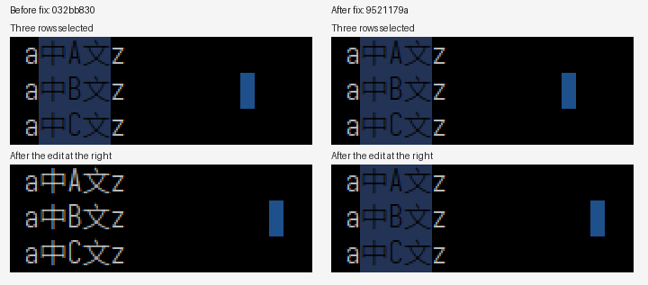

# 应用编辑选框旁边的文字后，还能不能复制？

可以。`9521179a` 修复了一个具体问题：鼠标框选了多行，程序仅在其中一行的选框旁边插入或删除字符时，原来的字仍在原位，但旧版会取消整块高亮。默认右键也因此交给子程序，本来要复制的操作变成了应用里的点击。

下面是 GDI 窗口的实际画面，局部按两倍放大。顶部都是同一段三行选区；底部是在中间一行的右侧插入两格后取得。右侧的小色块在两版里都移动了，说明采到了编辑后的画面。

| Windows 上的实际操作 | 旧 GDI / DirectX | 新 GDI / DirectX |
| --- | --- | --- |
| 默认右键：保留原文就复制，选中字被改动就把鼠标按下和松开交给应用 | 各 6/14 | 各 14/14 |
| 编辑后再次按 Ctrl+Shift+C：只复制，不向应用输入 | 未重复此项 | 各 4/4 |
| 配置为右键复制并粘贴：有选区时粘一次，无选区时转交点击 | 未重复此项 | 各 6/6 |

实际手势是应用接管鼠标时按 Ctrl+Shift+左键，从「中」的右半格拖到「文」的左半格，三行原文依次为 `中A文`、`中B文`、`中C文`。旧版在 8 种本应保留的场景中既丢了屏幕高亮，也没有重新写入系统剪贴板，而是将右键传给了应用。新版分别按每行实际显示的位置判断，包括从右向左排列的希伯来文字和双倍宽度行。切开宽字符、使选中的字重新排列、或只横移框内的一行，都仍会取消选区。右键粘贴以接收器读到的 UTF-8 字节衡量，逐一核对行分隔、最后的键盘标记和没有多发的鼠标事件；仅剪贴板里还留有旧文本不算通过。

- [修复前的 14 项，两种渲染器](https://github.com/xiongnemo/nemoterm/actions/runs/44714350665)：产品 `032bb830`，EXE SHA-256 `78d80809569f5f12a8b3651e5af4b3c7b83ceaf02ad7d9acf0026b3843422a64`。
- [新产品完整 CI 中的同一组检查](https://github.com/xiongnemo/nemoterm/actions/runs/44714993575)：产品 `9521179a`，EXE SHA-256 `ee317bc6b8218f6e4dfbe376cda6076b583fc835c6fdbb8d3697f492a0d97224`。这里的通过数只指矩形选区检查。
- [同一新 EXE 的三种操作](https://github.com/xiongnemo/nemoterm/actions/runs/44715874226)：每个渲染器 14+4+6 项。实际字体为 `SarasaTermSC Nerd Light`，每个测试进程自然退出。默认右键的重复回放不累加到旧版对比的分母。

[保留的原图和原始回执](rectangle-neighbour-edits.zip)收录六份 GitHub 制品的相关成员。`artifacts.json` 列出原始 ZIP 的编号、散列、夹具提交，以及原件在包内的 `sha256/` 索引；同一串字节只保存一次。`audits.json` 是另行从原始 PNG、剪贴板与子程序记录计算的逐项结果。下载原始 GitHub ZIP 后也能用 `python scripts/review-block-row-edits.py <gdi.zip> <directx.zip>` 复核；三种操作的回放加 `--bindings`。旧版本按设计返回非零，列出实测差异。
