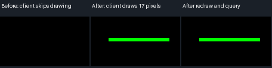

# 让应用在绘制前发现 ReGIS

以前，应用即使在 Nemoterm 上能画图，也可能根本不尝试：主设备属性（DA1）的功能列表只含 Sixel（4）和 ANSI 颜色（22），而 `CSI ? 3 ; 1 ; 0 S` 会回应 `CSI ? 3 ; 1 S`（未知项目）。[修复前的实际会话](regis-discovery-before-b7f4bfa.zip)来自 GitHub 托管 Windows 的 [44410983727](https://github.com/xiongnemo/nemoterm/actions/runs/44410983727)。GDI、DirectX、直接采集 GDI 桌面像素和请求 OpenGL（实际回退 GDI）四组都记录到同样的原始回复。客户端见不到 ReGIS 功能位，因此没有发送绘图指令。文件与 `b7f4bfa` 手测版的 SHA-256 一致。

[独立 XTerm 查询记录](regis-discovery-xterm.zip)来自 [44410985831](https://github.com/xiongnemo/nemoterm/actions/runs/44410985831)，制品 `14477336288`，SHA-256 `873bcd56b1dd5ab0fff77b39185632c6686459b9b94af369d276fd8646e3c839`。Ubuntu Runner 从先前保留的原始制品取出启用 ReGIS 的 XTerm 412，校验 SHA-256 后用两种画布大小分别运行。两个进程都声明功能位 3 和 4；读几何尺寸分别返回 160×120 和 800×480。项目 3 的设置、重置、读最大值均返回状态 3，未知操作返回状态 2。原来的无 ReGIS 构建仍是其他图形项目的对照。Nemoterm 保留自己的终端型号和其他功能位，不伪装成具有 XTerm 的全部选件。

`6ee2996` 的查询直接读取绘图使用的页面尺寸；终端窗口的行列数、字体像素和 Sixel 图像上限是独立的。原生窗口验收中，客户端只有先读到 ReGIS、Sixel 和有效画布才会继续：它按返回尺寸计算起点，画一条 17 像素绿线，核对位置应答，再重绘并查询，检查颜色和坐标是否仍然正确。

[完整 CI](https://github.com/xiongnemo/nemoterm/actions/runs/44411510449)构建的 Windows 单 EXE 来自制品 `14477886358`，长 4,869,120 字节，SHA-256 `3785ec282c588ee7277a916323223a9334ee93ecb07cf642721b2215d898e225`。[四组原生窗口回放](regis-discovery-after-6ee2996.zip)每组都完成了三个阶段：`CSI ? 62 ; 3 ; 4 ; 22 c`，随后 `CSI ? 3 ; 0 ; 800 ; 480 S`；在 (100,60) 到 (116,60) 画出 17 个绿色像素，收到 `[116,60]` 加 CR；重绘并尝试设置/重置后，画面和返回的尺寸均保持。实际渲染为 GDI、DirectX、直接采集桌面的 GDI，以及回退到 GDI 的 OpenGL 请求。以下两张新图来自同一实际 DirectX 窗口，原图按整数倍最近邻放大。

[三个编译器的逐帧结果和终端输入记录](regis-discovery-components-6ee2996.zip)保留整段和逐字节输入。GCC、Clang 和 MSVC 的新功能查询均与 XTerm 的 ReGIS、Sixel 功能位及完整 160×120 画布应答相符，功能查询帧都是 0 个不同像素；未分配解码器时的内存计数和解码器指针均为空。之前不参与逐帧对照的这一个场景现在单列比较功能位和几何，保留两种终端各自完整的 DA1 型号和原始应答。原来的五个像素失败不变。[更新后的 132 帧重绘分析](regis-discovery-after-repaint.json)仍为原始呈现对照 127/132、独立重绘对照 130/132，每种输入方式各一次。

[REA 的原始 PE 导入记录](rea-6ee2996-imports.json.gz)按 DLL 名、函数名和序号对照上一版，普通 81 个 DLL 描述符 / 669 项函数、延迟加载 ICU 的 1 个描述符 / 11 项函数均相同，没有增加新的静态依赖。[选区组](selection-receipt-6ee2996.zip)中六项全部通过；[关闭确认回放](profile-close-6ee2996.zip)在标签、整个多标签窗口和独立窗口中分别验过鼠标 Cancel 和 Esc 后的立即输入。上述结果均对应同一 EXE，不代表整体回归已通过。

[真实客户端输入回执](agents-receipt-6ee2996.zip)这次为 30/30（制品 `14478920699`），包括 Codex、Claude Code、OpenCode 的选区与快捷键，以及 Codex 启动期/就绪期贴图。一次启动期成功不能改变已证实的时序限制。[默认网格混排回执](agents-grid-receipt-6ee2996.zip)为 6/8（`14478395765`）；未通过的仍是默认 Claude 的 GDI 和 DirectX 两种渲染，显式保留应用字序的 profile 两组均通过。 从原始制品 `14478670630` 按各自回执的 SHA-256 读取[八份实际字形、物理拖选、剪贴板和服务端请求](agent-glyph-receipts-6ee2996.json)。八个窗口均从右往左拖选两个字符，快捷键复制与高亮一致，每个客户端均只提交一次与复制文本匹配的请求，没有图片。六个窗口为 `Aגְ`，默认 Claude 的两个窗口为 `Aא`。

[同机十次 Codex 冷启动](pterm-paired-6ee2996.zip)使用这一份产品及与本机 Scoop 同哈希的 pterm 0.85（run `44413042565`、制品 `14479600313`）。在相同 160×48 网格和 Sarasa Light 字体下，收到回环回复后，两次前端私有工作集中位数：pterm **3.78–3.79 MB**、Nemoterm 单标签 GDI **5.04–5.10 MB**、单标签 DirectX **9.68–9.71 MB**。这是稳定窗口，不是压力负载峰值。对应总工作集分别为 21.84–22.61、33.07–33.99 和 44.60–44.63 MB；前端模块与受测作业内的进程未命中所查 WebView 名称。

Sarasa Light、160×48 字符的[六项 GDI 压力负载](memory-gdi-6ee2996.zip)与[六项 DirectX 压力负载](memory-directx-6ee2996.zip)全部通过。下表列出各自私有工作集最高的那项（Unicode 混排与 Kitty 图片同屏），三项均为该前端整个采样过程各自的峰值，并非保证发生在同一瞬间。子进程另计。

| 前端 | 私有工作集 | 总工作集 | 私有提交量 |
| --- | ---: | ---: | ---: |
| GDI | 18,837,504 B | 53,542,912 B | 22,097,920 B |
| DirectX | 28,864,512 B | 74,141,696 B | 32,747,520 B |

[完整交互汇总](interaction-rollup-6ee2996.zip)（制品 `14477609422`）从相同文件哈希的 78 个用例核验了 **76 项**。两项未通过均为上述默认 Claude 的原文字序；选区、鼠标、输入、剪贴板、窗口、设置、内存等其他组通过。完整 CI 还包含 XTerm 的历史图形对照；不能用 76/78 代替整个工作流结果。

## 重绘与原始画面的差别

[修复前单独的逐帧核对](regis-discovery-before-repaint.json)读取 MSVC 制品 `14474178116` 的实际 RGB 哈希及差异 PNG，仅在原始参考裁剪哈希与已记录的实际 RGB 哈希相等时才用参考像素重建无差异帧。用[比对脚本](../scripts/compare-regis-repaint-evidence.py)将相同输入按步骤对齐，并验证两份 XTerm 参考的回复字节一致；每个产品图像又与原始 RGB 哈希校验。这里只比较已保存的像素，不模拟桌面重绘。在 131 帧 × 两种分包方式中，5 帧与旧的首次显示不同：向上滚动、两次向下滚动、换行滚动和共享调色板改色。这 **5 帧均与另一份 XTerm 的强制重绘图像一致**。相反，`erase-line` 第 1、2 步均与最初画面相同，却各与强制重绘图相差 101 像素：Nemoterm 擦掉的线在 XTerm 重绘时重新出现。每种分包分别是原始对照 **126/131**、重绘对照 **129/131**。两套参考的呈现历史不同；原始失败保留。
