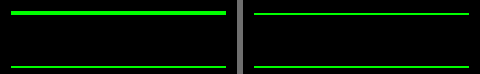

# ReGIS at the scrollback limit

With one saved line, scrolling a 40×12 window up three rows and then back down used to bring discarded image pixels back into view. To distinguish over-retention from clearing too much, the fixture draws adjacent 101-pixel green lines immediately above and below the cutoff, and a third line further down. A DSR response from the child separates each action from its pixel observation. The runner uses SarasaTermSC Nerd Light at 8×20 pixels per cell.

| Graphic source scanline | Before (`4c3bc30`) | After (`85fe9b1`) |
| --- | ---: | ---: |
| 39, last evicted pixel row | 101 green pixels | 0 |
| 40, first retained pixel row | 101 | 101 |
| 65, stays visible while scrolling | 101 | 101 |

The before/after crops are from the original DirectX BMPs, enlarged 3× with nearest-neighbour sampling. All four [baseline jobs](https://github.com/xiongnemo/nemoterm/actions/runs/44235499177) passed the original 59 checks, then failed the new third check with 303 green pixels rather than 202. In the [fix run](https://github.com/xiongnemo/nemoterm/actions/runs/44236147822), each job passed the same 59 checks and **all 12 bounded-history checks**. Writing new ink into the expired band and scrolling again discards it again; shrinking the window by three rows and growing it restores only the permitted history. Repaint preserves the result. Actual GDI, DirectX and the directly presented GDI window were captured. The OpenGL request fell back to GDI. These are fixed-width single-window cases.

The terminal clips main-screen graphics only above the retained text history. Fully discarded sparse tile rows are released; a partial row clears only the newly discarded scanlines. Draws into a previously trimmed band make those scanlines eligible for trimming again. A uniform background can be cropped without allocating tiles. The terminal-core tests also check the zero-history case, memory release after lowering the limit and preservation of alternate-screen pixels while trimming the main screen.

The [component comparison](https://github.com/xiongnemo/nemoterm/actions/runs/44236148036) remains **failed**. GCC, Clang and MSVC all passed the terminal framing tests, the 70-frame comparison and the five full-repaint palette frames. In each compiler's whole and bytewise 131-frame comparisons, the same ten historical frames differ: one alternate-screen frame, four scroll frames and five shared Sixel/ReGIS palette frames. They remain visible in the original records.

Source-host artifact `14397786086` contains the 4,853,760-byte single executable, SHA-256 `2a0a82cc2357ee8184cddc21d8610a49bccc9855711b09318c82daef87ca6688`. [Evidence archive](regis-history-limit-evidence.zip), SHA-256 `c5e446ddaa24c54f46dc4cdf5a1db79dc76377a8183469e8ae6fc905b67a7946`: the eight unmodified window artifacts (including the original failures), source receipt, component observation JSON and selected logs, workflow/job/artifact metadata, and a per-entry manifest. The archive does not include a duplicate executable. No memory or full-product claim is inferred from the pixel tests.
