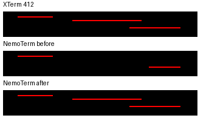

# 横向编辑文字后，ReGIS 图形不能被永久擦掉

在两行 ASCII 文字上画红线，让应用在设有左右边界的区域内编辑文字，再强制窗口重绘。旧版 `226ddd98` 的文字移到了正确位置，但红线缺了几段，再重绘也回不来。修复版 `f20a27da` 将单元格附带的栅格图像与独立的 ReGIS 页分开处理。插删文字时不再把 ReGIS 页的一段当作废弃文字永久清除。明确的擦除命令仍走原来的路径。

下图是插入三个字符后、强制重绘的同一小块窗口，原始像素按整数倍放大。中间的旧版丢掉了红线的一段；顶部原版 XTerm 和底部修复版相符。

| 操作 | 旧版重绘后缺少的像素 | 修复版重绘后的像素差 | 修复版强制重绘前与 XTerm 的像素差 |
| --- | ---: | ---: | ---: |
| 空操作 | 0 | 0 | 0 |
| ICH / DCH（插入 / 删除字符） | 73 / 73 | 0 / 0 | 40 / 59 |
| SL / SR（向左 / 右滚动） | 17 / 40 | 0 / 0 | 147 / 147 |
| DECIC / DECDC（插入 / 删除列） | 40 / 18 | 0 / 0 | 130 / 130 |
| DECBI / DECFI（在边界后退 / 前进） | 6 / 6 | 0 / 0 | 147 / 147 |

表内数字是每次独立窗口回放、160×120 检查区域里的差异；GDI、DirectX 分别整段或逐字节写入，四组计数完全相同。修复版在 36/36 个窗口中的重绘画面均逐像素相等（旧版 4/36，只有空操作相等）。每项分别在编辑前后查询 14 个位置；两版的文字应答都逐字节相同。窗口带有两条绿色对照线，另用两格交换红绿验证所采表面确实在更新。两版每组九个进程均自然退出。

**严格参考对照仍报告失败。** 原版 XTerm 自然显示的中间画面随操作发生变化：插删字符时一部分红色像素移到别处，滚动和插删列时一部分红线暂时消失。向 X11 客户区发出完整 Expose 后，原有红线全部回到原处，同时文字维持编辑结果。修复版立即显示完整的图形，因此在八种编辑的重绘前仍有上述差异；没有跳过这些帧，也没有用重绘后的参考帧替换它们。

- [XTerm 412 原始采集](https://github.com/xiongnemo/nemoterm/actions/runs/44691719953)；[重放输入、应答和逐帧参考](../testdata/upstream/regis-text-motion-xterm.zip)。首次未开启 GetChecksum 的[失败运行](https://github.com/xiongnemo/nemoterm/actions/runs/44691360396)没有取得文字回执，不作为文字移动的证据。
- [旧版确切单文件的四组回放](https://github.com/xiongnemo/nemoterm/actions/runs/44692169465)，SHA-256 `bd8cf49fe772b29d9a22789c330ce57693d3a088e192532225af4d2f5f09e934`。
- [修复版全量运行中的四组回放](https://github.com/xiongnemo/nemoterm/actions/runs/44692457263)，SHA-256 `3edfab2cd2a9eef007a2bdfaf7991390ce46f979b1ea69c7df4545dc6d0da86c`。
- [两版的文字回执、窗口表面、原始 PNG、产物编号与 SHA-256](regis-horizontal-evidence.zip)。本项只验证横向文字编辑与 ReGIS 共存，不代表其他控制序列或全部交互已通过。
