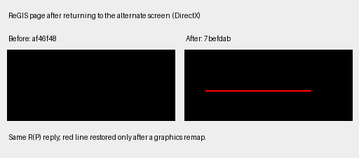

# Six historical ReGIS frame differences on `6cf4387`

The original comparison is still failed. Using only saved images, we compared its MSVC component render to a second pinned XTerm run that recorded both the presented window and an explicit full repaint after every step. Input bytes through each named step matched. Repainting between steps changes the reference's history; it cannot replace the original reference or prove the cause of a difference. Pixel counts below cover the 160×120 crop. Whole and bytewise transports returned the same counts.

| Scene and zero-based step | Original presented frame | Second run, presented frame | Second run, full repaint |
| --- | ---: | ---: | ---: |
| Alternate screen re-entry, 3 | 101 | 101 | 101 |
| Scroll up, 2 | 101 | 101 | 0 |
| Scroll down, 1 | 101 | 101 | 404 |
| Scroll down, 2 | 303 | 202 | 202 |
| Newline scroll, 2 | 202 | 202 | 0 |
| Shared ReGIS palette, 1 | 600 | 600 | 0 |

The alternate screen case re-enters with `CSI ? 1049 h` and immediately issues ReGIS `R(P)`. The reply matches (`[120,80]` followed by CR). At y=80, x=20..120, both XTerm captures show a red line (`204,33,33`) while the product component is black. The two reverse-scroll steps also differ after a repaint. For example, just after `CSI 3 T`, the two XTerm green lines in the repaint are at y=20 and 80; in the component their visible counterparts are at 59 and 119. These are concrete remaining differences; treating all six as stale pixels would hide them.

[Component crops, original observations and comparison data](regis-six-frames-6cf4387.zip), sourced from MSVC artifact `14427812800` (archive SHA-256 `f145cf51f0a7585981f2d5dee281e687f39b05799b48b5668c0192b5454a7eec`), [original pinned XTerm images](regis-reference-evidence.zip) and [the separate repaint capture](regis-repaint-reference.zip). This comparison uses the retained component compositor, not screenshots from the single-file Windows frontend.

The [unchanged comparison reports for the `a985632` candidate](regis-comparison-a985632.zip) retain the same six mismatching view frames in both transports. The separate default private-Sixel reports retain the `identity-st` and `overwrite-st` failures. These are unaltered observation members from MSVC artifact `14432142798`; the original archive identity is in `source.json`. The 1047 fix addresses repeated entry of a populated bank. It does not resolve the 1049-plus-ReGIS-query frame listed above.

A split-screen replay separated the ordinary cursor report (`CSI 6 n`) from the ReGIS position report (`R(P)`). On [stock XTerm 412](regis-remap-xterm-149623c.zip) (run `44321120500`), a bare 1049 re-entry was blank in both cases. After requesting the page on that screen, the 101 red pixels returned **only** when the main screen had run a ReGIS query. Explicit `ED 2` then removed all 101 and another query did not resurrect them. Both transports agreed, before and after Expose; the collector's 98 scenes passed its controls. XTerm kept the main graphic invisible until a ReGIS command remapped it; Nemoterm has a separate guarantee to preserve its main display on return.

In the [unchanged `af46f48` native replay](regis-remap-before-af46f48.zip) (run `44321285732`), the cursor-report control passed, but the graphics-report case returned the correct `[120,80]` position with **zero** red pixels at the remap. Each artifact contains observations of the two branches, including the failures. The archive index identifies the original downloads. XTerm's mapper hides the previous destination/display on an actual graphics command, and its character-area clearing code skips hidden graphics. A bare bank switch is insufficient to infer that a previously displayed graphic may be deleted.

On the single Windows executable `7befdab` (4,860,416 bytes, SHA-256 `df7e15c753ce20e6ee669eb80c1c7a99fae5421786a9760e2d5bd6bcc5c279bb`), both query branches now pass all 11 native steps each. Actual GDI and DirectX, and separately the presented GDI client, recovered exactly 101 red pixels after the graphics query, none after the cursor query, and none after explicitly erasing the active page. The requested-OpenGL job used GDI fallback. The existing 104 primary geometry and 12 scrollback checks passed in all four jobs. With GCC, Clang and MSVC, both whole and bytewise comparisons of the original `alternate-page-ownership` scene now match every reply and pixel. The unchanged reference still has **five** failing frames (scroll-up step 2, scroll-down steps 1 and 2, newline-scroll step 2, and shared-palette recolour step 1). [Original observations and hashes for the native and component jobs](regis-remap-after-7befdab.zip), run `44322938841`.

[Independent scroll-origin comparison](regis-scroll-origin-xterm.zip), run `44323997088`, separated actual text movement from graphic movement. In the 6×13 reference font, two rows down (`CSI 2 T`, insert two lines, or two reverse indexes at home) moved the white text markers down 26 pixels. After Expose the two green lines still occupied y=20 and 80, both before and after the ReGIS query; a new red line appeared at y=50. In the up-scroll control the lower green line moved to y=54, then disappeared after a ReGIS remap and Expose. The **reference run failed** its transport gate: after the two reverse indexes, whole and bytewise input produced different *initially presented* pixels at step 1, with matching original bytes, replies, and full repaints on that step and identical results on the other three steps. All 103 scenes ran, with no failed independent controls. This is evidence about stored geometry versus presentation, not a replacement golden or a passing Nemoterm scroll test.
