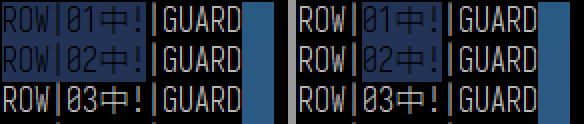
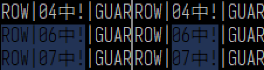

# 应用有新输出时，能否留在正在阅读的历史行？

终端原来只认本地 profile 上的两个滚动开关。即使应用明确请求“新输出时留在历史里，真正键入时回到提示符”，`b3274ed` 仍按旧设置处理。新实现把 `CSI ? 1010 h/l` 接到“输出时回到底部”，把 `CSI ? 1011 h/l` 接到“键入时回到底部”。两项独立，可用 `CSI ? Ps $ p` 查询，用 `CSI ? Ps s/r` 保存和恢复。它们只改变这个终端的运行状态，不写入 profile，也不改变别的标签。

[固定的 XTerm 412](../testdata/upstream/xterm412-scrollback-modes.zip)在四种启动设置中给出了 72 段应答。首次保存之前恢复，两个模式都是关闭；备用屏切换、软重置和硬重置保留运行中的设置。这些行为取自原始回复。Nemoterm 打开窗口时仍读取用户选的两项初值；本地重新配置时，改变哪一项，就更新哪一项，应用对另一项的覆盖保留。

在 [GitHub Windows 对旧 EXE 的回放](https://github.com/xiongnemo/nemoterm/actions/runs/44552352165)中，GDI 和 DirectX 各有 72/72 段回复与 XTerm 不同；32 项实际滚动中，各有 16 项不符合应用要求。测试在历史顶部让子程序输出一个可见字符，或让 Windows 输入一个数字，直接读取原生滚动条位置。旧版只在 profile 恰好与应用要求相同时表现一致。[两份未修改的原始制品](scrollback-modes-before-b3274ed.zip)。

首个实现 `d0f1b12b` 在两种渲染器均通过 72 段应答及 32 项窗口行为，但是已有的固定存储检查发现模式表从 112 字节涨到了 120 字节。`a29abfa6` 改用 30 个有符号 16 位槽，共 60 字节，足以保存鼠标模式 -1 以及最大编码 1016；原有空间上限和精确新大小均检查。[首版窗口回执、失败日志及修正后完整 sanitizer 日志](scrollback-modes-storage.zip)。这些字节是每个终端的模式表，并非进程工作集测量。

修正版 `a29abfa6` 在[同一份 EXE 的 GitHub Windows 回放](https://github.com/xiongnemo/nemoterm/actions/runs/44553596113)中，GDI、DirectX 各通过 **72/72 段应答、32/32 项窗口滚动**。应用已接管鼠标时，两种渲染器也都成功在 Shift 拖选期间接收新输出：历史位置保持在第 0 行，复制得到 `HISTORY 03 中`；真正键入 `7` 后才回到底部第 49 行。子进程只收到状态回复和一个 `7`。这两组共十个终端进程组均自行退出。[两份原始制品和 EXE 摘要](scrollback-modes-after-a29abfa.zip)。

### 滚动历史已满时的矩形高亮

历史区有 32 行并且已满。应用接管鼠标后，用实体 Ctrl+Shift+左键在最早的三行各选中第 5 到第 9 列（从 1 数起），其中包含宽字 `中`。按 Ctrl+Shift+C 后，剪贴板是 `00中!`、`01中!`、`02中!` 三行。随后子程序逐行输出，让这三行依次从历史中消失。测试采集实际渲染器的窗口像素：选区外的独立色块标识当前行号，选区背景色标识哪些列真的高亮。

[修复前的托管窗口回放](https://github.com/xiongnemo/nemoterm/actions/runs/44556452166)：`a29abfa6` 的 GDI 和 DirectX 都在第一行被挤出后把剩余两行的高亮向左扩大了四列；再挤出一行，最后一行仍多亮四列。剪贴板里已经复制的原文没有变化。产品把矩形的左边界按普通跨行文本处理，错误地重设成第 1 列。[两个渲染器的原始截图及逐行记录](selection-eviction-before-a29abfa.zip)。

`97f8b05b` 按矩形选区剩余的行裁剪高亮，保留列边界；最后一行离开时才清除高亮，不改动已复制的文字。[修复后的两份原始制品](selection-eviction-after-97f8b05b.zip)在 GDI、DirectX 各有七张窗口截图。在四次追加后，两种渲染器分别显示两行、一行、零行、零行的五列选区；剪贴板始终保留原来三行。这份 EXE 的 72 段 XTerm 应答、32 个滚动位置及按住 Shift 复制中文的检查也分别通过。独立组件用向上与向下滚动、正向与反向框选四种组合检查裁剪。

图为同一时点的两张实际 GDI 窗口截图，均按同一位置裁切并等比放大。原始包也收录该 EXE 的 REA 静态导入记录：普通和延迟导入 DLL、函数名与序号和测试版 `b3274ed` 一致。动态加载和实际内存需另行观测。

### 矩形跨过 TUI 的滚动区域

固定八行，每行有行号、宽字 `中` 和选区外的色标。应用接管鼠标，只滚动第 3 至第 6 行；其余行留在原处。用 Ctrl+Shift+左键框选第 5 至第 9 列后，先按 Ctrl+Shift+C，再让应用滚动。测试先从不参与高亮的色标认出每一行，再检查窗口哪些列真的高亮，并保留复制的数据和前台子进程收到的字节。

- [旧版 `476a2c76` 的 24 组原始窗口记录](selection-region-before-476a2c76.zip)：每种渲染器有 8/12 个结果不同。例如框选第 6–8 行后将中间窗口向下滚动一行，第 7、8 行仍在原处，但高亮从原来的第 5 列扩到第 1 列；相反方向还会使应该保留的两行完全失去高亮。
- `fae009ea` 按整条滚动命令移动原先选中的行。如果剩余字符仍构成矩形，就保留原列宽；如果它们分成两段，就清除高亮，不把空行或别的文字连进选区。[两种渲染器各 12/12](https://github.com/xiongnemo/nemoterm/actions/runs/44569781887)。滚动本身不改系统剪贴板。
- [同一中间版本的右键原件](selection-region-recopy-fae009ea.zip)暴露出第二个问题：只剩 `00中!` 和 `01中!` 高亮时，显式右键复制却仍带上已消失的 `02中!`。开启“复制并粘贴”时，子进程确实收到了额外的第三行。默认模式没有向子进程发送粘贴内容；选区一旦分裂并清除，下一次右键正确地成为 SGR 鼠标按下与松开。此附加回放的[第一次尝试](https://github.com/xiongnemo/nemoterm/actions/runs/44570482487/attempts/1)发生在制品发布前，未运行受测 EXE；这里使用的是同一工作流的第二次尝试。

`42232a2d` 在下一次明确复制时重新读取仍然高亮的文字。单纯滚动不会覆盖已经复制到剪贴板的三行；再按 Ctrl+Shift+C 或右键时，剪贴板才变为剩下的两行。选择“复制并粘贴”时，子进程也只收到这两行。[同一份 EXE 的两组原始制品](selection-region-after-42232a2d.zip)覆盖 **46/46**：每种渲染器 12 个滚动场景、4 个默认右键、4 个右键复制并粘贴、3 个键盘复制。窗口像素、剪贴板和子进程收到的字节分别核对。选区被滚动分成两段时会清除，之后应用照常收到右键。EXE 的 SHA-256 为 `f6e2acd5d51db02e3ff0095e65da72c13e38d4f1ea1f12c7c55ba3eb8efb874d`。

两边均取自 GitHub 托管 GDI 窗口截图，裁取第 6–8 行并放大两倍。DirectX 的原始截图也在制品内。
