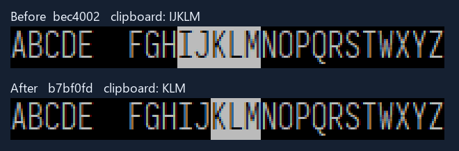

# 按住鼠标时，应用在同一行插入或删除字符

按住 Shift，在 `K` 上按下鼠标左键。此时应用在它左侧插入两格，再把鼠标拖到 `M` 松开：应高亮并复制 `KLM`。旧版 `bec4002` 仍从屏幕原来的位置开始，复制成 `IJKLM`。如果应用删掉的恰好是按住的字，旧版还会复制补到那个位置的文字。

`b7bf0fd` 跟踪被按住的字。字移动时，它仍是选区的起点；字被删除、挤出边界或宽字被截断时，松手不会选中补位的字。应用开启鼠标跟踪时，取消这次选择后的下一个右键仍能回到应用。这个修改不增加每格或每个窗口的持久存储。

| 同一套 Windows 桌面交互 | `bec4002` | `b7bf0fd` |
| --- | ---: | ---: |
| GDI / DirectX × Sarasa / profile 默认字体，每种 15 项窗口消息 | 8/60 | 60/60 |
| GitHub Windows 桌面实际键鼠输入，每种渲染器 3 项 | 0/6 | 6/6 |

测试同时核对高亮像素、右键与快捷键复制的文本、以及应用收到的原始鼠标字节。覆盖普通和矩形选区、插入模式、横向滚动、组合字符、双宽字和双向文本。表内是新增的 66 项断言组合，不是整个项目的通过率。[旧版原始截图与回执](selection-column-before-bec4002.zip) · [新版原始截图与回执](selection-column-after-b7bf0fd.zip)。新版与旧版分别取自 [完整 CI](https://github.com/xiongnemo/nemoterm/actions/runs/44496986357) 与 [同一测试在旧 EXE 上的回放](https://github.com/xiongnemo/nemoterm/actions/runs/44496779434)。

另一个测试只比较字符内容：同一份输入分别送入独立构建的 XTerm 412 和两个 Windows EXE，在 28 个场景中每次查询 26 个单元格；不借用 XTerm 的鼠标策略判断 Windows 选择是否正确。旧版匹配 **724/728** 个单元格，新版 **725/728**。修复的是插入字符时边界留下半个 `中` 的情况。剩下三个差异均为同一位置：`DCH`、`DECDC` 或 `SL` 向左移动两格后，第 20 列在 XTerm 是空格 (`0x20`)，Nemoterm 是 `V` (`0x56`)。两版都如此，这三项对照仍判为失败。

[独立 XTerm 原始应答](selection-column-xterm.zip) · [旧 EXE 对照](column-cells-bec4002.zip) · [新 EXE 对照](column-cells-b7bf0fd.zip)。新版 EXE 为 4,856,320 字节，SHA-256 `30de4cef81033fb47cc1dffce629bf7cfa22542f53dd5d158874efe51b6c44e9`；旧版为 4,872,192 字节，SHA-256 `9f43a0ddc23219f3ac3974fee73b3b6f8de8f45c63adf3e668d7eef99984275e`。
