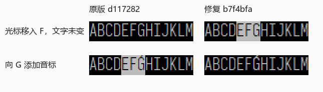

# 应用更新光标时保留可复制的选区

用 Shift 选中 `ABCDEFGHIJKLM` 里的 `EFG`，随后让子程序发送一段光标控制或文字。鼠标报告开启，右键设置保持默认「仅复制」。在每个更新之后，读取实际画面的选区、系统剪贴板的更新与内容，并用终端状态应答夹住应用收到的原始右键字节。只有高亮仍在、右键复制 `EFG` 并且没有向应用发送鼠标字节时，才记作仍可复制。改写已选字形则反过来，不能继续显示旧选区。

[修复前的 Windows 窗口、截图与输入字节](selection-cursor-before-d117282.zip)来自 run `44403831001`，制品 `14474132894`（SHA-256 `631e76afee95b58a725e7c40a4593c1bd7c513963d7d96ad3aebee80e8374d2f`）。产品 `d117282` / `77ddf8170adcacc4e023da250049ad4dff29f964960393be1153126df2cd80aa`，测试 `af15be0`。四个窗口（GDI、DirectX × Sarasa Light 8×20、原默认字体 9×16）均为 **3/8**。每种配置都出现以下结果：

| 子程序的操作 | 正确的选区行为 | 原版结果 |
| --- | --- | --- |
| `CUP` 将光标移到 `F`、`HT` 或 `CHT` 跨过选区 | 仍能复制 | 高亮消失；应用收到了右键按下和松开 |
| `CBT` 向左跨过选区 | 仍能复制 | 通过 |
| 改写 `D`，光标自然前进到 `E` | 仍能复制 | 高亮消失；应用收到了右键 |
| 改写 `F`，或从 `D` 开始输出占两格的「中」 | 取消旧选区 | 通过 |
| 光标在 `G` 之后，输出组合音标 U+0301 | 取消旧选区 | 仍然高亮；右键错误地复制了旧的 `EFG` |

修复 `b7f4bfa` 将失效判断放在写入、拆开双宽字或添加音标的实际位置。纯光标定位不动选区。字符复制缓存与右键策略不变；没有增加字符格、历史行或终端实例的存储。终端核心测试同时覆盖流式和矩形选择。

[修复后同一组远程窗口](selection-cursor-after-b7f4bfa.zip)来自 `44404296808`、制品 `14473449193`，原始 ZIP 的 SHA-256 为 `286f43b7dbab4e0151694dd9093f194a7cae358528f58f2a2f9f730b839a6d3f`。四个窗口各 **8/8**，整组 **32/32**，原来的拖选、快捷键和绑定试验也通过。下图是同一 GDI/Sarasa 格子按整数倍放大的原始截图，上行应用只移动光标，下行修改最后一个选中的字形。

[这个 Windows 单文件](https://github.com/xiongnemo/nemoterm/actions/runs/44404296808/artifacts/14474875134)为 4,868,608 字节，SHA-256 `c8c3ccc3a5064faf0234687bdb0aaa1ba295b67f2d17f331757dc4f46638cec2`。在[同文件的 profile 与关闭确认回放](profile-close-b7f4bfa.zip)中，关闭标签、整窗和独立窗口，点 Cancel 和按 Esc 后都能立即接着输入，三个子进程各收到 `abc`。原始制品 `14474658273`，SHA-256 `05f9bace252194086928f34cb5c5aca9b6f3161cf294c46eb0466529df33d036`。

应用兼容性也用同一份 `c8c3ccc3…` 单文件复测：[真实 WSL Vim](wsl-vim-b7f4bfa.zip) 在 `TERM=xterm`、`TERM=xterm-256color` × GDI、DirectX 四个窗口通过；[terminfo 颜色](wsl-colour-b7f4bfa.zip) 在两种渲染器上检查 `xterm`、`xterm-256color`、`xterm-direct`；[实际 WSL Sixel](wsl-sixel-b7f4bfa.zip) 在两种渲染器上分别检查显示、重绘和清除。[原始 Unicode 边界报告](unicode-boundary-b7f4bfa.zip)为 3/4：产品 GDI、DirectX 和系统 ConPTY/Claude 通过；独立 winpty/Claude 对照未能在原定时限内显示正常视图的回复，发送两次 Ctrl+C 后等待退出 18 秒超时。没有把诊断中后续出现的回复改计为通过。

[此版本的真实客户端输入记录](agents-receipts-b7f4bfa.zip)是 28/30：Codex 的两种启动期贴图失败，编辑器就绪后的两种均通过。[160×48 逐窗口记录](agents-grid-receipts-b7f4bfa.zip)是 6/8：所有窗口都实际从画面反向拖选、写入剪贴板并向回环服务器提交了一份与高亮一致的文本；默认 Claude Code 的两种渲染器和提供给它的原文预期字序不同。显式保留应用字序的 Claude、默认 Codex 和 OpenCode 均通过原文与屏幕字形逐项对照。没有用独立的终端输入测试替代真实客户端提交。

在同一个 `b7f4bfa` 前端，Sarasa Light、160×48 的[六项 GDI](memory-gdi-b7f4bfa.zip)和[六项 DirectX](memory-directx-b7f4bfa.zip)压力负载均通过。两种渲染器的峰值都出现在 Unicode 与 Kitty 图片混合负载。GDI 最高私有工作集 19,095,552 B、总工作集 55,820,288 B、私有提交 22,577,152 B；DirectX 分别为 29,130,752 B、74,354,688 B、32,837,632 B。20/30 MB 门槛按私有工作集判定，不把总工作集或私有提交和它混用。

[完整交互汇总](interaction-rollup-b7f4bfa.zip)（run `44404296808`，制品 `14476521053`）对同一文件验出 **74/78**，四个失败是上述两项 Codex 启动贴图与两项默认 Claude 字序。[加强核验后的单组选区回放](selection-verified-rollup-b7f4bfa.zip)（run `44407058129`，测试 `c00763d`，制品 `14476411166`）为 **6/6**；四个图形窗口在汇总中各有 **8** 项逐条核验的光标更新。汇总从对应测试产物按哈希读取真实记录，复核左、右相邻字符、选区背景、剪贴板及应用输入。这个 6/6 不替代完整 74/78，也不覆盖单独的 ReGIS 原版画面对照。
