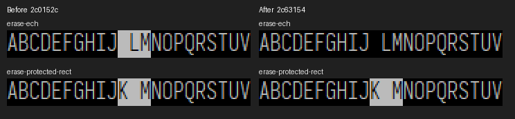

# 应用擦字时，Shift 鼠标选区是否还指向按住的字

按住 `K`，让应用通过 `CSI X` 擦掉它，再向右拖到 `M` 并松手。旧版把替代 `K` 的空格连同 `LM` 高亮，右键会把 ` LM` 写进剪贴板。这是终端前端的选择错误，与客户端是否支持图片粘贴无关。

[旧版回放](https://github.com/xiongnemo/nemoterm/actions/runs/44510106666)使用 `2c0152c` 的原始 EXE（SHA-256 `79e504be64bfc37c2fdfaa79ae179b9a5e9da4ca08ebae29cc8782e3a28ec663`），测试提交 `1125707`。[原始 GitHub 制品 14522582225](selection-erase-before-2c0152c.zip)，ZIP SHA-256 `cd6361684b657b845b56e44ded29789139269c6efeb004fe03da07952ef2f783`。四个窗口分别用 GDI 或 DirectX、Sarasa Light 标签页或干净 profile 的独立窗口；均开启应用鼠标跟踪。按下、应用输出、松手、右键分别有子进程应答。观测包括最终高亮的字格、剪贴板是否被改写，以及子进程收到的原始鼠标事件。

- 旧版四个窗口中，每个都只有 5/12 项擦除检查通过。7 个失败是 ECH、EL、ED、DECERA、DECSEL、DECSERA 擦到按住的字，以及从宽字符的另一半开始擦除。EL 的实际复制结果是 `IJ` 后跟 CRLF；擦宽字符的结果以两个空格开头，后跟邻格的文字。两种渲染器实际按键和鼠标也重现了 ECH 误复制。
- 原本正确的行为也需要保留：擦掉 `K` 右边的 `L` 还能选择 `K M`；选择性擦除跨过受保护的 `K` 时仍能起选；原来就是普通空格的按下点，以及另一行上的按下点也应继续有效。

`2c63154` 在分割宽字或改写格子之前，把待选的屏幕位置映射到原字。擦掉原字时取消这次手势；受保护、普通空格或未被覆盖的字则重新定位。滚入回滚区仍沿用已有的滚屏处理。没有增加每字符或每窗口的常驻字段。

| 同样的输入与检查 | `2c0152c` | `2c63154` |
| --- | ---: | ---: |
| 窗口消息（12 例 × 两种渲染器 × 两种字体配置） | 20/48 | 48/48 |
| Windows 实际鼠标与按键（擦掉原字和保留受保护字 × 两种渲染器） | 2/4 | 4/4 |

[新版原始 GitHub 制品 14523597100](selection-erase-after-2c63154.zip)，ZIP SHA-256 `96d746ab07f6878670aca2b490a0d428ccbe79c5e09fde24be460be444f786b8`。连同此前的插删列和重画场景，这批相同版本的记录共有 160/160 项窗口消息检查及 14/14 项实按检查通过。可用 `scripts/compare-held-erase-evidence.py` 对两份下载的 ZIP 单独复核 52 个擦除手势的原始按键、剪贴板和高亮格，并重建上图。

[新版 160×48 真实客户端记录](selection-erase-agent-grid-2c63154.zip)：Codex、OpenCode、Claude Code 在 GDI／DirectX 的 10 个默认网格选择、复制与提交场景全部通过。这批现有的客户端场景与上面的擦除手势单独计数。

[新版 pterm 对照的原始记录](selection-erase-pterm-2c63154.zip)（[工作流](https://github.com/xiongnemo/nemoterm/actions/runs/44511307454)）为 10/10。相同的 Codex、160×48、SarasaTermSC Nerd Light，收到首轮回复后的前端私有工作集中位数（两轮、十进制 MB）：pterm **3.740–3.777**，单标签 GDI **5.370–5.415**，单标签 DirectX **9.974–10.015**。相应总工作集：**21.869–22.671**、**35.770–36.676**、**47.239–47.276**。这些是稳定窗口，不是压力峰值。

[新版严格 XTerm 宽字对照及字符完整性检查](column-edge-2c63154.zip)：与[上一版原始数据](column-edge-2c0152c.zip)相比，两个 JSON 的观测字段完全一致，只有 EXE 哈希不同。独立的 1,872 格完整性检查通过；严格比对依旧有 3/728 格差异。

[新版完整 CI](https://github.com/xiongnemo/nemoterm/actions/runs/44510289348)使用 SHA-256 `22e5cc72fee4c1f157468b29c5af8b2eaccbcbda1c90637467e74fb1309e739f`、4,857,856 字节的 [Windows 单文件制品](https://github.com/xiongnemo/nemoterm/actions/runs/44510289348/artifacts/14523910915)。上述专项结果不代表整个工作流全绿。

本版另有三份[原始交互记录](preview-interaction-2c63154.zip)，内含 GitHub 制品的原始 ZIP、编号和 SHA-256：

| 操作 | 同一份 EXE 的验收结果 |
| --- | --- |
| 关闭确认 → Cancel → 直接打字 | 单标签关闭、整个标签窗口关闭、独立窗口关闭三种路径，子进程都收到 `A` 的按下和松开。 |
| WSL 中运行 Vim | GDI 和 DirectX 各用默认 TERM 与 `xterm` 运行，四组鼠标、强制选择、粘贴和调整窗口大小的回放通过。 |
| Codex、OpenCode、Claude Code 交互 | 30 项通过 28 项。Codex 启动即贴图的窗口输入和系统键鼠输入均失败；等待编辑器就绪后两种输入均通过。OpenCode 的两种贴图输入也均通过。 |

[中英文设置的远程 DPI 记录](https://github.com/xiongnemo/nemoterm/actions/runs/44510289348/artifacts/14522788074)覆盖 100%、125%、150%、175%、200%。
