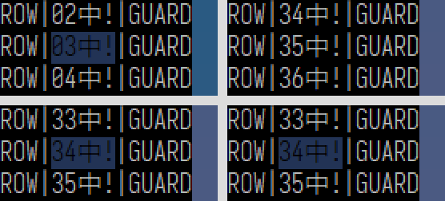

# 清空滚动历史时，Shift 选中的文字会怎样？

在开启鼠标跟踪的子程序里，按住 Shift 可以从滚动历史选择文字。应用请求清除历史时，如果选中的行已被删除，接下来的拖动不应选中替换到同一位置的文字，松手也不应把半个鼠标手势发给应用。如果同一行仍在当前屏幕上，则应该还能复制原来选中的字。profile 禁止应用清历史时，原选区和历史都应该保留。

`bdf847f9` 修正了刚按下鼠标时对历史行的判断：在第一次移动前，按下位置是终端唯一有效的选区坐标。Windows 菜单直接清历史时，也会正确结束已失去文字的本地拖选手势。以下观察均针对同一 4,947,456 字节单文件（SHA-256 `d6605d697e3084b080e68d7a7db8ea4cfcba392a627ea85e068028c25b30ab31`），使用 SarasaTermSC Nerd Light。

[首次 GDI 制品](https://github.com/xiongnemo/nemoterm/actions/runs/44696025018/artifacts/14611605332)和[首次 DirectX 制品](https://github.com/xiongnemo/nemoterm/actions/runs/44696025018/artifacts/14610858193)各通过 6/8 个窗口。未通过的四个窗口中，应用已经写出清历史和状态查询，但鼠标仍按住，旧画面有五格高亮；测试一直等回复，最终超时并清理进程。这四次没有松手，也没有后续剪贴板结果。`term_out` 在拖选过程中暂停消费输出，直到松手后继续。首次超时保留原评分。

[同一 EXE 的第二次回放](https://github.com/xiongnemo/nemoterm/actions/runs/44697268656)通过 **20/20** 个窗口，GDI 和 DirectX 各 10 个。与第一次相比，测试改为从子程序写完清屏和查询之后开始观察；若已经拖出高亮，就先核对五格原文仍在、子程序尚无回复，再实际松开鼠标，要求收到一次正确回复。另两例在鼠标仍按住的情况下直接向终端分派本地菜单命令，再移动和松手，独立检查它不会被应用的清历史权限挡住。测试没有打开弹出菜单，因为打开菜单本身会转移鼠标捕获。

| 操作 | 在屏幕和剪贴板上实际看到的结果 |
| --- | --- |
| 在历史行刚按下、拖动中或已松开时，应用清历史 | 视口回到当前屏幕，旧行不再高亮。右键未覆盖剪贴板，子程序收到完整的右键按下和松开。 |
| 选中文字仍在当前屏幕，或只往回看了一行 | 清历史后仍能用快捷键和右键复制 `35中!` 或 `34中!`；即使文字在屏幕上移了一行，复制内容也没变。 |
| profile 禁止应用清历史 | 行标、滚动条和原文字均保留，两种复制方式都得到 `03中!`。 |
| 在禁止远程清历史的 profile 中，分派本地清历史命令 | 选的是历史行就取消，选的是当前行就保留。随后新按 Shift 拖选仍能复制 `37中!`，应用不会收到孤立的拖动或松开。 |

两轮均从原始 PNG 重新读取七行的色标和选区底色，再与子程序接收的按钮字节、系统剪贴板内容和退出记录核对。[两轮原始截图与回执、逐项核对、GitHub 制品 ID 和散列](selection-history-clear.zip)。
