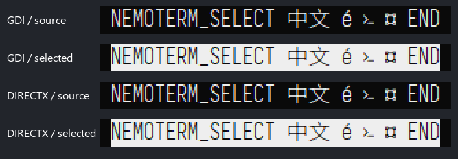

# Held Shift selection through scrollback

Each test starts a Windows terminal with 24 visible rows and 54 numbered Unicode lines. The child requests mouse reporting. A single movement beyond the top or bottom edge must scroll while the left button remains held. Checks compare scrollbar positions, endpoint pixels, exact copied characters and the input bytes received by the child.

| Image | Hosted observation |
| --- | --- |
| `57217fd` | Both GDI and DirectX moved only one row (30→29 and 0→1), then stopped. [Original failed group](selection-history-baseline.zip), run 44245791704. |
| `463c79c` | On both renderers the viewport reached 30→0 upward and 0→30 downward. The clipboard held exactly 35 lines upward (445 characters) and 34 downward (432). The endpoint was highlighted and the lower guard cell stayed unselected. [Original group](selection-history-463c79c.zip), run 44246209592. |
| Same `463c79c` | Actual mouse input, system copy/paste shortcuts, re-entry and release outside passed before an immediate hit-test failed. [Original failure](selection-history-native-attempt1.zip), run 44247078350. |
| Same `463c79c` | The hit-test recorded the tab hover preview briefly covering the terminal. Waiting for the terminal before each new press allowed all five system gestures to pass, including cancel and application-controlled drag. A separate test failed on both renderers when Shift was first pressed during the outward movement: the child got its matching release, but the viewport stayed at 30. [Original replay](selection-history-takeover-baseline.zip), run 44247606690. |

The `463c79c` executable is 4,857,856 bytes, SHA-256 `994d313e802efedd3c91e7e101ec1e3df5bbfc7d661ed6b2192626dfef5efd54`. Each view starts a Windows timer only during a captured local drag outside the grid. Commit `1b24e72` also starts the timer from the new anchor when Shift takes over an application drag. Its [aggregate run](https://github.com/xiongnemo/nemoterm/actions/runs/44248020960) is separate from the results above.

For `463c79c`, all six 160×48 DirectX memory cases passed the inclusive 30,000,000-byte private-working-set budget. The largest frontend sample was the dense Unicode and Kitty image workload: 29,085,696 bytes private working set, 74,358,784 bytes total working set and 33,447,936 bytes private commit. The highest value among the other five private-working-set samples was 27,639,808 bytes. The six reports, image identity and case outcomes are in the [original DirectX group artifact](held-selection-dx-memory-463c79c.zip) from run 44246209592 (archive SHA-256 `473af091eb0ae913c9833bcab39b8f51fa3b9348a282f3ce69f60c106c4e2db9`). In the separate agent group on this image, the DirectX frontend reached 13,373,440 bytes during the Codex reply/resize test and 9,232,384 bytes across the five sampled OpenCode phases. These values exclude the client and console host processes.

## Candidate 1b24e72

In [run 44248020960](https://github.com/xiongnemo/nemoterm/actions/runs/44248020960), GDI and DirectX both passed the original upward and downward drags and the new mid-drag takeover. Shift was first introduced on the single motion outside the grid. The scrollbar went from 30 to 0, the clipboard contained the expected 391 characters across 31 lines, and the application received only the matching SGR press and release at its original cell (column 3, row 5). A separate run of the five system-input gestures on that same executable confirmed that re-entry, release and cancellation each stopped scrolling at position 26 for all 13 samples. Ordinary application drag stayed at 30. [Unmodified group, including captures and clipboard/child records](held-selection-1b24e72.zip).

The 4,857,856-byte [single executable from this run](https://github.com/xiongnemo/nemoterm/actions/runs/44248020960/artifacts/14402433348) has SHA-256 `fc9e9427ccdf3e5e172d4cc081975876b56185a2fc30d9a0b3d80cc73149449e`. All **44 cases in 12 groups** recorded passing outcomes and natural job cleanup. English and Chinese real single-monitor DPI tests passed 12 cases each. These counts do not include the separately scheduled single-file suite or the historical ReGIS component comparisons.

| Frontend private working set, decimal bytes | GDI | DirectX |
| --- | ---: | ---: |
| Highest sample over the six 160×48 full-grid workloads | 18,894,848 | 28,545,024 |
| Codex reply and resize | 7,180,288 | 13,316,096 |
| Highest among OpenCode's recorded interaction phases | 6,483,968 | 9,297,920 |

The dense Unicode and Kitty workload also recorded 53,387,264 bytes total working set and 22,364,160 private commit for GDI, 71,692,288 and 32,313,344 respectively for DirectX. REA inspected the downloaded PE without executing it: 669 normal imports in 81 DLL descriptors, and 11 delay-loaded ICU functions. No WebView/CEF/Chromium import was declared; runtime snapshots from four actual agent cases inspected 70–77 frontend modules and the job processes at startup and after submission, with no checked browser-engine name matching. [Original group receipts, memory counters, DPI records, agent observations and full REA import evidence](interaction-1b24e72.zip), SHA-256 `6049b2b4d12fe6c700e2f3630925eb7efa23d3f9f1bffcad33f0dce37deec0b5`.

## Portable build: independent restart and close

The MinGW portable executable from the preceding `463c79c` run has a different SHA-256 (`f1a6c0b931e02776f6fc40d6323d36ddd74e2732c0b36e4d478ed98e9fd49fdc`) from the single image above. In the [original job](https://github.com/xiongnemo/nemoterm/actions/runs/44246209592/job/134607761216), all four restart identities and stale-paste checks passed; after the last WM_CLOSE, the 15-second deadline failed with one frontend still active, and cleanup terminated it. No dump or window inventory was captured then, so its cause is unresolved.

The [first replay](https://github.com/xiongnemo/nemoterm/actions/runs/44249275217) reproduced the four instrumented restart cycles in three clean lifetimes. Three separate uninstrumented controls stopped on an observer assumption that the real message box used button ID 1. On the [second replay](https://github.com/xiongnemo/nemoterm/actions/runs/44249933352), the control tree showed one enabled confirmation button labelled `OK` with ID 2. The fixture verified the specific owner, message text and button before clicking, and checked both same-process terminal windows were enabled afterwards. Three instrumented and three uninstrumented lifetimes passed all four restart cycles; in the latter, input was delivered to the new shell only. All six frontends exited normally after the last WM_CLOSE in 0.016–0.188 seconds, without terminating remaining job members. No product changes or deadline extensions were used for these replays. [Original failure record and both replay archives](session-restart-463c79c-comparison.zip).

The corresponding [three compiler component records](regis-1b24e72-checks.zip) retain the historical ReGIS differences on `1b24e72`: 10 frames differ in each compiler's whole and bytewise 131-frame views. All 70 terminal-parser frames and five explicit palette repaint frames pass in both transports. This prevents describing the aggregate as completely green.

## OpenCode with system mouse and keyboard

In the [eight-case agent replay](https://github.com/xiongnemo/nemoterm/actions/runs/44253011943) two new cases used the Windows system input queue in the hosted desktop instead of the terminal's key API: Shift+left-drag, Ctrl+Shift+C, Ctrl+Shift+V, Enter to submit and Ctrl+C to exit. The pinned OpenCode client enabled mouse tracking itself. While the left button remained held, the terminal owned mouse capture and displayed the exact selected cells; after release the highlight remained. Across all 30 cells, every sampled source-background pixel changed from `#0A0A0A` to `#EEEEEE`. All background samples in the two neighbouring cells remained unchanged. The figure below enlarges the original captured strips by 2×.

After replacing the clipboard with an image-only sentinel, Copy recovered the exact selected Unicode text. Nothing rewrote the clipboard between Copy and Paste. OpenCode submitted the expected prefix plus that text to the loopback provider, including the decomposed accent and both Nerd Font code points. Both clients and their terminal windows exited naturally; the fixture restored the clipboard. GDI peaked at 6,086,656 bytes and DirectX at 9,019,392 across the five frontend samples in these specific cases. Client output and pixels are retained with the [original successful artifact](agent-system-1b24e72-verified.zip), SHA-256 `d11ecb25545ead0ee172d8ef0cc6a4e5a68ae25e97f1ef1d2eeb8bd9224a7c48`.

The initial [system input attempt](agent-system-1b24e72-first.zip) did not establish the GDI highlight and did not reach the DirectX drag. An ordinary DirectX case also failed when a job process image was unavailable (WinError 5); the observer now retains that unsuccessful enumeration and still requires a complete fresh snapshot within the same deadline. On the [second attempt](agent-system-1b24e72-motion.zip) GDI passed the highlight, clipboard and submission checks but timed out during exit. The DirectX controller's hit-test returned the terminal's `NemotermDirect3D11` child. The successful run verified its same-thread parentage and `HTTRANSPARENT` response before sending the actual button input, and verified the terminal then acquired capture. The two system cases are the only additions to the original 44: **46 distinct cases passed across the aggregate and same-image replay**, not a single 46-case aggregate.

The [rectangular history replay](https://github.com/xiongnemo/nemoterm/actions/runs/44253644261) passed on the same GDI and DirectX image. It pressed Ctrl+Shift on an application-tracked screen, then released both modifiers while the button remained held and the pointer stayed beyond the top. The selection retained its block shape through 30 scroll positions. Both renderers copied the five requested columns across 35 lines (243 Unicode characters including CRLF), kept the whole wide glyph and combining mark, and changed exactly the expected cells in a 24×7 grid of selected and neighbouring cells. The application received no mouse or shortcut bytes. [Raw captures, clipboard and viewport positions](held-rectangle-1b24e72.zip), SHA-256 `c1f24829392e508f8549bd7e37e37f25f4d648eadd38f4535004257ce0677212`. This extends the existing selection cases; it does not increase the 46-case count.

## Completed single-image suite and subsequent aggregate

The [final `1b24e72` package](https://github.com/xiongnemo/nemoterm/actions/runs/44248020960/artifacts/14405103258) contains only `nemoterm.exe`. The executable digest and byte count agree with the interaction preview above and the [original 170-check receipt](single-image-1b24e72-validation.json). All 170 check names are distinct. The Windows portable job also passed on its separately built image. The three historical ReGIS component jobs in this run still failed.

The [next aggregate on `6748baf`](https://github.com/xiongnemo/nemoterm/actions/runs/44254112138) ran all 46 different interaction cases together on executable SHA-256 `8033ec47484277427f08a7cacf76a208aa6ff8c48eb2a48c3f9ba8d2b7bf0482`. Each of the 12 groups recorded passing cases and zero remaining processes without forced termination. The six 160×48 workloads on this image peaked at 19,456,000 bytes for GDI and 29,257,728 bytes for DirectX (private working set); both peaks occurred during dense Unicode and Kitty graphics. The [original group receipts and sampled memory counters](interaction-6748baf-receipts.zip) identify the source, executable and original GitHub artifacts. These figures do not apply to the subsequent Sixel fix.

The `6748baf` Windows portable and single-image jobs subsequently passed. The [final single-file download](https://github.com/xiongnemo/nemoterm/actions/runs/44254112138/artifacts/14407938680) contains only `nemoterm.exe`, byte-identical to the source-host image used for those 46 checks. The [170-check validation receipt](single-image-6748baf-validation.json) records that SHA-256 and the single file in its executable directory. The old ReGIS job outcomes remain failed.
