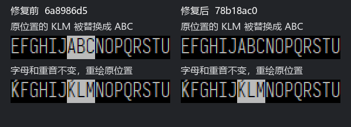

# 按住 Shift 时，应用重新填充或复制矩形

在应用已接管鼠标的情况下，按住 Shift 和左键指向 `K`。如果应用在松手前用矩形复制命令 `DECCRA` 把原地的 `KLM` 替换成 `ABC`，这一次选择应该取消；下一次普通右键应交给应用。如果应用只是把原地的字复制到别处，原处的 `K` 仍可作为选区起点。

[修复前 `6a8986d5` 的托管 Windows 窗口](https://github.com/xiongnemo/nemoterm/actions/runs/44682932298/artifacts/14605243876)只通过 **20/56**：窗口消息 16/48，实际系统输入 4/8。在 GDI 标签窗口中，原字被矩形填充覆盖时复制成了 `ZZM`，被矩形复制覆盖时复制成了 `ABC`。在同一组中，单独覆盖 `中` 的后半格也没有取消；在原位置用相同重音重绘 `Ḱ` 则可以继续选，这是应当保留的行为。两种渲染器均核对了截图、剪贴板和子进程管道实际收到的输入。

[可复核的原始 PNG、窗口记录、制品 ID 和校验值](selection-rectangle-redraw.zip)。完整制品可用 `python scripts/review-rectangle-press.py <interaction-selection.zip>` 离线读取；脚本核对原始制品清单对每份结果和截图的哈希，再读截图的高亮列、右键归属和子进程的原始字节。预期保留的选区同时核对 Ctrl+Shift+C 和右键复制；预期取消的手势以系统剪贴板不变和下一次右键送到子进程为准。`research/` 中的复核包只包含这项对照所用的原始成员。

[修复版 `78b18ac0` 的同组回放](https://github.com/xiongnemo/nemoterm/actions/runs/44683142606/artifacts/14605314075)通过 **56/56**（窗口消息 48/48，系统输入 8/8）。覆盖原位置的 `ABC` 不再高亮，剪贴板不变，子进程收到了下一次右键的完整按下和松开。在相邻希伯来文字的重绘引起左右顺序变化时，现在选中原先按住的字符，复制 `אX`；旧版复制的是 `XX`。两版记录和全部这 112 个窗口截图均包含于上面的复核包。候选单 EXE 长 4,931,584 字节，SHA-256 为 `680f8492c38f319418a41e3ef976b989e1d4fe75e026176b59c5f5161183b65e`。

[同一候选文件的 24 轮 Codex 会话](https://github.com/xiongnemo/nemoterm/actions/runs/44683657169/artifacts/14605702208)测得前端私有工作集峰值 **5,758,976 字节（GDI）** 和 **10,084,352 字节（DirectX）**，同机原版 pterm 为 3,784,704 字节。这个会话只验证日常使用；不替代满屏图文压力测试。
