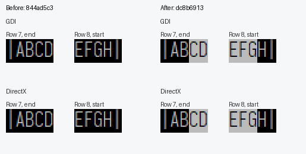
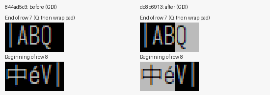

# 主屏折行后，还能复制原来选中的字吗？

在 80 列主屏第 7 行末显示 `|ABCDEFGH|`，让子程序接管鼠标，再按住 Shift 用真鼠标选字。窗口缩窄为 74 列时，`D` 留在第 7 行，`E` 移到第 8 行。两种渲染器使用相同字体 SarasaTermSC Nerd Light。以下结果来自 GitHub 托管 Windows。

| 操作 | `844ad5c3` | `dc8b6913` |
| --- | --- | --- |
| 选中 `CDEFG`，松手，再缩窄、恢复 | 高亮消失，右键交给子程序 | 两行持续高亮；在 74 列和恢复到 80 列时复制都是 `CDEFG`，中间没有多一个换行 |
| 按住 G，缩窄后反向拖到 C | 失去选区 | 原来的锚点跟到下一行，复制 `CDEFG` |
| 矩形选中 `EFG`，三个字一起移到下一行 | 高亮消失 | 保持矩形，复制 `EFG` |
| 矩形选中 `CDEFG`，字形分散到两行两端 | 取消选区 | 同样取消；下一次右键由子程序接收 |

[旧版回放](https://github.com/xiongnemo/nemoterm/actions/runs/44632337778/artifacts/14582687375)和[候选版回放](https://github.com/xiongnemo/nemoterm/actions/runs/44632752976/artifacts/14582724518)的测试文件逐一相同，只有 EXE 不同。四种操作各跑 GDI 和 DirectX，结果从 **2/8 到 8/8**。每个用例核对实际字形、选区颜色、复制结果和子程序接收的字节，不能只凭剪贴板里的旧缓存判定成功。[第二组回放](https://github.com/xiongnemo/nemoterm/actions/runs/44633566378/artifacts/14584205003)使用同一候选 EXE，在仍处于窄窗口时额外按 Ctrl+Shift+C；两个渲染器的六个存活选区均复制到正确文字。

核心的 MinGW 测试还使用中文宽字符和组合附标。无法映射到保留字形的端点、经过双向文字重排而不能确认的坐标、以及不再构成一个矩形的选区都不会被猜测恢复。这里没有对每个全屏客户端重复四种操作。

[记录包](selection-reflow-dc8b6913.zip)内含以上三个原始 GitHub 制品、来源和 SHA-256、[独立 PNG 核对脚本](../scripts/compare-selection-width.py)的两次输出。单 EXE `dc8b6913` 的 SHA-256 为 `d6780333dcf89afa73659e490523aef36f948537df456d9d06da7dc6c775c6a2`。

## 汉字正好放不下，空出的一格会不会被复制？

相同的测试脚本在[旧版](https://github.com/xiongnemo/nemoterm/actions/runs/44636915483/artifacts/14585431664)和[候选版](https://github.com/xiongnemo/nemoterm/actions/runs/44635620788/artifacts/14583442301)分别打开真实 GDI、DirectX 窗口。先显示 `|ABQ中éV|`，选中 `Q中é`，再缩窄窗口。`Q` 留在第 7 行右端，剩下的一格放不下宽字符；`中` 的两格和带附标的 `e` 移到第 8 行。第二种手势是在 `中` 的右半格按下 Shift+左键，保持按住直到缩窄后再拖到 `é`。子程序在两种操作中都启用了鼠标跟踪。

旧版 **0/4**：两种手势都失去高亮，右键被子程序收到；第二种手势按 Ctrl+Shift+C 读到上次缓存的 `Q中é`。候选版 **4/4**：两种渲染器在 74 列、恢复到 80 列、右键复制三个时点都分别得到 `Q中é` 和 `中é`，没有多出空格或换行，也没有鼠标字节传给子程序。普通选区的高亮背景可以覆盖 `Q` 后面的空白格，但该格不会成为剪贴板字符。原始图中 `中` 的左右半都在；比较重音笔画所在的行，也可以把选中的 `é` 和单独的 `e` 区分开。

[两份未经修改的制品、散列与独立逐格核对](selection-unicode-reflow.zip)。在两次窗口中冻结的测试文件散列只有 EXE 不同。`scripts/compare-selection-width.py --unicode BEFORE.zip AFTER.zip` 可从原始 PNG 及子程序记录复核。[第一次调度旧 EXE](https://github.com/xiongnemo/nemoterm/actions/runs/44636325698)因生产源码与来源提交不匹配被拒绝，未运行产品；后续在真实旧源码上只叠加相同测试文件，通过了原有的身份检查。
