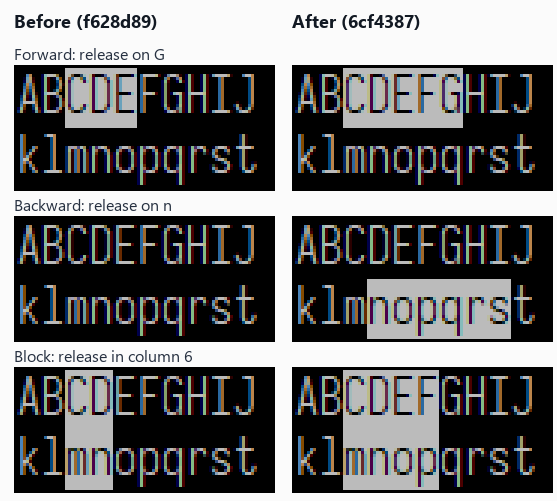

# The cell where the mouse button is released

A selected range could stop at the last move event rather than the cell in which the left button was released. After a Shift drag in a mouse-reporting application, this affected both the visible highlight and what Ctrl+Shift+C put on the clipboard.

[Hosted comparison before the change](https://github.com/xiongnemo/nemoterm/actions/runs/44305974301) used the same `f628d89` MSVC executable (SHA-256 `bce43b16e14965bf54dc5797e098eb8e26bf8924b20870e61ad4301525bff5a2`) that passed the previous 74-case suite. The new fixture sends explicit Win32 button/move messages to an owned terminal; it does not infer these message sequences from a physical device. It samples both rows of the real window, checks the system clipboard under its own shortcut, and uses two terminal status replies to delimit peer input. Both renderers agreed:

| Gesture with application mouse reporting enabled | Expected | GDI and DirectX before correction |
| --- | --- | --- |
| Press C, move to E, release on G | `CDEFG` | Only `CDE` highlighted and copied |
| Press s, release on n without an intervening move | `nopqrs` | No selection; clipboard still contained `CDE` |
| Ctrl+Shift block starting at C, released two columns beyond the last move | `CDEF` / `mnop` | `CD` / `mn` |
| Press and release on the same cell | No selection | No selection |

The illustration crops the same two text rows from the original DirectX captures at left and right and enlarges them 3× without smoothing.

The peer saw only the two status replies for each of these mouse sequences. The original [screenshots, window observations and case outputs](selection-release-before-f628d89.zip) are unmodified (artifact `14427379149`; SHA-256 `3d8e62f5786104b7294bb3f76501fcba7c537388bfe10e4cd80698a107b94a16`).

Candidate `6cf4387` computes the release endpoint with the same cell ordering, bidirectional mapping and selection expansion as intermediate movement. It does so only when finishing a local character gesture, without synthesizing an application mouse event or an extra scroll tick. The [candidate full run](https://github.com/xiongnemo/nemoterm/actions/runs/44306179760) exercises this case alongside the prior checks; earlier passing results apply only to their original executable.

On the candidate's 4,859,904-byte MSVC image (`c044018d55d4b312b65f15d6875468efa31be07491313f2cee5a2043c8d6c898`), actual GDI and actual DirectX both matched all four rows, including every highlighted cell, both status replies and the expected clipboard text. The complete selection group passed 4/4. The [unaltered after artifact](selection-release-after-6cf4387.zip) is `14429275659`, archive SHA-256 `d116d71b428c67635621d7cf5d6d6bceb702e8c81793ea72d35a8a471af25018`. The earlier 74/74 result and the two new old-image failures above both stand.

On the same single-file preview, the combined interaction report verified **72/74** cases, including all four selection checks and all twelve 160×48 stress cases. Highest sampled frontend private working sets: **19,501,056 bytes GDI** and **28,766,208 bytes DirectX**, both for dense Unicode with Kitty graphics. The two failures were pasting an image at the first visible Codex input marker, through system keys and through the window API. Both timed out waiting for the image to appear. Both separate post-idle Codex cases and both OpenCode image cases passed. These failures are retained, rather than replaced by the earlier preview's 74/74. [Combined report, original memory archives and selected original client records](selection-release-acceptance-6cf4387.zip): report `14429142760`, GDI `14430435605`, DirectX `14428943360`, clients `14430065001`. For the independent client behavior see [the startup timing investigation](agent-unicode-boundary.md#codex-image-paste-during-startup).

The original full run `44306179760` subsequently finished. Its MinGW portable job succeeded. The isolated MSVC image passed 169 of 170 groups, deferring and then failing `codex-image-paste`. The [unaltered partial receipt](single-image-6cf4387-partial.json) is from evidence artifact `14433850638`, original archive SHA-256 `afdf2152acd096ffd633e540c837c7d49459f0d0ceab4b01cc2d8813e09724dd`. It did not publish an accepted single-image archive.
