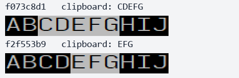

# 鼠标还按在字上时，应用改变行宽

按住 Ctrl+Shift，在 `E` 上按下左键。这时应用用 `ESC # 6` 把这行改为倍宽；将鼠标拖到新位置的 `G` 并松开。旧版选中了 `CDEFG`，修复版选中 `EFG`。反过来，如果按下的字符整个移出了窗口，这次拖选现在会取消。后续移动和松手仍由终端接收，下一次独立右键交回启用了鼠标上报的应用。

| GitHub 托管 Windows 实际窗口 | `f073c8d1` | `f2f553b9` |
| --- | ---: | ---: |
| 按住后变为倍宽，矩形选区 | 0/6 | 6/6 |
| 按住后恢复普通宽度，矩形选区 | 0/4 | 4/4 |
| 打开左右边距，同时恢复普通宽度 | 0/6 | 6/6 |
| 按住的字已移出屏幕，取消这次手势 | 0/6 | 6/6 |
| 按住后变为倍宽，普通选区 | 4/4 | 4/4 |
| 行改成双高下半行，横向比例不变 | 4/4 | 4/4 |
| 程序只改变相邻行的宽度 | 4/4 | 4/4 |
| 合计 | 12/34 | 34/34 |

四个窗口分别使用 GDI、DirectX，两种渲染器各有一个 SarasaTermSC Nerd Light 标签窗口和一个使用 profile 默认字体的独立窗口。28 项使用窗口鼠标消息；另 6 项在两个 Sarasa 窗口上使用 Windows 系统鼠标键盘。每项独立比较松手前后的原始 PNG、实际高亮列及选区外区域、系统剪贴板和启用 SGR 鼠标上报的子程序收到的字节。保留选区时分别用右键和 Ctrl+Shift+C 读取文字；取消选区时只检查下一次右键不改动剪贴板并送达子程序。上图是同一系统手势在两个版本窗口中的行裁剪，放大两倍。另有[Windows 核心鼠标用例](https://github.com/xiongnemo/nemoterm/actions/runs/44676544217/job/136091447425)，覆盖只剩半个汉字可见及屏幕首行等情况。

[旧版原始制品](https://github.com/xiongnemo/nemoterm/actions/runs/44676272043/artifacts/14601714654) · [新版原始制品](https://github.com/xiongnemo/nemoterm/actions/runs/44676544217/artifacts/14602687538) · [比较记录及原始截图](selection-rendition-press.zip)。下载任一原始制品可用 `python scripts/review-rendition-selection.py <archive.zip>`（Pillow）按记录复核，不运行终端。

[同一份 EXE 的第二次托管回放](https://github.com/xiongnemo/nemoterm/actions/runs/44677856393)中，选区组六项均通过；独立步骤从四个新窗口的原始截图、剪贴板和应用输入再次得到 **34/34**。证据包内的 `repeat/` 保存了该次 CI 直接产生的逐项复核和汇总报告。
