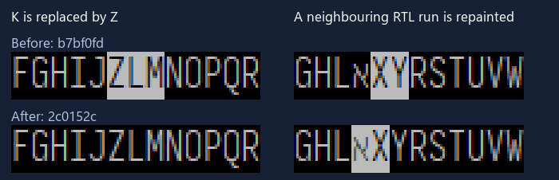

# 应用重画时，Shift 鼠标选择从哪里开始

按住屏幕上的 `K`，还没拖动，应用把它改写成了 `Z`。旧版等到松手才按屏幕坐标取字，把从未按住的 `ZLM` 高亮并复制了。`2c0152c` 在实际写入之前找到按住的字：如果原字被替换，取消这次选择，保留剪贴板；如果只是原样重画 `K`、改写旁边的字或因双向文本重排而挪动它，则继续跟随原字。

| 在同一组 Windows 输入上比较 | `b7bf0fd` | `2c0152c` |
| --- | ---: | ---: |
| 7 种重画 × GDI、DirectX × Sarasa、profile 默认字体 | 8/28 | 28/28 |
| 桌面实际按键和鼠标：替换、原样重画，各在两种渲染器上运行 | 2/4 | 4/4 |

测试逐格比较高亮，再核对右键和快捷键复制的文字。应用开启鼠标跟踪时，还检查真正传到子进程的按下、松开字节：被取消的左键手势没有泄漏，接下来的右键能正常回到应用。双向文字用例中，按住的 `א` 没有被改写，只因右邻字被换成拉丁字母而移动；旧版复制 `XY`，新版复制 `אX`。

另外六种新场景在相同 EXE 上检查组合附标、emoji 后续变宽、跨行占用下一行、旁边仍完整的字、插入模式，以及期间先改字再改回。加上之前的列移动用例，扩展组共有 **112/112** 项窗口消息检查和 **10/10** 项实际键鼠检查。这个数字只代表被测选择手势，不是完整 CI 的通过率。源代码只在相关行有未完成的鼠标选择时才需要跟踪按住的字，没有增加每个终端字符格的存储。

[旧版同一套输入](selection-repaint-before-b7bf0fd.zip) · [新版原始对照](selection-repaint-first-2c0152c.zip) · [新版扩展记录与所有截图](selection-repaint-2c0152c.zip) · [远程扩展回放](https://github.com/xiongnemo/nemoterm/actions/runs/44504339992) · [完整 CI](https://github.com/xiongnemo/nemoterm/actions/runs/44503310589)。新 EXE 为 4,873,728 字节，SHA-256 `79e504be64bfc37c2fdfaa79ae179b9a5e9da4ca08ebae29cc8782e3a28ec663`。

[同机运行 Codex 的内存对照](selection-repaint-pterm-2c0152c.zip)共 10/10 通过。字体为 SarasaTermSC Nerd Light，网格 160×48，每种配置以正序和反序各冷启动一次。下表为首个回复出现之后，两轮前端进程测得的中位数范围（十进制 MB）；不包括 Codex 和控制台子进程，未对进程执行内存整理。

| 前端 | 私有工作集 | 总工作集 | 私有提交量 |
| --- | ---: | ---: | ---: |
| pterm 0.85 | 3.752–3.781 | 21.848–22.639 | 4.440–4.469 |
| Nemoterm 单标签 GDI | 5.071–5.112 | 33.178–34.091 | 6.517–6.541 |
| Nemoterm 单标签 DirectX | 9.724–9.761 | 44.749–44.790 | 11.256–11.362 |

实际客户端的 `agents` 分组共 30 项。Claude Code、Codex、OpenCode 的 24 项选区、快捷键和右键回放全部通过，包括右键仅复制及复制后粘贴；其余 6 项贴图中 4 项通过。失败的是 Codex 启动阶段立即贴图（窗口接口、系统键鼠各一项），并非这次鼠标选区修复的通过条件。等待 Codex 编辑器就绪的两种输入路径都通过。

[同一 EXE 的完整交互报告与原始分组记录](selection-repaint-aggregate-2c0152c.zip)为 **78/80**。GDI 和 DirectX 各 6/6 项 160×48 压力负载通过；三项独立记录的峰值如下，未必出现在同一采样点。日常 Codex 前端总工作集低于约 50 MB，满屏图像、Unicode 与标签压力下总工作集会超过 50 MB。两种渲染器满足各自的私有工作集上限。

| 前端 | 私有工作集峰值（字节） | 总工作集峰值（字节） | 私有提交峰值（字节） |
| --- | ---: | ---: | ---: |
| GDI | 19,361,792 | 55,934,976 | 22,802,432 |
| DirectX | 28,827,648 | 71,581,696 | 32,210,944 |

[关闭确认回归](https://github.com/xiongnemo/nemoterm/actions/runs/44503310589/artifacts/14518327730)的三个窗口类型全部通过；[DPI 记录](https://github.com/xiongnemo/nemoterm/actions/runs/44503310589/artifacts/14519376086)确认中英文设置窗口实测为 96/120/144/168/192 DPI。ReGIS 核心历史参考画面的失败仍单独保留，不计入 80 项交互。
