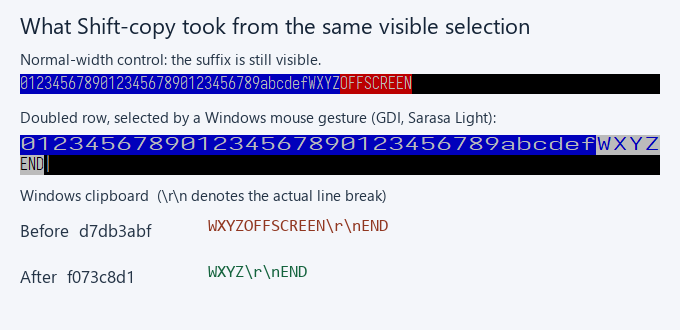

# Shift 跨行复制只取屏幕上看得见的字

旧版在普通宽度下写入 `WXYZOFFSCREEN`，随后应用把这一行横向放大。此时窗口只显示到 `WXYZ`。按住 Shift 从 `W` 拖到下一行的 `END`，Windows 剪贴板却仍收到 `WXYZOFFSCREEN` 和 `END`。`f073c8d1` 先确定绘制出来的列范围，再映射回原始字符，因此普通宽度下可见的后缀仍会被复制，放大后移出窗口的后缀不会进入剪贴板。

| GitHub 托管 Windows 窗口 | 原试用版 `d7db3abf` | 修复版 `f073c8d1` |
| --- | ---: | ---: |
| 普通宽度对照，保留可见的 `OFFSCREEN` | 4/4 | 4/4 |
| 放大行：倍宽、上半行反向拖选、下半行末尾空格 | 0/12 | 12/12 |
| Windows 系统鼠标和 Ctrl+Shift+C：倍宽行 | 0/2 | 2/2 |
| 逐格截图高亮与预期范围一致 | 18/18 | 18/18 |
| 应用鼠标上报已启用，但只收到两个测试同步应答 | 18/18 | 18/18 |

每版使用四个窗口：SarasaTermSC Nerd Light 的多标签 GDI 和 DirectX，以及默认字体的独立 GDI 和 DirectX 窗口。逐格比较来自下载的原始 PNG；每个放大行还与一条从未写入隐藏后缀的参考行对比。图中是 Sarasa GDI 实际系统输入的裁剪；两版这一选区的两行像素完全相同。Windows 核心用例另测了奇数宽窗口中末字只露一半、双向文字从不可见的源列排到可见列，以及软换行时不插入换行符。

[旧 EXE 与原始失败](https://github.com/xiongnemo/nemoterm/actions/runs/44672824926/artifacts/14601013448) · [新 EXE 的原始选区记录](https://github.com/xiongnemo/nemoterm/actions/runs/44673225346/artifacts/14602230647) · [两版原始 JSON、截图、制品身份和逐格复核记录](selection-scaled-copy.zip)。复跑方法见[远程交互验收](../docs/INTERACTION_ACCEPTANCE.md)。
