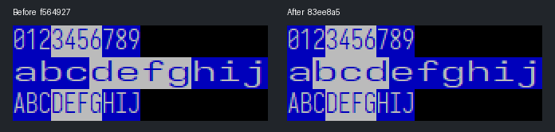

# 跨不同宽度的终端行框选

DEC 程序可以把一整行的字宽放大两倍（`ESC # 6`），也可以分别画出双高字符的上、下半行（`ESC # 3` / `ESC # 4`）。这和单个汉字占两格不是一回事。矩形拖选量的是屏幕上的列；同一条竖边在普通行和放大行上可以落在不同的字符上，碰到半个宽字也应该选中整个字。

[修复前两种渲染器的原始数据和截图](selection-scale-before-f564927.zip)来自远程回放 `44382328535`，使用 `f564927` 的单文件和 `ae2a85f` 的测试。在三行 `0123456789`、放大行 `abcdefghij`、`ABCDEFGHIJ` 上，框选从零开始的第 3 到 6 列时，普通行正确复制了 `3456`、`DEFG`，放大行却复制了 `defg`（第 6 到 13 屏幕列），而可见框覆盖的是 `bcd`（包含两端的整字，第 2 到 7 屏幕列）。GDI 和 DirectX 的四个场景各自全部失败，应用均没有收到误发的鼠标输入。

复验保持相同的坐标、期望文本和像素区域。在应用接管鼠标时，按下 Ctrl+Shift 和左键，先松开修饰键，再结束拖动。测试独立确认每行确实以预期宽度画出，再检查选区周围所有字符格的像素是否改变、Ctrl+Shift+C 得到的 Unicode 文本，以及同一条终端输入流上的回复。它不检查所有双向文字排列。

[修复版原始结果](selection-scale-after-83ee8a5.zip)来自 `44383008947` 的制品 `14464578916`；源提交 `83ee8a50ba43ba02b1747f5211c399cb0f77a79f`，Windows x64 EXE 为 4,850,176 字节，SHA-256 `3822bf211f3030f6da0af78ff7349a6e1af2cd1635537811a36fe02dbfade594`。GDI 和 DirectX 均使用 SarasaTermSC Nerd Light，四个场景分别通过：跨过放大行、从上半行反向拖、从下半行正向拖、只框一个屏幕列。放大行 `bcd` 的两个半字边缘正确展开，普通行保持原宽。四个 `selection` 子测试均通过，外层 Job 没有剩余进程。下图是两份 GDI 原始截图相同区域的裁剪，左为修复前，右为修复后。

在同一次完整 CI，未显式指定 Sarasa 的两套独立检查发现了另一个像素问题：[MinGW 记录](scaled-edge-mingw-83ee8a5.zip)、[隔离单文件的原始图与记录](scaled-edge-single-83ee8a5.zip)。两份结果的四种拖选都复制了正确的文字，但放大行最右侧的相邻一格也有像素变化。隔离窗口的原图为 722×386，字符格 9×16。`double-middle` 选中的屏幕列为 2–7；第 8 列左边缘（客户区 x=73）有 10 个像素从带字形抗锯齿的颜色变为原背景蓝，并非相邻整格被高亮。Sarasa 的绿色结果不能代替这个默认字体条件。新回归对默认 profile 字体与显式 Sarasa 分别检查两种渲染器，仍要求未选格零像素变化。
