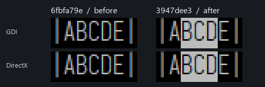

# 应用重复请求当前屏幕时的 Shift 选区

全屏程序可以用 DEC 私有模式 47、1047、1049 切换主屏和备用屏。旧版对这三种请求一律取消选区：即便缓冲区、文字、光标所在行都没变，高亮也会消失。此时右键本应复制，却会交给已经接管鼠标的应用。

[旧版远程回放](https://github.com/xiongnemo/nemoterm/actions/runs/44607274099)使用原来的 `6fbfa79e`。两种真实窗口都用 SarasaTermSC Nerd Light，应用启用 1002 和 1006 鼠标模式。每例确认当前屏幕和鼠标模式的原始回复，实际按住 Shift 和左键，观察逐格像素、右键前后的剪贴板序号和进程收到的原始字节；已经松手的选区与仍按住左键的情形分别测试。两屏故意画相同的 `|ABCDE|`，以免把屏幕文字相同误认为原来的选区仍存在。

| 发送请求时 | 需要的行为 | 旧版 GDI / DirectX |
| --- | --- | --- |
| 主屏已选中，再请求主屏 `?47l`；或主屏刚按下，再请求主屏 `?1049l` | 已有高亮保留；尚未拖动时能继续选中 `BCD` | 各 0/2 |
| 备用屏已选中，再请求备用屏 `?1047h`；或备用屏刚按下，再请求备用屏 `?47h` | 同上，右键应复制 `BCD` | 各 0/2 |
| 实际进入或离开备用屏；或在备用屏再次 `?1049h` 清屏后重画相同文字 | 原选区失效；不向应用补发半次左键手势，下一次独立右键正常交给应用 | 各 3/3 |

修复在处理应用发来的请求时区分“留在原缓冲区”和“换屏或清屏”；在后者丢掉尚未完成的本地拖选时，左键仍归终端直到松开。`1049` 原有的光标保存和恢复不变，也不干预调整窗口尺寸时临时交换内部缓冲区。

**修复后，[同一套远程测试](https://github.com/xiongnemo/nemoterm/actions/runs/44607488923/job/135858380411)由 6/14 提高到 14/14。** 两个 Sarasa 窗口各验证七例。只请求留在当前屏幕时，无论是已完成的选区，还是只按下、松开 Shift 后才继续拖动的选区，最终高亮都恰好三格。右键更新系统剪贴板为 `BCD`，没有向子程序发送按键或鼠标字节。实际换屏或清屏时，两版的三个对照均正确；下一次右键完整地报告按下和松开，剪贴板未被改写。测试没有把鼠标按下但尚未移动当作已经在拖动；上述模式请求在这种情况下确实得到应答。

图为 `alternate-pressed` 场景同一行的原始像素，放大三倍。留存的[四份原始下载及逐项对照](selection-screen-3947dee3.zip)含全部窗口和回执。[离线核对脚本](../scripts/compare-screen-selection.py)从截图重新计算七个位置的选中状态，并检查原始按键的次序、鼠标位置、模式查询、剪贴板文本和鼠标报告。两份测试目录的文件散列只有 EXE 不同。修复版的[单文件构建](https://github.com/xiongnemo/nemoterm/actions/runs/44607488923/artifacts/14571391046)为 4,866,048 字节，SHA-256 `3119a405be7f6d3a88ecee19e82e768fab37a5530a6f4bb26d6ef069d4a499b2`。

**左键仍按住、画面已经有高亮时的独立补测：8/8。** [同一份 EXE 的另外一次回放](https://github.com/xiongnemo/nemoterm/actions/runs/44610867615)在看到 `BC` 两格高亮后，等子程序完成切屏请求的写入，确认鼠标捕获仍属于该终端，再松开 Shift、拖到 `D` 并松开左键。两种渲染器各四次。在这八次观测中，子程序发布“已写入”时均还没收到终端的模式应答，松开后收到了正确的屏幕状态。留在当前屏幕时，高亮变成 `BCD`，实际 `Ctrl+Shift+C` 和右键都将这三个字母写入剪贴板；真实切屏或清屏时，高亮消失，独立右键完整送至应用。上方证据包的 `drag/` 包含此次原始运行、逐项结果和前后 16 张截图。
