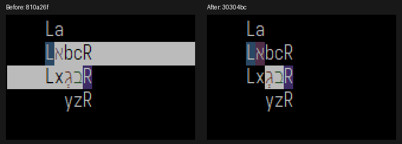

# 分栏滚屏时，Shift 选择起点跟着哪个字？

当应用启用鼠标跟踪，只把一段列向上或向下滚动时，按住 Shift 的本地选择应随最初按住的**字**移动。一段从右向左的文字可以跨过栏边界：屏幕上在左边的字可能属于右栏，另一个没换行的字也可能改变显示列。

图为同一个远程 GDI 窗口场景，截取两个原图相同区域并最近邻放大 2 倍。完整原图：[旧版](selection-split-before-810a26f.png) · [修复版](selection-split-first-30304bc.png)。

| GitHub-hosted Windows 检查 | `810a26f` | `30304bc` |
|---|---:|---:|
| 窗口消息：上/下滚，按住的字在滚动/静止栏，普通/矩形选择。GDI/DirectX × Sarasa/默认字体 | [0/32](selection-split-before-810a26f.zip) | [32/32](selection-split-first-30304bc.zip) |
| Windows SendInput：真实 Shift/左键点击、系统捕获、滚动后释放修饰键、拖动、Ctrl+Shift+C。Sarasa 字体，两种渲染器 | [0/4](selection-split-system-before-810a26f.zip) | [4/4](selection-split-system-30304bc.zip) |

以左上角为零：滚屏前屏幕第 5 列是带附标的希伯来字母 gimel。向下滚动一行后，截图中它出现在下一行的第 6 列，与 bet 相邻。选中这两格应得到 `U+05D1 U+05D2 U+05B0`。旧版额外复制了相邻行中的文字和换行。另一种情形是按住视觉上位于第 7 列的 alef；它在静止栏内，但文字重排使它出现在本行第 5 列。旧版复制了目标之外的两个拉丁字母。两个 EXE 的子程序均未收到这次本地选择的鼠标字节，接收端记录包含且仅包含两个状态应答。

[同一 EXE 的右键和粘贴回放](selection-split-clipboard-30304bc.zip)（[远程工作流](https://github.com/xiongnemo/nemoterm/actions/runs/44474041114)）使用系统鼠标右键及 Ctrl+Shift+V。GDI 和 DirectX 各重放上述两种选区，共 4/4。默认右键把完整选区复制到系统剪贴板，子程序只收到了用例前后的状态应答；显式粘贴后，两次应答之间才出现 `d7 91 d7 92 d6 b0` 或 `4c d7 90`，恰好是所选文字的 UTF-8 字节。

修复在分栏滚动之前把按住的显示列对应到原文字符，在滚动之后再映射到新的显示列；只在鼠标按下与第一次拖动之间做这项工作。内核用例还检查了两行滚动、从中文宽字的右半格按下、没有中间移动消息就松键。这里验证的是滚动后仍然存在的字符。

旧 EXE 的 SHA-256 为 `24deed2cdaa8a3743793c014048ce057333c7f9bc77c4b59de545e5b7bbd27d3`。修复版 `30304bc5786a9aac68177084f44c9084ec6c2494` 的[原始单文件制品](https://github.com/xiongnemo/nemoterm/actions/runs/44472521397/artifacts/14505341500)为 4,871,680 字节，SHA-256 `712ed73e131f6498a354aac6eae77e31dd95a703f952a14189504486384b449a`。[旧版首次回放](https://github.com/xiongnemo/nemoterm/actions/runs/44472197530) · [旧版系统输入回放](https://github.com/xiongnemo/nemoterm/actions/runs/44473337878) · [修复版系统输入回放](https://github.com/xiongnemo/nemoterm/actions/runs/44473212114)。
