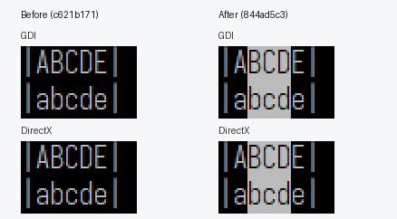

# 改变窗口宽度后，Shift 选中的字还在吗？

在应用接管鼠标的备用屏幕上，旧版只要调整窗口宽度就清除选区，即使选中的字还在同一格。实际能复现两种症状：加宽后，Ctrl+Shift+C 有时还能复制旧的缓存，让人误以为选区仍在，右键却已经落入应用；缩窄时保持 Ctrl+Shift+左键，再拖到第二行，复制的仍然只是之前那一行。

[旧版实测 `c621b171`](https://github.com/xiongnemo/nemoterm/actions/runs/44629486289)和[修复版 `844ad5c3`](https://github.com/xiongnemo/nemoterm/actions/runs/44629889832/artifacts/14583015122)在 GitHub 托管 Windows 上使用同一套夹具。两种实际渲染器均为 SarasaTermSC Nerd Light、80×24 起始网格；窗口消息没有伪造鼠标按住的状态。先向子程序打开鼠标跟踪，实际按下 Shift 和左键，再改变宿主窗口宽度。独立核对窗口像素、系统剪贴板和子程序收到的鼠标字节。

| 操作 | 旧版 GDI / DirectX | 修复版 GDI / DirectX |
| --- | --- | --- |
| 选中 `BCD`，松手，窗口加宽四列 | 高亮消失；Ctrl+Shift+C 读到缓存，右键交给应用 | 三格持续高亮，快捷键和右键都复制 `BCD`，无鼠标事件传给应用 |
| 按住 Ctrl+Shift+左键，缩窄六列，放开修饰键并拖到第二行 | 无高亮，只复制到旧的 `BCD` | 两行六格高亮，快捷键和右键都复制到 `BCD\r\nbcd` |
| 按住的源格确实被裁掉，随后移到别处松手 | 取消，之后右键由应用接收 | 相同行为，未在新位置误选或转发残留的拖动手势 |

六项宽度检查 **2/6 → 6/6**。修复版完整 selection 组的六个作业用例也全部通过；[另一个满屏客户端组](https://github.com/xiongnemo/nemoterm/actions/runs/44629889832/artifacts/14581294067)在同一份 EXE 上通过 10/10。后者没有在每个客户端内部重复上述三个窗口缩放场景。

适用范围是仍在固定网格相同列的完整字形，包括备用屏幕和关闭重排的主屏。MinGW 核心测试还覆盖中文宽字和组合附标；若剪掉了宽字的一半，则取消。主屏自动换行重排、跨行流式选择以及不能确认对应关系的双向文字不在本次保留范围内。

[原始制品与离线核对结果](selection-width-844ad5c3.zip)内含两份未修改的窗口制品；各自的 SHA-256、来源和每种渲染器的检查结果见 `sources.json` 和 `review.json`。两份测试目录的文件散列只有 EXE 不同。[离线截图核对脚本](../scripts/compare-selection-width.py)会独立读取原始 PNG 的格子背景，与系统输入、剪贴板及应用回执相互核对。

[该候选单 EXE](https://github.com/xiongnemo/nemoterm/actions/runs/44629889832/artifacts/14581148646)大小为 4,921,856 字节，SHA-256 `ea0bfee65ecae2fd8bb24571b865812b864cc7be1e0dbc604af0797410cfc709`。REA 静态识别为原生 AMD64 PE；普通与延迟导入表逐项与 `c621b171` 相同。窗口行为、实际加载模块和内存应从各自的运行记录判断。
