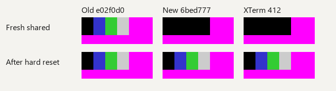

# 共享图形色表：新进程和硬重置不是同一个起点

首次使用共享色表时，固定的 XTerm 412 把未赋值的寄存器读作黑色；在 RIS 硬重置之后，它们才回到 VT340 模型的初始色。旧版 Nemoterm 的这两种情况都从模型色开始。`6bed777` 在新终端创建时把已有的共享色表填为不透明黑色，没有新增第二份色表；私有图片、显式赋色和硬重置保持原有行为。测试现在让终端自己初始化色表，不再由组件测试预填。

[旧 EXE](https://github.com/xiongnemo/nemoterm/actions/runs/44487746219)和[新 EXE](https://github.com/xiongnemo/nemoterm/actions/runs/44487668217)在相同的程序外测试下分别是 **2/7 和 7/7**。每例都用独立进程、真实 GDI、Sarasa Light、相同的字符和像素几何。背景为品红，四条 4×6 色块依次使用色号 0、1、3、15。检查保留整个 160×120 像素区域、应用回复、一次强制重绘前后的稳定帧，以及窗口自然退出。表内差异数是一次画面的像素数；每例重绘前与重绘后的比较结果相同。

| 场景 | 上游的四种 RGB | 旧版差异 | 新版差异 |
| --- | --- | ---: | ---: |
| 新进程，第一次用共享色表 | 全黑 | 72 | 0 |
| 软重置 DECSTR 后才用共享色表 | 全黑 | 72 | 0 |
| 先查询共享 ReGIS，再用共享 Sixel | 全黑 | 72 | 0 |
| 先查询私有 ReGIS，再用共享 Sixel | 全黑 | 72 | 0 |
| 只把共享色号 3 设成红色 | 黑、黑、`FF0000`、黑 | 48 | 0 |
| 新进程，使用私有色表 | 黑、`3333CC`、`33CC33`、`CCCCCC` | 0 | 0 |
| 硬重置 RIS 后使用共享色表 | 同上 | 0 | 0 |

[上游参考](https://github.com/xiongnemo/nemoterm/actions/runs/44486788446)的七种顺序逐一以整段、逐字节发送，两者全部吻合，所有参考对照通过。[原始参考](regis-bank-start-xterm.zip) · [旧版 Windows 制品](regis-bank-start-e02f0d0.zip) · [新版 Windows 制品](regis-bank-start-6bed777.zip)。旧文件 SHA-256 `be28e4e503383070855dac42d679c5427e224a68c3fb13195f7d2b820d0f2120`；[新文件](https://github.com/xiongnemo/nemoterm/actions/runs/44486109121/artifacts/14511425344) 4,872,192 字节，SHA-256 `e50c888b1933893896de9889492b886a160f157ed3c4cd3ebbcd8c7d685019de`。Windows 对照只主张整段写入，不主张逐字节窗口显示一致。

两次失败记录仍然保留：

- [上游原始全量采集](https://github.com/xiongnemo/nemoterm/actions/runs/44485146213)的 110 场景中，`scroll-origin-ri` 步骤 1 的两种输入在第一次呈现时相差 101 像素，重绘后完全相同。七个色表场景和所有参考对照均完成。第二次只采集七个场景及原有对照，两轮 14 组输入、回复及前后完整 RGB 摘要逐一相同。[原始失败和七个场景](regis-bank-first-collection.zip)。窄范围参考通过不改变原全量失败。
- [首次产品回归](https://github.com/xiongnemo/nemoterm/actions/runs/44485408209)的新测试把 6 像素字符格留给预期 8 像素的既有擦除测试，后者失败。改用独立测试终端后，[GCC、Clang、MSVC 的原生图形初始化和擦除检查](https://github.com/xiongnemo/nemoterm/actions/runs/44486109121)均通过，已有断言未删除。

[十个独立的首帧和重绘终点](regis-presented-pairs.md)中，首次取色原有的 600 个不同像素已归零。随后显式改红时两端的首帧仍不同，也仍有独立的滚屏与擦行差异。这次修复不以历史残影为兼容目标的替代证据。

[同一个新 EXE 的其它托管记录](shared-bank-runtime-6bed777.zip)：

- [同机 pterm/Codex 对照](https://github.com/xiongnemo/nemoterm/actions/runs/44488194244)10 次冷启动均完成。Sarasa Light、160×48，收到固定客户端的回复后，在约 3 秒采样中取各次中位数：单标签 GDI 私有工作集 5.075–5.091 MB，DirectX 9.699–9.728 MB，pterm 0.85 为 3.744–3.781 MB（十进制）。受检的前端模块和作业进程均无 WebView/Chromium 候选命中。这是稳定时段的前端样本，并非压力峰值。
- [完整回归](https://github.com/xiongnemo/nemoterm/actions/runs/44486109121)的 WSL 安装步骤遇到 Ubuntu 镜像索引大小不符，`wsl.exe` 返回 100，未执行产品测试；[同一 EXE 的独立重放](https://github.com/xiongnemo/nemoterm/actions/runs/44488131575)实际执行了 GDI 和 DirectX 两组 WSL Sixel 并通过。Unicode 原始边界检查 4/5，未通过的是独立 `winpty-claude` 对照超时；[同一 EXE 重放](https://github.com/xiongnemo/nemoterm/actions/runs/44488130950)5/5。证据包对成功和失败的原始制品分别列出摘要，独立结果不改变原回归状态。
- [日常图形套件](https://github.com/xiongnemo/nemoterm/actions/runs/44487940881)已包括七项启动色表检查，四个窗口作业全部通过。其中七项与固定 XTerm 直接对比是在实际 GDI 窗口执行的。

[完整交互汇总与两个内存组的原始制品](shared-bank-aggregate-6bed777.zip)对应同一 EXE，78/80。未通过的是 `agents/agent-image-codex` 和 `agents/agent-image-system-codex`，两条等待就绪的对应路径均通过。[真实客户端、默认网格和选区的分组记录](shared-bank-interaction-6bed777.zip)分别为 28/30、10/10、6/6。

| 160×48，六种负载的前端峰值（字节） | 私有工作集 | 总工作集 | 私有提交量 |
| --- | ---: | ---: | ---: |
| GDI | 18,677,760 | 53,350,400 | 22,450,176 |
| DirectX | 29,200,384 | 74,293,248 | 32,780,288 |

两组各 6/6。这些数字是每列在压力测试中的最大值，不能用稳定期中位数替代。交互汇总的 80 项不包含独立 ReGIS 协议套件；上述重绘差异仍保留在该套件的原始结果中。
