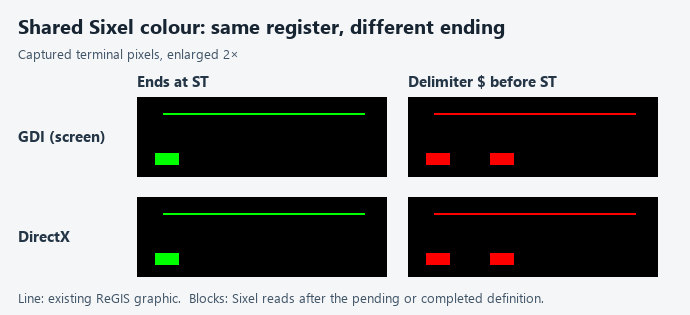

# When a Sixel colour becomes visible to other graphics

A trailing colour definition in a shared-palette Sixel used to repaint older graphics and change later images even when the final number ran directly into ST. `9ece5e0` keeps validating that number but only publishes a shared definition when the next byte in the payload terminates it. This leaves already completed writes live, including across cancellation. Raster validation and private-image finalization are unchanged in this candidate.

## Is it a register change or a stale frame?

On [the hosted XTerm reference](https://github.com/xiongnemo/nemoterm/actions/runs/44255656917), a ReGIS line initially uses green register 3. A second DCS supplies `#3;2;100;0;0` (red). A **new** Sixel then selects register 3 and draws a 12×6 block without defining any colour. This read cannot inherit stale pixels from the old line. In separate processes the writer had already painted a 12×6 block, or had drawn nothing. Every stage was captured before and after an Expose. Each scene also ran from scratch under bytewise input.

| End of the red definition | Existing 101-pixel line | Writer's 72 pixels, when present | New 72-pixel block |
| --- | --- | --- | --- |
| `ST` | green | green | green |
| `$` then `ST` | red | red | red |

These are the final frames on both transports. Reference green is RGB `(51,204,51)`, red `(255,0,0)`. Exposing the window did not change the final results. The [unmodified upstream artifact](shared-register-readback-xterm.zip) contains all 71 scenes, exact wire bytes, both sets of PNGs and the reference identity: XTerm commit `5c75ead9a75d4b2e666ca06fa94503b5766ed93f`, archive SHA-256 `193fc60e26d512680bf3bd357bcaf0da2a1b0c85323b7d92ae834f12e7840255`.

## Product evidence

The [single-image native jobs](https://github.com/xiongnemo/nemoterm/actions/runs/44256389198) used a 4,857,856-byte executable, SHA-256 `ff4f6e4fd7d7a39165803e9cda1ff42d75b739a695ed928e2af4c5594758264f`. Actual GDI, actual DirectX, and directly presented GDI passed all 64 geometry/colour checks and 12 history checks each. The OpenGL request fell back to GDI. The new native sequence observed 101 green line pixels, then 173 green pixels after adding a fresh block. After an explicitly terminated write and a second fresh block, all 245 pixels were red. The colours survived repaint in both cases. The Windows test defines pure green explicitly.

[The component comparison](https://github.com/xiongnemo/nemoterm/actions/runs/44256966939) used the same product source on MSVC, GCC and Clang. Each compared all three steps of the four new scenes (12 cropped frames per transport, whole and bytewise) to the upstream full repaints: zero differing pixels and zero reply differences. In the **original** suite, 125 of 131 frames now match in both transports on all three compilers, up from 121. All 70 terminal-parser frames and all five earlier two-way palette repaint frames still match. The six remaining presented-frame differences are `alternate-page-ownership` step 3, `scroll-up` step 2, `scroll-down` steps 1 and 2, `newline-scroll` step 2, and `regis-palette-False` step 1. The three historical comparison jobs remain failed. This does not establish universal graphics compatibility.

[Product evidence](shared-register-product-evidence.zip), SHA-256 `892d18ac40784ed0910fbd5ecb91906ee17fa5bd55a58fdd29b1cbc8c3d777a5`, retains the four original window archives, source-host receipt, per-compiler observations, and GitHub artifact metadata from both runs. [Earlier records](regis-1b24e72-checks.zip) retain the original ten failing frames.

The [candidate download](https://github.com/xiongnemo/nemoterm/actions/runs/44256389198/artifacts/14406012996) includes this exact Windows image. All **46 distinct interaction cases in 12 groups** passed together, with no remaining job members or forced termination. In the six full-grid Sarasa 160×48 workloads, frontend private working set peaked on dense Unicode and Kitty graphics at **19,673,088 bytes (GDI)** and **29,286,400 bytes (DirectX)**. Total working set for that workload was 56,430,592 and 74,530,816 bytes respectively; private commit was 23,101,440 and 33,173,504. The [original group receipts and complete memory observations](interaction-9ece5e0-receipts.zip) identify this exact executable, sequence of samples and hashed GitHub artifacts. The separate single-image suite was still running at the time of this measurement.

[The subsequent private-palette comparison](private-sixel-terminator.md) covers default private colour definitions and the separately observed behavior of the next picture.

The separate single-image and portable jobs subsequently passed. The [final single-file package](https://github.com/xiongnemo/nemoterm/actions/runs/44256389198/artifacts/14409553339) contains only the `9ece5e0` executable, byte-identical to the native-window and interaction preview. The [original validation receipt](single-image-9ece5e0-validation.json) records that SHA-256 and 170 distinct passing checks. The six historical frame differences remain.
